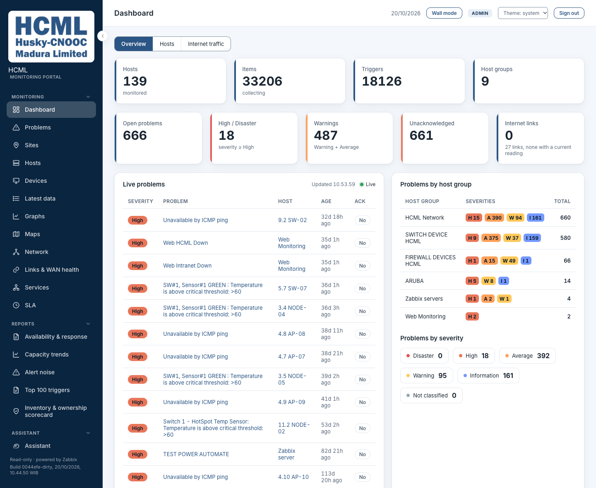
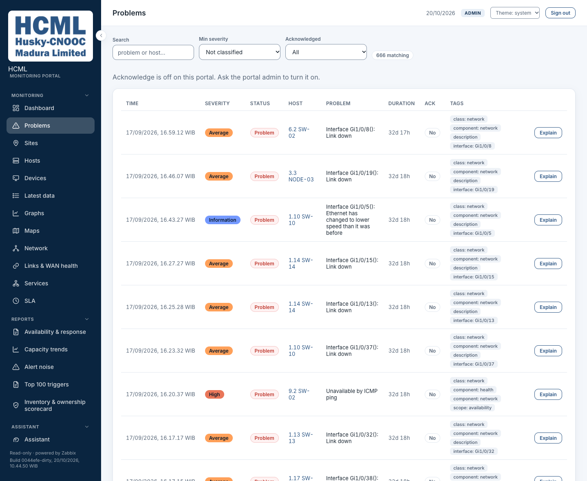
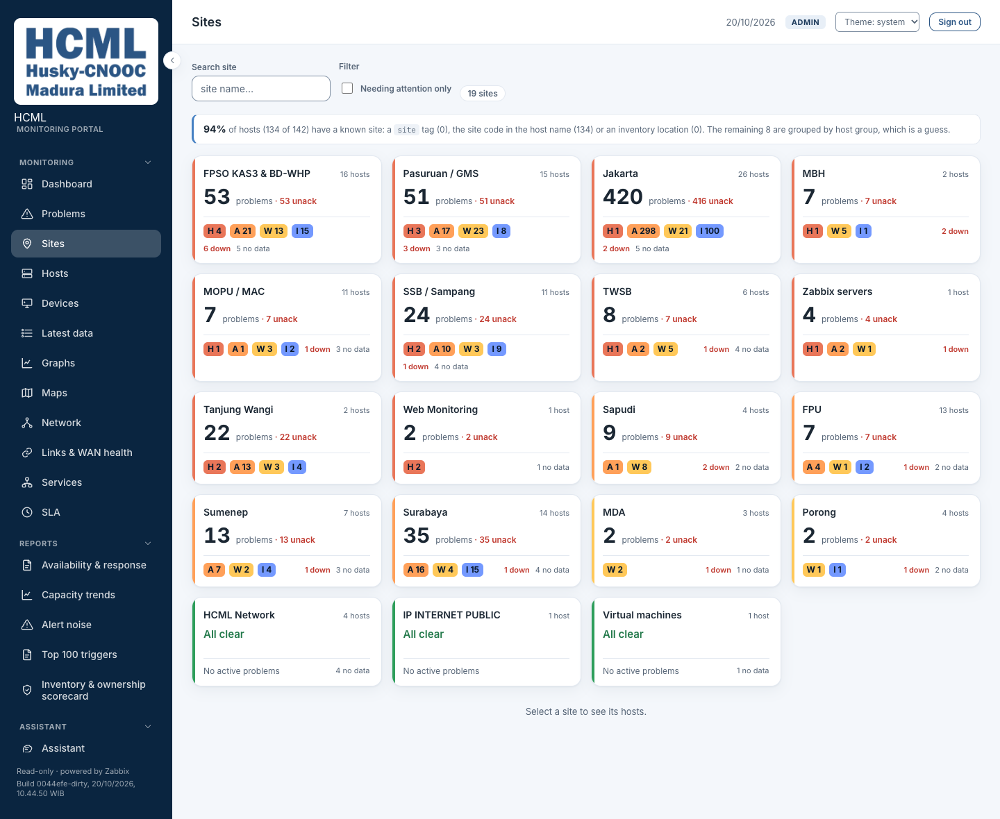
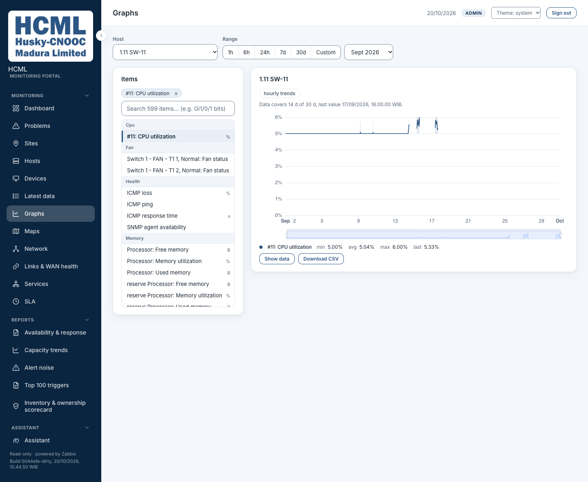

# HCML Monitoring Portal

A web portal that shows the state of HCML's servers, network devices and WAN links, grouped by
site. HCML is Husky-CNOOC Madura Limited. The portal reads everything from HCML's Zabbix monitoring
system and has no database of its own.

Zabbix already collects every measurement, and it stays the place to set up hosts, items and
triggers. Its own screens list things device by device. This portal regroups the same data by site
and by service, answers "is anything wrong right now?", and works out the monthly availability
figure (the SLA), which HCML's Zabbix has no services configured to produce.

It changes nothing in Zabbix except one thing: an operator can acknowledge or close a problem. That
single write uses its own Zabbix token. Leave that token blank and the portal cannot write at all.

An optional assistant can explain problems in plain language. **In this copy the assistant uses
Claude, a model hosted by Anthropic, so the text of those questions leaves this machine.** The
sibling copy, `hcml-portal-ollama`, runs the same code against a model on the local computer instead.

New to the abbreviations? Every one used in this file is explained in the
[Glossary](#glossary) at the end.

### What it looks like









Host names, addresses, interface descriptions and meter titles in these images are stand-ins; the counts,
severities, times and site names are real. The Dashboard's Hosts and Internet traffic views, the Devices page,
Show data with its CSV download, the dark theme, the narrow-screen layout and the Network page (every device
reads "No data" there, because the Zabbix server of this restored copy is off) are in
[`docs/screenshots/`](docs/screenshots/README.md), with how the names were replaced.

### How the parts connect

```
 Browser (React)  ──HTTP+SSE──►  BFF (Fastify, holds tokens, caches)  ──JSON-RPC──►  Zabbix API
```

The first arrow is plain HTTP on this computer's loopback address: nginx listens on port 8080 inside
its container and Docker publishes it on `127.0.0.1` only. Nothing in this repository terminates
TLS, so before the portal is reached from another machine, put TLS in front of it:
[`docs/operations/tls.md`](docs/operations/tls.md).

Read it left to right. Your browser only ever talks to the portal's own server, the BFF. The BFF
holds the Zabbix and model credentials, so the browser never sees them. It asks Zabbix for data in
Zabbix's JSON-RPC format, keeps recent answers for a short time so it does not ask twice, and sends
the result on. The live Dashboard keeps one connection open (SSE) so updates arrive without a reload.

Nine flows are drawn in that same one-line style (a page load, the live Dashboard, the request
pipeline, the cache, sign-in, where a number comes from, both AI paths and the one write) in
[`docs/flow/README.md`](docs/flow/README.md#the-nine-flows-one-line-each).

### Contents

- [What it looks like](#what-it-looks-like): the main pages, as images
- [Tech stack](#tech-stack): what it is built with, and why
- [Layout](#layout): where each file lives
- [Quick start (local dev)](#quick-start-local-dev): run it on your own machine
- [Deploy (Docker, next to Zabbix)](#deploy-docker-next-to-zabbix): run it in containers
- [Usage](#usage): signing in, the 19 pages, downloading the SLA report, calling the API, the assistant
- [Configuration](#configuration): every setting the BFF reads
- [Testing](#testing)
- [Milestones](#milestones)
- [Related docs](#related-docs)
- [Known gaps](#known-gaps)
- [Glossary](#glossary)

---

## Tech stack

40 direct dependencies in total, 17 in the BFF and 23 in the web app, of which 13 ship: the
rest are build, test and lint tools. The two heaviest categories
of dependency a project like this usually carries are deliberately absent: there is no ORM or
database driver (the portal owns no data: everything comes from Zabbix over the API) and no
component library (the UI is plain CSS, so the app runs with zero extra setup).

### BFF: `server/`

| Piece | Version | What it does here |
|---|---|---|
| Node | 24 LTS (`node:24.11-alpine`, pinned by digest) | Picked for native `fetch` and `AbortSignal.timeout`. The Zabbix client is about 170 lines and the model client about 750, both written straight onto them, so there is no HTTP-client dependency at all |
| TypeScript | ^5.9 | ESM throughout: `"type": "module"`, `NodeNext` resolution, ES2022 target, `strict: true`. Tests live under `src/` (same imports as the code) but are excluded from the shipped `dist/` and typechecked by a second config |
| Fastify | ^5.12 | Plugin-scoped hooks are the reason the RBAC guard is a single `onRequest` at the root rather than a check repeated in every handler. 22 route modules register onto it → 39 endpoints, and `security/auth.ts` and `http/health.ts` add the other six: sign-in, `/api/auth/me`, `/api/auth/refresh`, `/api/auth/logout`, health and ready |
| `@fastify/helmet` | ^13.1 | Security headers. CSP is off: nginx serves the SPA, and Fastify serves data, not pages: JSON, the event streams and the report files, which download as attachments |
| `@fastify/cors` | ^11.3 | Exactly one allowed origin, from `WEB_ORIGIN` |
| `@fastify/jwt` | ^10.2 | Signs the login token (12 hours unless `SESSION_HOURS` says otherwise) and reads it from the session cookie, or from an `Authorization: Bearer` header for scripts. No route takes it in the query string |
| `@fastify/cookie` | ^11.1 | Sets the httpOnly, `SameSite=Strict` session cookie the token travels in, so no script on the page can read it ([ADR-0010](docs/architecture/adr/0010-session-cookie.md)) |
| `@fastify/rate-limit` | ^11.2 | Per-IP cap, with `/api/stream` and `/api/health` exempt, so a NOC wall that polls does not throttle itself, and sign-out, so a spent allowance never leaves the cookie working. The stream is capped instead: `STREAM_MAX_CLIENTS` screens in all and `STREAM_MAX_PER_USER` for one user, past which it answers 429. `POST /api/auth/login` has a tighter limit of its own: 10 attempts a minute, and a lock after 10 failures in a row that grows from 1 to 5 minutes |
| `dotenv` | ^16.4 | `.env` in dev. In Docker, Compose passes the environment directly |
| `@anthropic-ai/sdk` | ^0.124 | The `anthropic` backend of the AI layer, and nothing else. The OpenAI-compatible backend is hand-rolled on `fetch`: one response shape to maintain instead of a second SDK to keep current |
| Report writers | not a package | `src/export/` writes the monthly SLA report as a PDF and as an Excel workbook, on request, with Node's built-in `zlib` and `crypto` modules and no PDF or spreadsheet library. ADR-0011 (`docs/architecture/adr/0011-build-the-sla-report-files-in-the-bff.md`) has the trade-off |
| Vitest | ^5.0 | 1688 tests in 78 files. Zabbix is mocked at `src/clients/zabbix.ts` (the single module all API traffic funnels through) so the suite needs no live instance |
| tsx | ^4.16 | `npm run dev` watch mode only. Production runs plain `node dist/index.js` |
| ESLint (with `@eslint/js`, `typescript-eslint` and `globals`) | ^10.13 | Dev only, never shipped. `npm run lint` in `server/`: the recommended rules of ESLint and of typescript-eslint, and no warning allowed. The first run, on 19 October 2026, found 22 findings; the eight `eslint-disable` lines left each say why |

### Web: `web/`

| Piece | Version | What it does here |
|---|---|---|
| React | ^18.3 | The library every screen of the web app is written in |
| Vite | ^8.3 | Dev server proxies `/bff` → `:4000`, so dev and prod hit the same paths. The production build is static files |
| `react-router-dom` | ^7.18 | All 19 pages are `lazy()`. The initial bundle is 222 kB JS + 47 kB CSS (73 kB of the JS gzipped); a page after that costs between 1 and 28 kB, the Dashboard being the largest, and the chart library (612 kB, 206 kB gzipped) loads only with a chart. Raw sizes of the 20 October build |
| ECharts + `echarts-for-react` | ^6.1 / ^3.0 | Registered selectively (line chart, grid, tooltip, legend, data zoom, canvas renderer) instead of the barrel, which pulls in roughly a megabyte of chart types nothing draws. Drawn with the `v5` theme ECharts 6 ships, so the parts the portal does not colour itself look as they did on 5.x. Imported only by `TimeSeriesChart`, so its 612 kB chunk loads on Graphs and Network and nowhere else |
| Custom CSS | not a package | One stylesheet in 18 numbered parts (`web/src/styles/`). HCML blue `#2B5584`, measured from the company logo, with Inter for text and IBM Plex Mono for IDs and figures. Light and dark come from one set of CSS variables, per [`DESIGN.md`](DESIGN.md). `web/scripts/tokens.check.mjs` computes the contrast of every pair in both themes and fails on a raw value used where a token exists |
| Hand-rolled, on purpose | not a package | `shared/hooks/useSSE.ts` over native `EventSource`; `shared/hooks/useAsync.ts` for server state, in place of a query library; `features/assistant/parseMarkdown.ts` in 141 lines, because the assistant's answers are the only markdown in the app and a full renderer is a large attack surface for a small job |
| Vitest + Testing Library | ^5.0 / ^16.3 | 1173 tests in 81 files, run in jsdom: the sign-in return path, the CSRF header and 401 handling in `api/`, `useAsync`, `useSSE`, `useUrlState`, the wall highlight, the live list, `lib/time`, the report download buttons, the data-age and stale-copy notices, the CSV writer and the Assistant's chat storage. `npm test` in `web/` |
| ESLint | ^9.39 | `npm run lint` in `web/`: typescript-eslint, the two classic react-hooks rules and jsx-a11y's recommended set. On 9 because jsx-a11y does not support ESLint 10 yet |
| `openapi-typescript` | ^7.13 | Dev only, never shipped. `npm run gen:api` in `web/` turns `docs/api/openapi.yaml` into `web/src/generated/openapi.ts`. A test holds the app's hand-written types (`types/`) to those: a response schema that promises less than a page needs, or a kind the page cannot hold, fails `npm run typecheck` and names the place, such as `/api/hosts[].status` |

### Around it

| Piece | Version | What it does here |
|---|---|---|
| Zabbix | 7.0 | The only data source, read over JSON-RPC 2.0, never its database. Two tokens: read everywhere, write only for acknowledge/close |
| Docker Compose | not pinned | Two services, neither of them a datastore: `portal-bff` (Node, with a healthcheck on `/api/health` and `init: true`) and `portal-web` (nginx, which starts once the BFF is healthy). Both images are multi-stage and install with `npm ci` against a committed lockfile, so one commit builds the same twice |
| nginx | alpine | Serves the build and reverse-proxies `/bff`, with buffering off on the live stream and the assistant (SSE never arrives without it) and a 60 s read timeout elsewhere (180 s for explanations and for the monthly SLA and its download), a resolver so recreating the BFF alone does not leave `/bff` on 502, a one-year immutable cache on `/assets/`, and SPA fallback to `index.html`. It runs as an unprivileged user and listens on 8080 inside the container, with a read-only root filesystem (setup.md, section 23). It also adds security headers to the app's pages and files (the CSP, enforced since 14 October), gzips them, hides its version and writes `token=redacted` in its access log, for pages opened before the session cookie |
| The model | set in `.env` | One switch, `AI_PROVIDER`, over two backends that get the same prompt and the same JSON Schemas. See *Plain-language layer* below |

Deliberately not used: no ORM or database driver (the portal owns no data), no state-management
library (server state is two small hooks), no component library, no PDF or spreadsheet library (the
report writers are hand-rolled on `zlib` and `crypto`), and no second HTTP client: the Zabbix client
(about 170 lines) and model client (`ai.ts`, about 750) are both hand-rolled around native `fetch`.

### The two copies of this portal

This copy runs the hosted model: `AI_PROVIDER=anthropic` with `claude-sonnet-4-6`. Its sibling,
`hcml-portal-ollama`, is the *same source code* set to `AI_PROVIDER=openai-compatible` and pointed at
`qwen3:8b` running on the local computer. Everything in the three tables above is identical in both:
`server/src`, `web/src`, `tools/` and both `scripts/` folders match file for file.

Exactly 22 files differ between the two. All of them are settings, or documents written from
each copy's point of view. None of them is code:

- the two `.env` files and the two `.env.example` templates
- `docker-compose.yml` and `docs/api/openapi.yaml`, which name each copy's web port
- `docs/setup/11-running-deploying.md` and `19-authentication-rbac.md`, where three lines name the port and one the session cookie
- `README.md`, `docs/index.md`, and `AUDIT_REPORT.md` (each copy holds a different audit)
- `docs/architecture/adr/0005-*`, the decision record about the AI layer
- `docs/schema/CDM.mmd`, `ERD.mmd` and `PDM.mmd`, their three PDFs, and `docs/schema/README.md`
- `docs/flow/DataFlow.mmd`, its PDF, and `docs/flow/README.md`

The command that proves it, with the exclusions it needs, is in
[`docs/contributing.md`](docs/contributing.md), and `node tools/check/parity.check.mjs` runs the same
comparison with the 18 files that may differ (22 with the four `.env` files) named one by one.

---

## Layout

```
hcml-portal/
├── server/                      # BFF: Fastify + TypeScript, its own package.json, lockfile and Dockerfile
│   ├── src/
│   │   ├── index.ts             # the composition root: plugins, hooks, route registration
│   │   ├── routes/              # HTTP only: one registrar for each module (read the request, call a service, reply); 22 files, 39 of the 45 endpoints (sign-in is in security/auth.ts, health and ready in http/health.ts)
│   │   ├── services/            # what the routes call: the Zabbix reads and the work done on them, one module for each route,
│   │   │                        #   the reports in six files, the assistant in seven (assistant.ts is its entry) beside chat.ts,
│   │   │                        #   and the live-stream hub (stream.ts)
│   │   ├── sli/                 # derived SLA: engine, events, intervals, summary, time, tree
│   │   ├── export/              # SLA report files: one document model, a PDF writer, an Excel writer
│   │   ├── core/                # env config + startup validation, the TTL cache, the gate, query parsing, the body schemas, the Accept-Encoding weights; imports nothing else
│   │   ├── clients/             # Zabbix JSON-RPC (read/write token split), the model client, the caps on its use
│   │   ├── domain/              # what a host, a site and a problem are: naming rules, reachability, the shared reads
│   │   ├── security/            # cookie sign-in + 3-tier RBAC guard, password hashes, the page table, the viewer policy
│   │   ├── http/                # what index.ts wires in: rate limit, request id, compression, error mapping, health, shutdown
│   │   └── __tests__/           # vitest: 78 files, 1688 tests; layering.test.ts keeps the direction (routes → services → the shared folders)
│   └── scripts/                 # validate-sli.ts (HCML's published figures), hash-password.ts
├── web/                         # React + TypeScript + Vite, its own package.json, lockfile and Dockerfile
│   ├── src/
│   │   ├── features/            # one folder for each part of the portal, with its pages, components, hooks, logic and tests:
│   │   │                        #   assistant, auth, dashboard, graphs, hosts, meters, network, problems, reports, shell, sla
│   │   ├── shared/              # what two or more features use: components/, hooks/, lib/
│   │   ├── styles/              # the stylesheet in numbered parts; index.css imports them in cascade order
│   │   ├── generated/           # openapi.ts, made from docs/api/openapi.yaml by `npm run gen:api`; never edited by hand
│   │   ├── __tests__/           # tests that cross features (routes, layering, wording), the fixtures, and the setup; the other tests sit beside their code: 81 files, 1173 tests in all
│   │   ├── api/, types/, guards/ # the client, the shapes it returns and the checks that read them: one file for each feature behind an index.ts
│   │   └── App.tsx, main.tsx, theme.ts
│   ├── scripts/                 # css.check.mjs, tokens.check.mjs, markdown.check.ts, units.check.ts
│   ├── public/                  # logo.png · logo-mark.png · logo-icon.png (served at /), the fonts
│   ├── brand/                   # the supplied original, kept for provenance, not served
│   └── nginx.conf               # serves the build, reverse-proxies /bff
├── tools/
│   ├── check/                   # the repository against itself: openapi, erd, links, diagrams, parity (run by CI)
│   └── live/                    # tools that read a running portal: page audit, keyboard walk, CSP trial server, load and timing
├── docs/                        # everything documentary lives here
│   ├── index.md                 # what is documented, and in what order to read it
│   ├── getting-started.md       # clone → running portal
│   ├── contributing.md          # the house rules, and why each one exists
│   ├── setup/                   # how each subsystem works and why: 38 parts, indexed by setup.md
│   ├── api/openapi.yaml         # all 45 endpoints; checked by tools/check/openapi.check.ts, and the web's types against it by a web test
│   ├── architecture/adr/        # 13 Architecture Decision Records (MADR)
│   ├── schema/                  # the data model on three pages: CDM · ERD · PDM (start here)
│   ├── flow/                    # how it runs: WebFlow · ServerFlow · DataFlow, and nine one-line flows
│   ├── ux/                      # who uses this: roles, the acknowledge journey (derived, not interviewed)
│   ├── operations/              # backing up the .env files; TLS for any deployment beyond localhost
│   └── erd/                     # the full data model (erd.md) and the reference set behind it
├── deploy/                      # settings.example: every non-secret setting and its default
├── .github/workflows/ci.yml     # five jobs: server, web, checks, secret scan, Docker images
├── .github/dependabot.yml       # weekly pull requests for the actions, the npm packages and the base images
├── package.json                 # no dependencies: `npm run verify` runs every check from here (see tools/README.md)
├── LICENSE, SECURITY.md         # the terms the code is shared on, and how to report a vulnerability
├── DESIGN.md                    # the design direction: identity, palette, typography, mood
├── CHANGELOG.md, tracker.md     # what changed in each build, newest first; the rows of work and their state
├── setup.md                     # the index of docs/setup/
├── AUDIT_REPORT.md              # security + documentation audits
└── docker-compose.yml           # portal-web (nginx) + portal-bff
```

19 pages: Dashboard · Problems · Sites · Hosts · Devices · Graphs · Latest data · Maps · Network ·
Links & WAN health · Services · SLA · Availability & response · Capacity trends · Alert noise ·
Top 100 triggers · Inventory & ownership scorecard · Assistant · Login

---

## Quick start (local dev)

### 0. Zabbix prep

Create a read-only role + user in Zabbix and an API token for it. If you want
acknowledge/close, create a second, write-capable token: deliberately not the same one, so no
read path can ever write. Smoke-test:

```bash
curl -s http://localhost:8080/api_jsonrpc.php \
  -H 'Content-Type: application/json-rpc' \
  -H 'Authorization: Bearer <TOKEN>' \
  -d '{"jsonrpc":"2.0","method":"host.get","params":{"output":["hostid","name"],"limit":3},"id":1}'
```

### 1. Backend (BFF)

```bash
cd server
cp .env.example .env          # set ZBX_URL + ZABBIX_API_TOKEN; auth needs JWT_SECRET + PORTAL_PASS
npm install
npm run dev                   # http://localhost:4000
npm test                      # 1688 tests, no live Zabbix needed

curl localhost:4000/api/health   # { ok, ts, ai, writeBack, defaults, version, startedAt, build, ready, streams }
```

`/api/health` answers 200 even while Zabbix is down: `ok` means the process is up, and `ready.ok` says whether it can read Zabbix (one `host.get` with a 2 s limit, cached 15 s). Outside Docker `build` reads `unknown`, since the commit and time come from Docker build arguments.

### 2. Frontend

```bash
cd web
npm install
npm run dev                   # http://localhost:5173 (proxies /bff → :4000)
```

### 3. Data

Point `ZBX_URL` at a Zabbix that already has hosts. An empty one makes for an empty portal.

> **The demo-estate seed scripts have been removed** (21 Sep 2026). They wrote to whatever `ZBX_URL`
> pointed at, which since 15 September is HCML's restored production data, and their
> deliberately HCML-shaped host names could collide with real ones. The demo estate itself was parked
> in the `proto1_pgdata` volume, which was removed on 19 October 2026, so it is gone.
>
> The scripts are gone for good. An earlier version of this note said they were recoverable from
> commit `b4a4059`; that was checked on 21 Sep and is false. `tools/` was created on 8 September, one
> day *after* that commit, and was never `git add`ed: its tree holds 88 paths and not one of them is
> under `tools/`. A genuinely empty dev Zabbix would need them written again.

---

## Deploy (Docker, next to Zabbix)

```bash
cp .env.example .env          # ZBX_URL, ZABBIX_API_TOKEN, a real JWT_SECRET and PORTAL_PASS
docker compose up -d --build
# http://localhost:8081
```

To have `/api/health` show which build is running, pass the commit and time when building:
`BUILD_COMMIT=$(git rev-parse --short HEAD) BUILD_TIME=$(date -u +%Y-%m-%dT%H:%M:%SZ) docker compose up -d --build`.
They are Docker build arguments, not `.env` settings the BFF reads, and they read `unknown` when left out.
`portal-bff` has a healthcheck on `/api/health` (it passes while the process answers, whether or not Zabbix does) and
`init: true`; `portal-web` starts once it is healthy. On `SIGTERM` the BFF ends its live streams, closes and exits, giving up after 8 s, inside Docker's
10 s stop timeout.

`JWT_SECRET` has no default. Compose refuses to start without it, and the BFF exits if it is
one of the two values published in this repo or shorter than 32 bytes (`openssl rand -hex 32` gives
a good one): an authenticated portal signing tokens with a value published in this repo looks
perfectly healthy while anyone can forge an admin token.

`PORTAL_PASS` has no default either. It used to be `admin`, which made `admin`/`admin` the
sign-in. The BFF now refuses to start while any user's password is empty or `admin`: set
`PORTAL_PASS`, or `PORTAL_USERS` instead.

Reaching Zabbix. The Zabbix stack runs in its own compose project, so there is no shared network
and no DNS between them. `ZBX_URL` defaults to `http://host.docker.internal:8080/api_jsonrpc.php`,
which works on Docker Desktop. On Linux add `extra_hosts: ["host.docker.internal:host-gateway"]`, or
point `ZBX_URL` at the Zabbix host directly.

The portal runs independently of Zabbix: Zabbix upgrades don't affect it, since it only uses the
stable API.

---

## Usage

Everything above gets the portal running. This section is what it is *for*. The step-by-step first
run (Zabbix token, smoke test, first login) is in
[`docs/getting-started.md`](docs/getting-started.md) and is not repeated here.

### Signing in

There is no user table. Users come from the environment: `PORTAL_USERS` as comma-separated
`name:password:role` triples, or `PORTAL_USER`/`PORTAL_PASS` as the single-admin shorthand. A
successful login gives the browser a JWT valid for 12 hours by default (`SESSION_HOURS`), in a cookie named `hcml_session`
(`SESSION_COOKIE`). The cookie is httpOnly, so no script on the page can read it, and `SameSite=Strict`,
so other sites cannot make the browser send it. The browser sends it with every request to the
portal, so it survives a page refresh and stays until you sign out or it expires; the page itself
keeps only when the session ends (`web/src/api/session.ts`). Signing out (`POST /api/auth/logout`)
clears the cookie and sends every other open tab to the sign-in page. Sign-in allows 10 attempts a
minute per account from one address.
[ADR-0010](docs/architecture/adr/0010-session-cookie.md) has the trade-off.

Cookies ignore ports, so the two portals on one machine need different cookie names, or signing in
to one signs you out of the other. `docker-compose.yml` passes `SESSION_COOKIE`, and hcml-portal-ollama
defaults it to `hcml_session_ollama`.

An open portal renews its own token an hour before it runs out (`POST /api/auth/refresh`), for every
user, so a wall screen stays signed in for as long as the page stays open. A closed tab renews
nothing, and its token runs out as before. Every request looks the user up again: remove someone from
`PORTAL_USERS` and restart the BFF, and their access ends at once; change a role and it takes effect at once; change `JWT_SECRET` or raise `SESSION_EPOCH`, and
everyone's ends. A token also names its portal (the issuer and audience come from the cookie name), so one from :8081 is refused on :8082. [ADR-0009](docs/architecture/adr/0009-renew-an-open-portals-sign-in.md)
has the trade-off.

With `AUTH_ENABLED=false`, an opt-in for local work (the default is `true`), there is no login at
all and every caller is treated as `admin`.

Three roles, and the BFF is what enforces them:

| Role | Can reach |
|---|---|
| `viewer` | Everything not listed below. Unmatched routes require viewer, so a new route is protected by default |
| `operator` | …plus `/api/links`, `/api/net/*` and the acknowledge write |
| `admin` | …plus `/api/reports/inventory` |

The sidebar hides what your role cannot reach, but that is cosmetic: the guard is server-side and
returns 403 whatever the browser shows. The rules are `ROUTE_RULES` in `server/src/security/auth.ts`. A password
in `.env` is plain text unless the entry is an scrypt hash (accepted since 7 October 2026), and either is
compared in constant time. The BFF audit items on this (BE-12 to BE-17, in `hcml-portal-ollama/AUDIT_REPORT.md`) are closed;
what is still open is under [Known gaps](#known-gaps).

### The 19 pages

Grouped by the question each one answers, not by the order they appear in the sidebar.

| Page | Route | What it answers |
|---|---|---|
| Dashboard | `/` | Is anything wrong right now? The only page that streams. Everyone gets a second view, the Hosts: how many hosts are up, degraded, down or without data, the devices of each kind, the web scenarios that pass or fail, and the ten busiest hosts by CPU and by memory. Operators and admins get a third, the internet traffic meters: a gauge for each link, read from HCML's Zabbix dashboard, with a link that is down said to be down, the other direction shown when it is high, and a card for the links on the first view. A wall screen turns between the views by itself (`/?wall=1`, `rotate=` for the seconds, `view=` to hold one) |
| Problems · Alert noise · Top 100 triggers | `/problems` · `/reports/noise` · `/reports/top-triggers` | What is firing, and what fires so often that nobody reads it any more |
| Sites · Hosts · Devices · Latest data · Graphs · Maps | `/sites` · `/hosts` · `/devices` · `/latest` · `/graphs` · `/maps` | Where a device is, what kind it is, what it is reporting, and what it looked like an hour ago. Graphs can show the points of a chart as a table (Show data) and download them as a CSV file |
| Network · Links & WAN health | `/network` · `/links` | Operator role and above. The WAN view: which links are up, and what they cost in latency and loss |
| Services · SLA · Availability & response | `/services` · `/sla` · `/reports/availability` | The monthly figure. Derived in the portal, validated against HCML's own published reports, and downloadable as a PDF or an Excel file |
| Capacity trends | `/reports/capacity` | What is filling up, and roughly when it runs out |
| Inventory & ownership scorecard | `/reports/inventory` | Admin role. How complete the inventory data actually is |
| Assistant | `/assistant` | Plain-language questions over the estate |
| Login | `/login` | Only reachable when `AUTH_ENABLED=true` |

Sites, links, incidents, host availability and the SLA are the portal's own work: Zabbix has no
table for any of them. That is the whole reason the portal exists
([ADR-0001](docs/architecture/adr/0001-bff-over-zabbix-api.md)).

### When the data is old

Two things can make what a page shows older than it looks, and both are now said on the page. If
Zabbix has stopped collecting (the Zabbix server is down, so every call still works but no value
moves), the Dashboard shows a notice, "Zabbix has collected nothing since …", and its Live badge
turns amber. The portal reads this from the newest value any ICMP item holds, which `GET /api/freshness`
reports. If Zabbix fails while a slow report is asked for, the BFF answers with the last copy it kept
and the SLA, Availability, Capacity and Alert noise pages say so: "Zabbix did not answer, so this is
the last copy the portal kept, from …". The BFF marks such an answer with `X-Data-Stale` and
`X-Data-Age-Seconds` headers, and the body is unchanged.

### Download the SLA report

The SLA page and the Availability & response page can hand over the month on screen as a file: a
PDF report to print or attach to an email, or an Excel report to sort and total. Both buttons
sit in the controls row. The SLA page shows them on its *Derived monthly SLA* view. The Availability page shows
them only when the period is one calendar month and the basis is *Availability (ICMP)*, since a
rolling window has no SLA month to report. Either page downloads the same report.

The file holds the SLA page's figures, with both methods side by side: the strict one, and HCML's
report method. The PDF opens with the overall figures and a bar chart of SLA by site against the
target. After that come tables by category, by site and by device, the WAN paths, the web checks and
the devices never measured, then two notes on how to read the report and how it was computed. The
Excel file has a Summary sheet and one sheet for each table, with percentages and durations stored as
numbers so they sort and total. Files are named `HCML_SLA_Report_2026-08.pdf` or `.xlsx` and always
use the light colours, because they are printed and sent by email.

The BFF builds the file when someone asks, from the figures it already holds for the SLA page, and
stores nothing. No model is involved, so a report sends nothing to Anthropic. It writes both formats
with Node's built-in modules and no PDF or spreadsheet library. The endpoint is
`GET /api/sli/export` (viewer role, so a script can fetch it with a bearer token, as under
[Calling the API](#calling-the-api)). How the files are built, and what they leave out, is in
`setup.md` §18 and in ADR-0011. Not built: a scheduled or emailed report, and a CSV of this report (the Alert noise page, the Inventory scorecard and the Graphs page's Show data have a CSV button each).

### Calling the API

A script signs in, takes the JWT from the `Set-Cookie` header (the body never carries it), and sends
it as a bearer token. Sign-in needs the header `X-HCML-CSRF: 1`, like every request that sets or
clears the cookie:

```bash
BFF=http://localhost:8081/bff        # dev: http://localhost:4000

TOKEN=$(curl -s -o /dev/null -D - "$BFF/api/auth/login" -H 'Content-Type: application/json' \
  -H 'X-HCML-CSRF: 1' -d '{"username":"admin","password":"…"}' \
  | python3 -c 'import sys,re;print(re.search(r"(?im)^set-cookie: *hcml_session=([^;]+)",sys.stdin.read())[1])')

curl -s "$BFF/api/sites" -H "Authorization: Bearer $TOKEN"

# The monthly SLA report as a file: format is pdf or xlsx. The -f stops an error message being saved as the file
curl -fsS "$BFF/api/sli/export?month=2026-08&format=pdf" -H "Authorization: Bearer $TOKEN" \
  -o HCML_SLA_Report_2026-08.pdf
```

The browser sends the cookie instead, and a Bearer header wins when a request carries both. A `POST`
that authenticates with the cookie must also carry `X-HCML-CSRF: 1` and, when it has an `Origin`,
come from the portal's own host and port; anything else gets 403 `csrf` (`csrfRefusal()` in `server/src/security/auth.ts`).
A Bearer request is not checked, so a script only needs the header to sign in or out, or when it
keeps the cookie (`curl -c` / `-b`) instead of the token.

No route takes a token in the query string, the live stream included: `EventSource` sends the cookie
like any same-origin request. `logging.ts` and nginx still redact `?token=` from their logs, for
pages loaded before the change.

The guard lets exactly four routes through without a token: `GET /api/health`,
`POST /api/auth/login`, `POST /api/auth/logout` and `GET /api/auth/me`, which checks the token itself. `/api/health` is public, so it carries the version, build and readiness and nothing sensitive: no address, token or error text. The guard judges the route the
router matched, not the URL text, so an encoded path such as `/%61pi/hosts` is guarded like
`/api/hosts`. Every error, at every status, has the same body: `{ "error": "…", "message": "…" }`.

The full contract is [`docs/api/openapi.yaml`](docs/api/openapi.yaml): 45 endpoints, both security
schemes, every status code, and [`docs/api/README.md`](docs/api/README.md) shows how to read it with
nothing installed. It is checked against the code by `./server/node_modules/.bin/tsx tools/check/openapi.check.ts`, so it
cannot quietly drift.

### The assistant

Optional, off unless configured, and never called on page load. Two paths:

- Explain: the button on a problem or an SLA figure. Sends that one item, returns a buffered
  answer, cached an hour.
- Assistant: the chat page. Sends a rollup of the whole estate and streams the answer
  back token by token over SSE (`POST /api/chat`, events `context`, `token`, `done`, `error`).

In this copy the model is hosted Claude over the Anthropic API, so what is sent (host names,
trigger names, problem text) **leaves this machine**. The sibling repo `hcml-portal-ollama` is the
same code pointed at a local `qwen3:8b`, where it does not. Which one answers is one line of `.env`
([ADR-0005](docs/architecture/adr/0005-provider-neutral-ai-layer.md)), and exactly what crosses on
each path is itemised in [`docs/flow/README.md`](docs/flow/README.md).

---

## Configuration

All of these are read by the BFF. `.env.example` is committed and must never contain a real
credential; `.env` and `server/.env` are gitignored.

Those two files are the portal's only state: the users, the tokens and `JWT_SECRET` are in them, and
nothing else holds a copy. Keep an encrypted copy of each, off this computer, and see
[`docs/operations/backup-and-restore.md`](docs/operations/backup-and-restore.md) for the restore
checklist. [`deploy/settings.example`](deploy/settings.example) lists every non-secret setting with
its default, versioned.

### Connection

| Var | Default | Purpose |
|---|---|---|
| `ZBX_URL` | `http://localhost:8080/api_jsonrpc.php` | Zabbix API endpoint |
| `ZABBIX_API_TOKEN` | none, required | Read-only token. `ZBX_TOKEN` is a deprecated alias that warns at startup |
| `ZABBIX_WRITE_TOKEN` | none | Separate write token for acknowledge/close. Blank ⇒ portal is strictly read-only and those routes return 503 |
| `ZABBIX_TIMEOUT_MS` | `10000` | Ceiling on one Zabbix call. Prevents a hung Zabbix hanging every page |
| `PORT` / `HOST` | `4000` / `0.0.0.0` | BFF listen port and interface. `server/.env.example` sets `127.0.0.1` for dev; Docker needs the default |
| `WEB_ORIGIN` | `http://localhost:5173` | The one origin CORS allows, with credentials |
| `TRUST_PROXY` | `false` | Honour `X-Forwarded-For`. `true` trusts one proxy hop (the nginx in front), a positive integer N trusts N hops, anything else none. On behind nginx, off otherwise, trusting it with nothing in front lets a client forge its own IP |
| `RATE_LIMIT_PER_MINUTE` | `300` | Per-IP request cap. `/api/stream`, `/api/health` and `POST /api/auth/logout` are exempt, and the stream is capped by the two settings below |
| `STREAM_MAX_CLIENTS` | `100` | Live screens (`/api/stream`) allowed at once. One more gets `429 too_many_streams` and quietly falls back to polling |
| `STREAM_MAX_PER_USER` | `5` | Live screens for one signed-in user, or for one client address when auth is off. A NOC wall of more than five screens on one shared login needs this raised |

### Access control

| Var | Default | Purpose |
|---|---|---|
| `AUTH_ENABLED` | `true` | Secure by default: unset or empty is on, `true`, `1` and `yes` are on, `false`, `0` and `no` are off, and anything else stops the server at start. Set it off only for local dev: the server then answers only to a localhost `Host`, and refuses write-back unless `ALLOW_WRITE_WITHOUT_AUTH=true` |
| `JWT_SECRET` | none, required when login is on | Token signing secret. With auth on, the server refuses to start on either value published in this repo or one shorter than 32 bytes |
| `PORTAL_USER` / `PORTAL_PASS` | `admin` / none | Single-user fallback. With auth on, the server refuses to start while any user's password, here or in `PORTAL_USERS`, is empty or `admin` |
| `PORTAL_USERS` | none | `name:password:role` triples, comma-separated. Roles: `viewer`, `operator`, `admin`. A password is plain text or an scrypt hash (`scrypt.N.r.p.salt.hash`, made with `server/scripts/hash-password.ts`) and may contain `:`. Names ignore case |
| `ALLOW_WRITE_WITHOUT_AUTH` | none | Dev only. With `AUTH_ENABLED=false` acknowledge and close are refused unless this is `true`. Not passed to the containers |
| `SESSION_HOURS` | `12` | How long one sign-in lasts, a number from 2 to 24. An open portal renews its token an hour before the end, so this limits how long a copied or forgotten session works, not how long a wall screen stays signed in. The server refuses to start on a value outside that range or one that is not a number |
| `SESSION_EPOCH` | `1` | A label of 1 to 32 letters, digits, `.`, `_` or `-`, stamped into every token. A token is refused under any other label, so raising it and restarting the BFF signs everyone out without a new `JWT_SECRET`. The server refuses to start on a label outside that pattern |
| `SESSION_COOKIE` | `hcml_session` | Name of the httpOnly cookie that holds the sign-in token. Cookies ignore ports, so two portals on one host need different names: hcml-portal-ollama's compose sets `hcml_session_ollama`. The server refuses to start on a name a cookie cannot carry |

### Grouping and scoring

| Var | Default | Purpose |
|---|---|---|
| `NET_GROUP_IDS` | none | Zabbix host group ids holding network devices. Empty = all hosts |
| `SITE_TAG` | `site` | Host tag naming the site: the most explicit signal for the Sites view |
| `SITE_GROUP_PREFIX` | none | Only host groups with this prefix name sites. Empty = use the first group |
| `OWNER_TAG` / `CRITICALITY_TAG` | `owner` / `criticality` | Tags the inventory scorecard looks for |
| `HOST_NAME_PATTERN` | none | Regex a compliant host name must match. Empty = naming not scored |

### Report thresholds

| Var | Default | Purpose |
|---|---|---|
| `AVAILABILITY_MIN_SEVERITY` | `2` | Severity floor for the availability report. 2, not 3: HCML's estate alarms at Warning, and a floor of 3 makes the page open empty |
| `LINK_LOSS_WARN` / `LINK_LOSS_CRIT` | `2` / `10` | Packet-loss thresholds, percent |
| `INTERNET_METERS_DASHBOARD` | `Global view` | The Zabbix dashboard whose gauge widgets are the internet traffic meters on the Dashboard. Each gauge names a link and gives its capacity and colour zones |
| `NOISE_SHORT_SECONDS` | `300` | Below this, a cleared incident counts as flapping |
| `NOISE_MIN_COUNT` | `5` | Firings before "flapping" means anything |

### Derived SLA

HCML's Zabbix has no services, so the SLA and Services pages measure availability in the portal
from the ICMP triggers every device already carries. See setup.md, *Derived SLA and services*.

| Var | Default | Purpose |
|---|---|---|
| `SLO_TARGET` | `99` | Availability target, percent: every row of HCML's reports uses 99 |
| `SLA_TIMEZONE` | `Asia/Jakarta` | Calendar months are cut at midnight in this zone |
| `SLI_PROFILE` | `availability` | Default method: `availability` (strict, unreachable or high loss is down, hours with no data left out) or `hcml-report` (reproduces HCML's published reports) |
| `SLI_REPORT_TRIGGERS` | `High ICMP ping loss` | Trigger names behind HCML's published figures |
| `SLI_AVAILABILITY_TRIGGERS` | `Unavailable by ICMP ping,High ICMP ping loss` | Trigger names that mean "down" for the strict method |
| `SLI_MIN_COVERAGE` | `0.5` | Below this share of collected time a device shows "no data" |
| `SLI_ZBX_PARALLEL` | `4` | Concurrent Zabbix calls while computing one report |

### Plain-language layer (optional)

Two backends sit behind one switch. Both get the same prompt and the same JSON Schemas, so they
are directly comparable on the same problem.

| Var | Default | Purpose |
|---|---|---|
| `AI_PROVIDER` | `anthropic` | `anthropic` (hosted Claude) or `openai-compatible` (a local model, Ollama, vLLM, llama.cpp) |
| `ANTHROPIC_API_KEY` | none | The `anthropic` backend. Blank ⇒ `/api/explain/*` returns 503 and the UI hides the buttons. Everything else still works |
| `AI_BASE_URL` | none | The `openai-compatible` backend, e.g. `http://localhost:11434/v1`. Blank ⇒ same 503 rule |
| `AI_API_KEY` | none | Optional, and only for a hosted OpenAI-compatible gateway. A local Ollama wants none |
| `AI_MODEL` | `claude-sonnet-4-6` / `qwen3:8b` | Per backend |
| `AI_TIMEOUT_MS` | `30000` / `120000` | Per backend. The SDK's 10-minute default is far too long for a request a human is waiting on; a local model generates more slowly and loads from disk when cold, so it gets more headroom |
| `AI_MAX_RETRIES` | `1` | Anthropic only: the SDK implements it. The local backend does not retry |
| `AI_CHAT_PER_MINUTE` / `AI_EXPLAIN_PER_MINUTE` | `10` / `10` | Assistant questions and explanations a minute for each signed-in user (or client address with sign-in off). Over it is `429 rate_limited` |
| `AI_MAX_CONCURRENT` | `4` | Hosted calls in flight at once. A local model takes one at a time |
| `AI_DAILY_TOKENS_PER_USER` / `AI_DAILY_TOKENS_TOTAL` | `500000` / `2000000` | Daily token budget for the hosted API only, reset at midnight in `SLA_TIMEZONE`. Used up is `429 ai_budget`. `0` switches a budget off |
| `AI_KEEP_ALIVE` | `30m` | Local model only: how long Ollama keeps it loaded after its last use (~5 GB for `qwen3:8b`) |
| `AI_OLLAMA_NATIVE` | `auto` | `auto` asks `AI_BASE_URL` without `/v1` for `/api/version` and, if Ollama answers, uses its native `/api/chat` for chat, explain, warm-up and prefill: the only API that takes a context size and honours `AI_KEEP_ALIVE` (each `/v1` call resets the expiry to 5 min). `true` / `false` skip the check; any other server keeps `/v1` |
| `AI_NUM_CTX` | `8192` | Native Ollama only. Context window in tokens, sent with every request: Ollama restarts the model, and drops its prompt cache, whenever a request asks for a different size. The cache for 8192 tokens takes ~0.6 GB, twice that of Ollama's default of 4096 |
| `AI_TEMPERATURE` | `0.7` | Native Ollama only. Sampling temperature, stated explicitly, since `/v1` sampled at 1.0. 0.7 / 0.8 is Qwen3's recommendation for answers without thinking |
| `AI_TOP_P` | `0.8` | Native Ollama only. Nucleus sampling, as above |

> **The governance question depends on which backend you pick.** With `AI_PROVIDER=anthropic` the
> portal sends host names, trigger names and problem descriptions to an external API, and every HCML
> source document is stamped *Private and Confidential*: a policy decision, not a technical one.
> With `AI_PROVIDER=openai-compatible` pointed at a model on the same host, none of it leaves the
> machine and the question does not arise.

#### Running the model locally

```bash
brew install ollama
brew services start ollama
ollama pull qwen3:8b          # ~5 GB
```

Then in `server/.env`:

```
AI_PROVIDER=openai-compatible
AI_BASE_URL=http://localhost:11434/v1
AI_MODEL=qwen3:8b
AI_TIMEOUT_MS=120000
```

Run Ollama **natively, not in a container**: Docker Desktop on macOS cannot pass through the Metal
GPU, so a containerised Ollama falls back to CPU and is far slower. From the `portal-bff` container,
reach it at `http://host.docker.internal:11434/v1`, the same way `ZBX_URL` reaches Zabbix.

#### The assistant

The Assistant page in the sidebar (`/assistant`) answers free-form questions: *"what needs
attention right now?"*, *"are we meeting the SLA?"*, from a read-only snapshot of the estate:
open problems, sites, unreachable hosts, SLA standing and degraded services, all from the same
caches the pages already use. The model has no tools and can neither query nor change Zabbix; the
worst it can do is be wrong, and the page says so. Answers stream in as they are generated
(`POST /api/chat`, server-sent events). Same `AI_PROVIDER` switch, same backends, `viewer` role.

The snapshot is reused for up to five minutes so the model can answer from its prompt cache
instead of re-reading ~2,400 tokens per question (first word in under a second instead of 6 to 8 s).
It is rebuilt at once when a problem opens, closes, is acknowledged or re-graded, and when a host's
state change has held for a minute (links that flap every few seconds do not force a rebuild).
Opening the Assistant page pre-reads the current snapshot. Questions naming a site get a short
per-host focus block after it. Hosted Claude takes `AI_MAX_CONCURRENT` (4) requests at once and a local
model takes one; a request that waits more than 20 s gets `503 ai_busy` with `Retry-After`.

The limit is the model's context window. Against Ollama the BFF asks for `AI_NUM_CTX` (8 192
tokens) on every request, so nothing needs setting in Ollama's own environment; through `/v1`
(`AI_OLLAMA_NATIVE=false`, or another server) the server's default applies: 4 096 tokens for
Ollama. Either way the snapshot is capped (20 problems, a budget per section) and the page shows
*partial view* when a list was cut.

---

## Testing

```bash
cd server
npm test          # 1688 tests
npm run lint      # eslint
npm run typecheck # app and tests

cd ../web
npm test          # 1173 tests, in jsdom
npm run lint      # eslint
npm run typecheck # app and tests
```

`npm run verify` at the repository root runs all of this, then the builds and the checkers. CI runs the same steps and three more that `verify` does not: the dependency audit, the secret scan and the two image builds.

Zabbix is mocked at `src/clients/zabbix.ts` (the single point all API traffic funnels through) so the
suite needs no live instance and runs in CI. Coverage is weighted toward the code that would produce
*confidently wrong numbers* rather than visible errors: interval merging in the availability report,
the RBAC route table, cache coalescing, and the naming-convention regex. The report files get the
same care: the tests read each PDF and workbook back, and fail when a colour, the logo or a sentence
copied from the web app drifts from its original.

---

## Milestones

- [x] M1 to M8: BFF, Overview, history graphs, SSE, theme + login, Docker, network views
- [x] M9: service-centric views (Sites, Services tree, SLA)
- [x] M10: reporting (availability, capacity, action aging, alert noise, inventory scorecard)
- [x] M11: auth + 3-tier RBAC, acknowledge/close write-back
- [x] M12: production image built and verified through nginx; test suite
- [ ] M13: real HCML devices onboarded in Zabbix → the views populate live
- [ ] M14: cross-trigger correlation

---

## Related docs

| Document | What it covers |
|---|---|
| [`docs/index.md`](docs/index.md) | Start here. What is documented, and in what order to read it |
| [`docs/getting-started.md`](docs/getting-started.md) | From a fresh clone to a running portal, step by step |
| [`docs/api/openapi.yaml`](docs/api/openapi.yaml) | The API contract: all 45 endpoints, checked against the code |
| [`docs/architecture/adr/`](docs/architecture/adr/) | Why the system is shaped this way: 13 decision records |
| [`setup.md`](setup.md) | How each part works and why, in 38 parts (the index of `docs/setup/`) |
| [`docs/schema/`](docs/schema/) | The data model on three pages |
| [`docs/flow/`](docs/flow/) | The same system in motion, on three more pages |
| [`docs/contributing.md`](docs/contributing.md) | The house rules before you change anything |
| [`DESIGN.md`](DESIGN.md) | The design direction: colours, type and mood |
| [`docs/erd/erd.md`](docs/erd/erd.md) | The data model in full |
| [`AUDIT_REPORT.md`](AUDIT_REPORT.md) | This copy's two audits: the web app (FE items) and the documentation (DOC items) |

---

## Known gaps

Kept short and honest; the full list is [`setup.md` §27](setup.md#27-limitations-and-known-gaps).

- The dataset is frozen at 17 Sep 2026 16:59:37. Local polling was stopped deliberately: a
  laptop should not poll production equipment. Every figure here is a snapshot of that moment.
- Security: a password in `.env` can still be plain text (an scrypt hash is accepted since 7 October 2026), and users come from
  environment variables. One thing is still the owner's to change: the Anthropic key flagged on 10 Sep. The key the running hosted
  portal holds was refused by Anthropic on 16 Oct, so Explain and the Assistant of that portal answer nothing
  until a valid one is in `.env`. The dev `server/.env` files hold a secret of their own since 13 October 2026. The audit items BE-12 to
  BE-17 are closed. Both Zabbix tokens belong to a Super admin user (SC-23, checked 13 October), so "the read
  token cannot write" holds for the portal's code and not yet for the credential.
- Nothing persists. The portal keeps no audit trail of its own (who acknowledged what is in the text
  Zabbix stores, `[portal:<user>]`, and in the BFF's log), no saved views, no user table, and
  a closed month's SLA is recomputed from scratch after every restart.
- The SLA report files are new. The Excel file was checked with several readers but has not been
  opened in Microsoft Excel itself, and both files were checked on realistic test data. They have also
  been downloaded from the running portal on HCML's own (frozen) data, on 12 and 15 October, where only
  their size and shape were looked at. The PDF prints text outside Western European letters, Cyrillic or
  Chinese for example, as `?`. There is no scheduled or emailed report and no CSV of the SLA report.
- Every performance figure is single-user and single-shot. No p95, no concurrency data, and the
  cache hit rate has never been measured.

---

## Glossary

Every abbreviation and technical term used in this file, grouped by topic and sorted A to Z inside
each group. The terms this project uses in its own specific way (site, link, incident, coverage and
others) are defined in more depth in [`setup.md` §28](setup.md#28-glossary).

### Words that mean different things in different places

| Term | What it means |
|---|---|
| Host | In Zabbix, one monitored device or server. In the setup instructions, "the host" is the computer the containers run on, which is why `host.docker.internal` exists. `HOST` is also a BFF setting: which network interface it listens on |
| Model | Either a language model, the AI that writes plain-language answers (Claude or `qwen3:8b`), or a data model, a diagram of what data exists and how it connects (`docs/schema/`, `erd.md`) |
| Service | Three things. Zabbix's own feature for grouping hosts into business services, which is empty at HCML. The portal's Services page, which builds that grouping itself. And a Docker Compose service, meaning one of the two containers, `portal-bff` or `portal-web` |
| Token | Four things. A Zabbix API token is the password-like key the BFF uses to read Zabbix (`ZABBIX_API_TOKEN`), with a second one for the single write (`ZABBIX_WRITE_TOKEN`). A login token is the JWT the BFF puts in your session cookie when you sign in. A model token is a piece of a word, the unit a language model reads and writes in, so "8,192 tokens" is a length of text. A design token is a named colour or size in `web/src/styles/01-tokens.css`, checked by `tokens.check.mjs` |

### HCML and the portal

| Term | What it means |
|---|---|
| API | Application programming interface: a set of web addresses a program calls to read or change data. Zabbix has one, and the BFF offers its own under `/api/` |
| Assistant | The chat page (`/assistant`) where you ask questions about the whole estate in your own words |
| BE-xx, FE-xx, DOC-xx | Numbered audit findings. BE items cover the BFF and are in `hcml-portal-ollama/AUDIT_REPORT.md`. FE items cover the web app and DOC items the documentation; both are in `hcml-portal/AUDIT_REPORT.md` |
| BFF | Backend-for-frontend: the portal's own server, in `server/`. It is the only part that talks to Zabbix or the model, it holds their credentials, it caches answers, and it computes the derived figures |
| Derived | Worked out by the portal from raw Zabbix data, rather than read from a Zabbix table. Sites, links, incidents, host state and the SLA are all derived |
| Endpoint, route | One address the BFF answers, such as `GET /api/sites`. There are 45, all listed in `docs/api/openapi.yaml` |
| Estate | Everything HCML monitors, taken together: all its hosts, sites and links |
| Explain | The button on a problem or an SLA figure that asks the model to describe that one item in plain language. The answer is kept for an hour |
| FPSO | Floating Production, Storage and Offloading unit, a ship-based offshore facility. It appears in HCML's own site and host names, such as *FPSO KAS3* |
| HCML | Husky-CNOOC Madura Limited, the company whose network and servers this portal monitors |
| M1 to M14 | Project milestones, listed under [Milestones](#milestones) |
| NOC wall | A large screen in a network operations centre that shows the Dashboard all day. The Dashboard is designed to be read from across a room |
| Roles | The three levels of access: a viewer reads; an operator can also acknowledge problems and open the WAN pages; an admin can also open the inventory scorecard. See [Signing in](#signing-in) |
| Site | One of HCML's 14 locations. Zabbix has no idea of a site, so the portal works out each host's site from its tag, its name, its inventory record or its host group, in that order |
| SPA | Single-page application: the web app loads once, then changes page inside the browser without reloading. nginx sends every unknown address back to `index.html` so this works |
| UI | User interface: the screens you see in the browser, built from `web/` |
| Write-back | The one action that changes Zabbix: acknowledging or closing a problem. It is off unless `ZABBIX_WRITE_TOKEN` is set |

### Zabbix and monitoring

| Term | What it means |
|---|---|
| Acknowledge, close | Acknowledging marks a problem as seen and being handled, with an optional message. Closing resolves it by hand. Together these are the portal's only write |
| Availability | The share of time a device could be reached |
| Coverage | How much of a period Zabbix actually collected data for a device. Below 50% (`SLI_MIN_COVERAGE`) the portal shows *no data* rather than a figure it cannot back up |
| Event | A trigger changing state. A PROBLEM event and the OK event that follows it mark the start and end of one outage |
| Flapping | A problem that keeps opening and clearing. The Alert noise page counts one as flapping when it clears in under 5 minutes and has fired at least 5 times |
| Host group | Zabbix's way of grouping hosts. The portal treats it as the weakest clue to a host's site |
| ICMP | The network protocol behind `ping`. Most availability figures here come from whether a device answers ping and how many pings are lost |
| Incident | The portal's own term: one problem from start to recovery, cut to the reporting month and merged with any overlapping problem so no outage is counted twice |
| Item | One measurement on one host, for example whether it answers ping |
| Link | The portal's own term for one WAN path, built from a host's ping, packet-loss and response-time items |
| Packet loss, latency | Packet loss is the share of pings that never come back; latency is how long the ones that do come back take. The Links page warns at 2% loss and marks a link critical at 10% |
| Problem | An event that has not been resolved yet |
| Profile | Which method the SLA page uses: `availability`, the strict one, or `hcml-report`, which reproduces HCML's own published reports |
| Severity | How serious Zabbix rates a problem, from 0 (Not classified) through Information, Warning, Average and High, to 5 (Disaster). HCML's estate raises alarms from Warning upward |
| SLA | Service level agreement: the level of service that was promised. In this portal it is also the name of the page that compares each device's monthly availability with the target |
| SLI | Service level indicator: the measured number itself, meaning the share of the month a device was up. The portal computes it from Zabbix's ping triggers |
| SLO | Service level objective: the target the SLI is measured against. 99% by default (`SLO_TARGET`), which is the figure HCML's own reports use |
| SNMP | Simple Network Management Protocol, which switches, routers and similar equipment use to report their counters to Zabbix |
| Tag | A `name: value` label on a Zabbix host, such as the `site`, `owner` and `criticality` tags the portal looks for |
| Trigger | A rule over items that decides when a measurement becomes a problem, for example *High ICMP ping loss* |
| WAN | Wide area network: the links that connect HCML's sites to each other and to the outside world. The Links & WAN health page shows them |
| Zabbix | The open-source monitoring system HCML runs, version 7.0. It collects every measurement; the portal only reads from it, apart from the one write |

### Web, network and security

| Term | What it means |
|---|---|
| Bearer token | Sending your JWT in the `Authorization: Bearer …` header of each request. Scripts and `curl` do this; the browser sends the session cookie instead |
| Cookie | A small value a server asks the browser to keep and send back with each request to it. The portal's session cookie, `hcml_session`, holds your JWT and is httpOnly, so no script on the page can read it |
| CORS | Cross-origin resource sharing: the browser rule that decides which websites may call the BFF. Exactly one is allowed, set by `WEB_ORIGIN` |
| CSP | Content Security Policy: a header that limits what a web page may load. It is off in the BFF because the BFF only returns data; nginx serves the pages |
| CSRF | Cross-site request forgery: another website making your browser send a request to the portal, cookie included. The BFF refuses a `POST` sent with the cookie unless it carries the `X-HCML-CSRF: 1` header, which another site cannot add |
| DNS | Domain Name System: turns a name such as `host.docker.internal` into a network address |
| ESLint | A linter: it reads the code for mistakes without running it, and in the web also for broken hook rules and accessibility problems (`npm run lint` in `server/` and in `web/`) |
| `.env` file | A text file of settings and secrets that the BFF reads when it starts. It is never committed to git. `.env.example` shows the same settings with no real values in them |
| EventSource | The browser's built-in way to open an SSE connection. It cannot add a header, but it sends the session cookie like any request to the portal, which is how the live stream knows who you are |
| Gitignored | Listed in `.gitignore`, so git never records the file |
| HTTP, HTTPS | The protocol browsers use to talk to servers. HTTPS is the encrypted form |
| IP address | The numeric address of a machine on a network |
| jsdom | A browser page simulated inside Node, so the web tests can render components and read the page without a real browser |
| JSON | A plain-text format for structured data. Every API call here sends and receives it |
| JSON-RPC | The request style Zabbix's API uses, version 2.0: every call is a JSON message that names a method, such as `host.get` |
| JWT | JSON Web Token: the signed login token the BFF gives you when you sign in, in the session cookie. It is valid for 12 hours unless `SESSION_HOURS` says otherwise, and an open portal renews it before then |
| Placeholder | The dummy value a setting has in `.env.example`. With login turned on, the BFF refuses to start while `JWT_SECRET` is empty, a value published in this repo, or shorter than 32 bytes |
| Rate limit | A cap on requests per IP address per minute, 300 by default, so one client cannot overload the BFF. Sign-in has a tighter cap of its own: 10 attempts a minute, and a short, growing lock after 10 failures in a row |
| RBAC | Role-based access control: what you can open depends on your role. The BFF enforces it; hiding a menu item in the browser is only a convenience |
| SSE | Server-sent events: a connection the browser keeps open so the server can push updates the moment they happen. The Dashboard and the assistant's streamed answers use it |
| Status codes 403, 503 | Three-digit answers from a server. 403 means the request was refused: your role cannot open this, or (`csrf`) a request that sets or uses the session cookie came without the portal's `X-HCML-CSRF` header or from another site. 503 means the feature is not available right now, for example acknowledging with no write token set, or the model already busy |
| URL | A web address |

### The AI layer

| Term | What it means |
|---|---|
| AI | Artificial intelligence. Here it means only the optional plain-language features: Explain and the assistant |
| Anthropic | The company that runs Claude. `ANTHROPIC_API_KEY` is the key for its service |
| Claude | Anthropic's hosted language model, `claude-sonnet-4-6`, used by `hcml-portal`. Anything sent to it leaves the machine |
| Context window | How much text a model can read at once, counted in model tokens. The BFF asks Ollama for 8,192 |
| GPU, CPU, Metal | The graphics processor and the main processor. Metal is Apple's way of using the Mac's graphics processor. Docker Desktop cannot pass it into a container, so Ollama runs directly on the Mac, where it is much faster |
| JSON Schema | A description of the exact shape a JSON answer must have. Both model backends are told to answer in the same shape, so their answers can be compared |
| Keep-alive | How long Ollama keeps the model loaded in memory after its last use: 30 minutes by default (`AI_KEEP_ALIVE`) |
| Language model, LLM | Large language model: software that reads text and writes text. It is what answers the assistant's questions |
| Native API | Ollama's own `/api/chat`. The BFF uses it whenever it detects Ollama, because only that API accepts a context size and keeps the model loaded |
| Ollama | A program that downloads language models and runs them on your own computer. It listens on port 11434 |
| OpenAI-compatible | An API that accepts the same request format as OpenAI's. Ollama, vLLM and llama.cpp all offer one, so a single BFF client works with any of them |
| Prompt | The text sent to the model: the instructions plus the data it should answer from |
| Prompt cache | The model server remembers the part of a prompt it has already read, so the next question on the same data is answered faster |
| `qwen3:8b` | The model `hcml-portal-ollama` runs through Ollama: Qwen3 with 8 billion parameters, about 5.2 GB on disk. Nothing sent to it leaves the machine |
| SDK | Software development kit: a ready-made library for calling one company's API. The Anthropic SDK is the only one used |
| Snapshot | The summary of the estate that the assistant answers from: open problems, sites, unreachable hosts and SLA standing. It is reused for up to five minutes |
| Temperature, top-p | Settings that control how varied the model's wording is. Lower values give more predictable answers |
| Warm-up, prefill | Loading the model before anyone asks (warm-up), and having it read the snapshot ahead of the question (prefill), so the first answer arrives sooner |

### Building and running it

| Term | What it means |
|---|---|
| Alpine | A very small Linux system that the Docker images are built on |
| Barrel import | Importing a whole library in one line. ECharts is imported piece by piece instead, so the browser does not download chart types nothing uses |
| Bundle, chunk, lazy-loading | The browser downloads the app's code as files called chunks. The first bundle is kept small, and each page's code is only fetched when you open that page, which is lazy-loading |
| Cache, TTL | A cache keeps a recent answer so the same question is not sent to Zabbix again. TTL, time to live, is how long an answer is kept |
| CI | Continuous integration: checks that run automatically on every push. Here they are in `.github/workflows/ci.yml` |
| CSS, CSS variables | CSS is the styling language of web pages. CSS variables hold each colour and size in one place, which is what lets light and dark mode share one stylesheet |
| Dependency | An outside library the project relies on. There are 40 direct ones, 13 of them shipped, and adding more is avoided on purpose |
| `diff -r` | A command that compares two folders file by file. It is how the two copies are proved to share one source tree |
| Docker, image, container | Docker packages an app with everything it needs into an image. A running copy of an image is a container. Docker Desktop is the app that runs Docker on a Mac |
| Docker Compose | Starts several containers together from `docker-compose.yml`. Here there are two: `portal-bff` and `portal-web` |
| dotenv | The library that reads `.env` into the BFF's settings during development |
| ECharts | The charting library that draws the graphs |
| ESM, NodeNext, ES2022 | How the code is written and loaded: modern JavaScript modules (`import` and `export`), Node's rules for finding them, and the language version the code is compiled to |
| Fastify | The web-server framework the BFF is built on |
| gzip, brotli | Two compression formats that shrink API responses before they are sent |
| `host.docker.internal` | A name that, from inside a container, points back to the computer running Docker. The containers use it to reach Zabbix and Ollama |
| In-flight coalescing | When several people ask for the same data at the same moment, the BFF sends one request to Zabbix and gives all of them the answer |
| Inter, IBM Plex Mono | The two typefaces. Inter is for text; IBM Plex Mono is for host IDs, addresses and figures that are compared down a column |
| Multi-stage build | A Docker image built in two steps, so the final image carries the finished app but not the tools used to build it |
| nginx | The web server in `portal-web`. It serves the built app and passes `/bff` requests on to the BFF |
| Node | The program that runs JavaScript on a server. The BFF runs on Node 24 |
| npm, lockfile, `npm ci` | npm installs the libraries a project needs. The lockfile, `package-lock.json`, pins their exact versions, and `npm ci` installs exactly those versions |
| ORM | Object-relational mapper: a library for working with a database. The portal has no database, so it has no ORM |
| p95 | The 95th percentile: the response time that 95 out of 100 requests are faster than |
| React | The library the web app's screens are written in |
| Reverse proxy | A server that receives requests and forwards them to another server behind it. nginx is the reverse proxy for the BFF |
| Stale-while-revalidate | Showing the last answer at once while fetching a fresh one in the background. The portal allows it for some reports and never for problem or acknowledgement state |
| tsx | Runs TypeScript files directly. It is used for `npm run dev` and for the check scripts |
| Typecheck | Running the TypeScript checker (`npm run typecheck`) to catch mistakes, without building anything |
| TypeScript | JavaScript with types that are checked before the code runs. Both `server/` and `web/` are written in it |
| Vite | The tool that serves the web app during development and builds it for production |
| Vitest | The test runner. `npm test` runs 1688 tests in `server/` with Zabbix faked, so no live system is needed, and 1173 in `web/` |
| zlib, crypto | Two modules that come with Node itself: zlib compresses and unpacks data, and crypto does hashing. The SLA report's PDF and Excel writers are built on them, in place of a PDF or spreadsheet library |

### Documents

| Term | What it means |
|---|---|
| ADR, MADR | Architecture Decision Record: a short document recording one design decision, the options that were rejected, and the trade-offs. MADR is the template these follow. There are 13, in `docs/architecture/adr/` |
| CDM, ERD, PDM | The three views of the data model in `docs/schema/`: the conceptual data model (what the business talks about), the entity-relationship diagram at the logical level (what the portal works with), and the physical data model (what the database actually stores) |
| `DESIGN.md` | The design direction: identity, colours, typefaces and mood |
| OpenAPI | A standard file format that describes every endpoint of an API. The portal's is `docs/api/openapi.yaml`, and a script checks it against the code |
| PDF, Excel file, CSV | A PDF is a document that looks the same on every screen and printer. An Excel file is a spreadsheet: here a workbook whose name ends in `.xlsx`. A CSV file is a plain-text table, one row per line with the values separated by commas. The SLA report downloads as a PDF or an Excel file, and makes no CSV. Three other pages have a CSV button: Alert noise, the Inventory scorecard and the Graphs page's Show data |
| README | This file: the first document to read in a code repository |
| `setup.md` | How each part of the portal works and why, in 38 parts |
