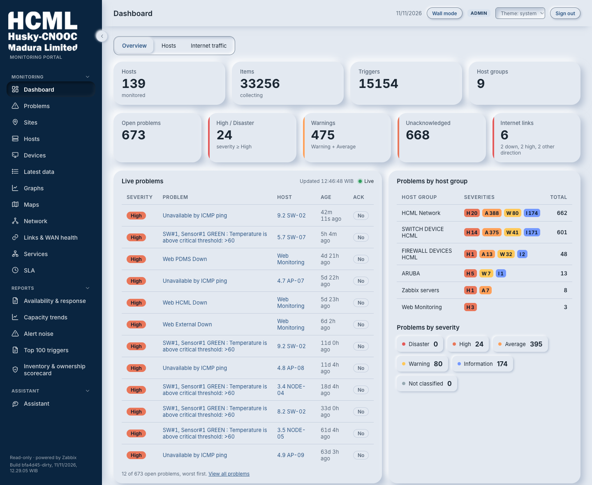
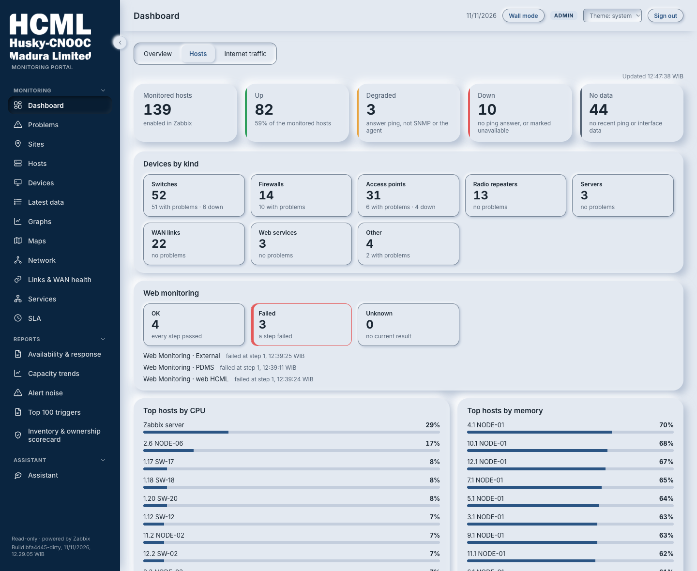
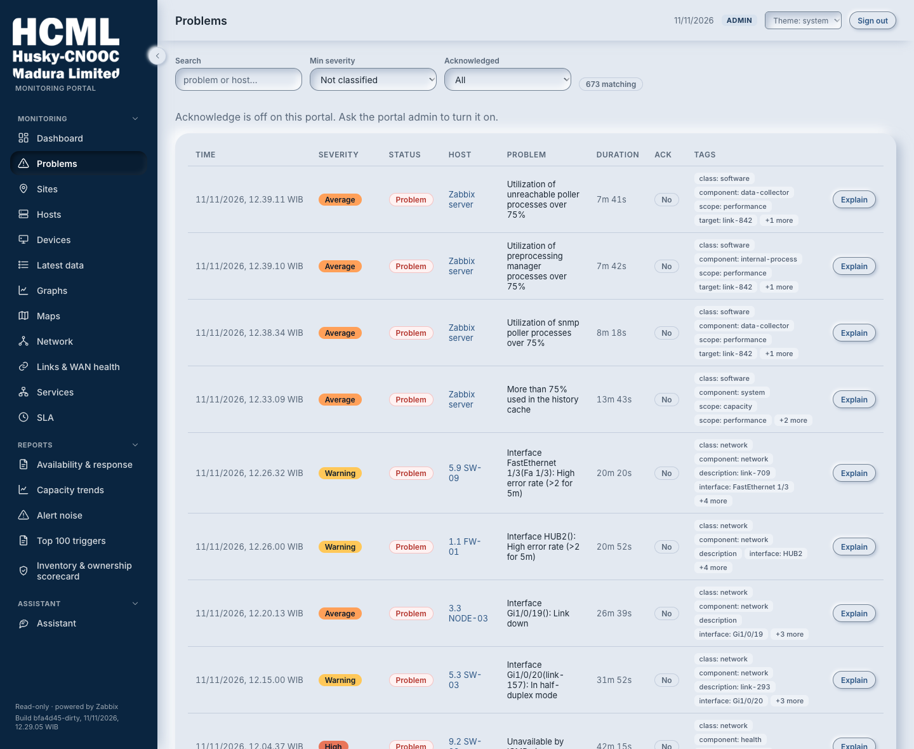
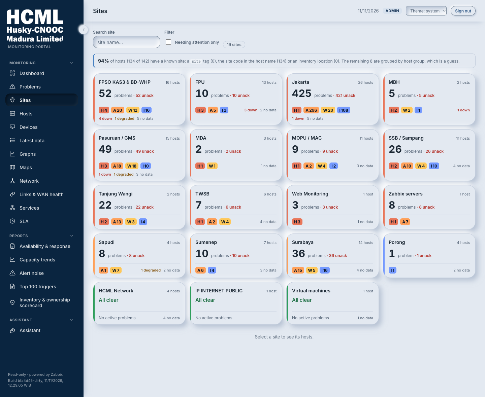
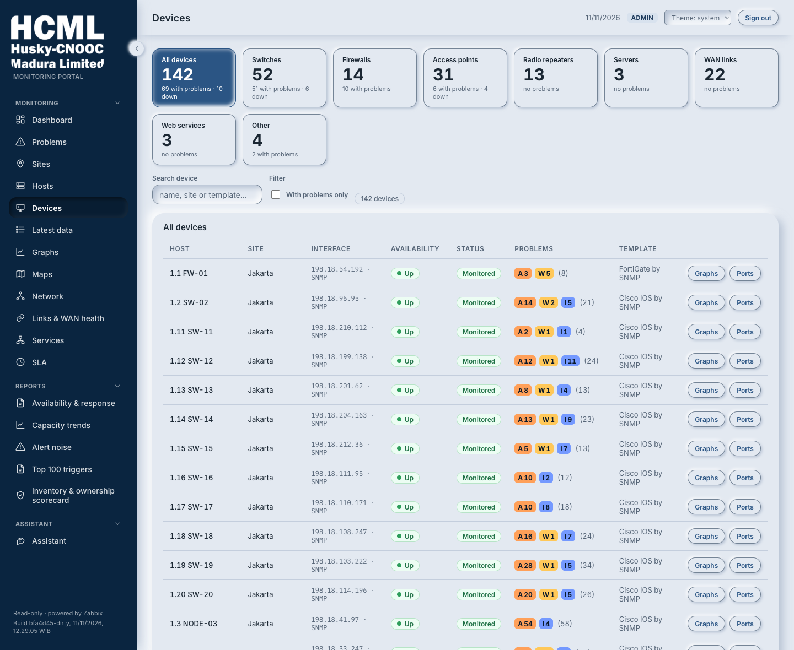
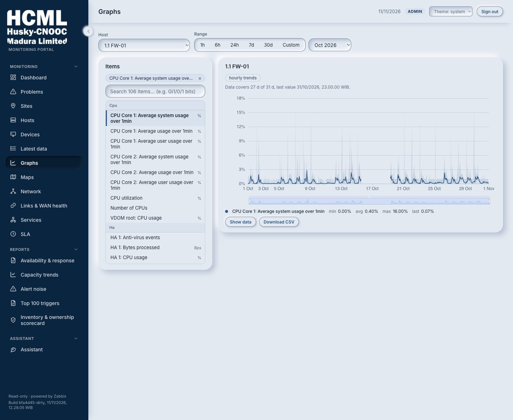
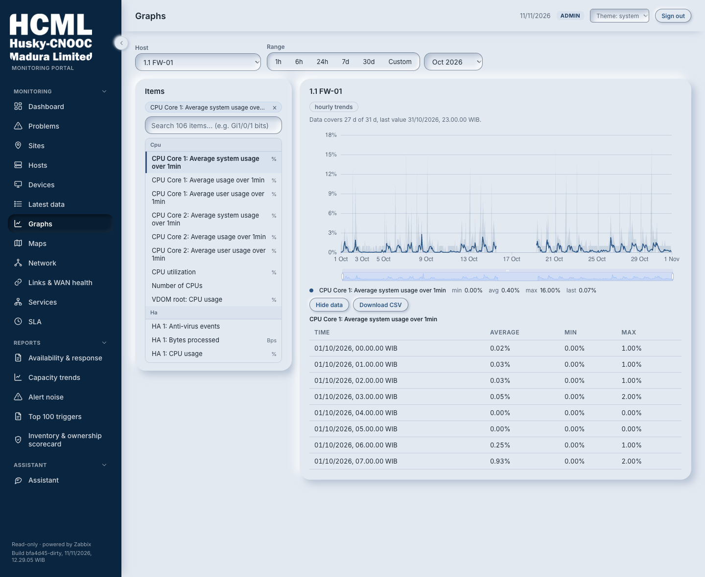
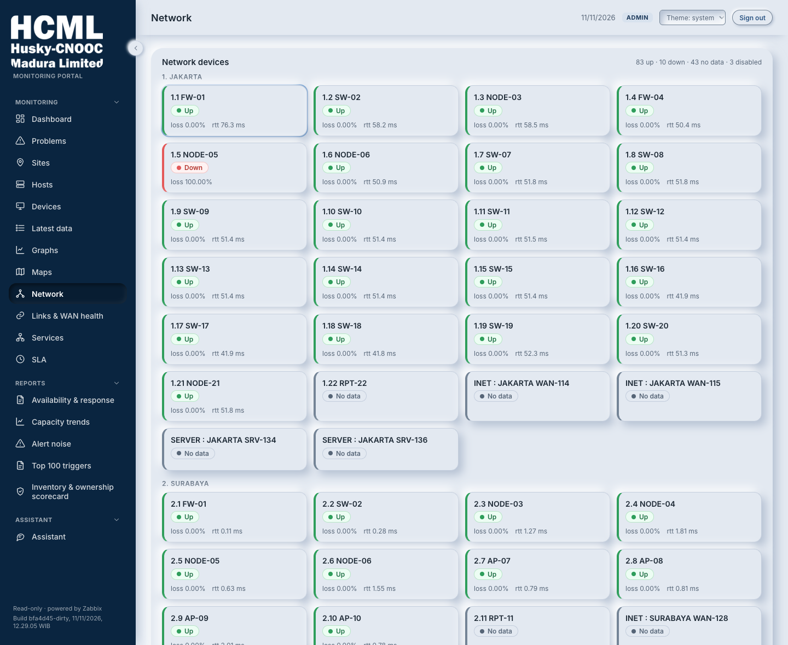

# The pages, as questions

| Who it is for | Reading time | Read first | Read next |
|---|---|---|---|
| Everyone | about 10 min | [What the portal is](what-it-is.md) | [Who can do what](who-can-do-what.md) |

> **Ringkasan**
>
> - Portal punya 19 halaman. Tiap halaman menjawab satu pertanyaan, misalnya "Apakah ada yang bermasalah sekarang?" atau "Berapa ketersediaan bulan lalu?".
> - Menu dibagi tiga: Monitoring, Reports dan Assistant. Halaman Login adalah satu-satunya yang bisa dibuka tanpa masuk.
> - Lima belas halaman bisa dibuka siapa saja yang sudah masuk. Network dan Links & WAN health mulai dari peran wall, dan Inventory hanya untuk admin.
> - Dashboard bisa dipasang di layar dinding. Layar itu berganti tampilan sendiri, dan sebaiknya memakai akun wall, yang tidak bisa menandai masalah.
> - Angka bulanan (SLA) dihitung portal sendiri dari riwayat masalah, dan bisa diunduh sebagai PDF atau Excel.

The portal has 19 pages. This page lists them by the question each one answers, not in the order of the menu, because that is how people arrive: they have a question and want to know where it is answered. The table says where each page sits in the menu and who can open it. The sections after it say what you will see.

| Page | Menu section | Who can open it |
|---|---|---|
| Dashboard | Monitoring | Anyone signed in. The internet traffic tab: wall screens, operators and admins |
| Problems | Monitoring | Anyone signed in. Acknowledging: operators and admins |
| Sites | Monitoring | Anyone signed in |
| Hosts | Monitoring | Anyone signed in |
| Devices | Monitoring | Anyone signed in |
| Latest data | Monitoring | Anyone signed in |
| Graphs | Monitoring | Anyone signed in. Graphs of network ports: wall screens, operators and admins |
| Maps | Monitoring | Anyone signed in |
| Network | Monitoring | Wall screens, operators and admins |
| Links & WAN health | Monitoring | Wall screens, operators and admins |
| Services | Monitoring | Anyone signed in |
| SLA | Monitoring | Anyone signed in |
| Availability & response | Reports | Anyone signed in |
| Capacity trends | Reports | Anyone signed in |
| Alert noise | Reports | Anyone signed in |
| Top 100 triggers | Reports | Anyone signed in |
| Inventory & ownership scorecard | Reports | Admins |
| Assistant | Assistant | Anyone signed in |
| Login | none | Anyone. It is the only page that needs no sign-in |

The menu hides the pages your role cannot open. That is a convenience. The server refuses a page's data to a role that may not have it, whatever the menu shows. [Who can do what](who-can-do-what.md) has the roles.

The pictures in this page were taken on 20 October 2026 from a copy of HCML's data in which every name and address had been replaced. The Zabbix server of that copy was switched off, so some figures read No data, which is how the portal looks when nothing is being collected. The interface has been restyled and refined since, so a page today looks a little different from its picture.

## Is anything wrong right now?

### Dashboard

The first page after signing in. It shows how many problems are open at each severity, and a list of the worst ones that changes by itself while you watch, with a small badge that says Live. When the page is not live, the badge says why, and [can I trust it](can-i-trust-it.md) lists the wordings.

A second tab, Hosts, counts the devices that are up, degraded, down or silent, the devices of each kind, the web checks that pass or fail, and the ten busiest devices by processor and by memory. Wall screens, operators and admins have a third tab with a gauge for each of HCML's internet links, taken from the Zabbix dashboard HCML already keeps. A link that is down says it is down. When a link is busy in the other direction, the gauge shows that too.

The same page is the wall screen. Open with the wall setting on, it drops the menu, enlarges the type, shows a clock and the time of the data, turns between its tabs by itself and scales to fit the window, because nobody can scroll a screen on a wall.

### Problems

The full list of open problems, with a search for a problem or a host, a minimum severity and a choice of acknowledged or not. A long list opens with a hundred rows and a button that adds a hundred more. Each row has an Explain button that writes the problem in plain words, when the portal has a model to ask. Operators and admins also have an acknowledge button on each row; a row they have just acted on says that it was sent and that the portal is waiting for Zabbix, which can take several seconds to show the change.

### Alert noise

Which alarms are not worth sending. A trigger can carry three flags. Flapping means it fires over and over and each firing is over within minutes (by default five firings in the period, each under five minutes at the median), which usually means its threshold is too tight. Unactioned means it fires that often and nobody ever acknowledges it, which means the team has learned to ignore it. Chronic means it has been open for more than a day. That last one is not noise: it is one condition nobody has cleared. The page also says how few triggers produced most of the alerts of the period.

### Top 100 triggers

Which alarms fired most in a period you choose, with the number of times each one fired. It counts firings only. Alert noise adds how long each lasted and whether anyone acted, which is what tells noise from a real fault.

## Where is it, what is it, and what is it saying?

### Sites

One card for each of HCML's sites. The card takes the colour of the site's worst problem, counts the devices that answer, those that do not and those with no data, and says where the portal found each device's site: in a tag, in the name, in the inventory record or in the group. The more devices carry an explicit site, the less the portal has to guess.

### Hosts

Every monitored device with its state: up, down, degraded, no data or disabled. Ping decides first. Degraded means the device answers ping while its other checks stay silent.

### Devices

A tile for each of eight kinds of device: switches, firewalls, access points, radio repeaters, servers, WAN links, web services and other. Each tile says how many there are, how many have a problem and how many do not answer, and opens the list of that kind. The kind comes from the device's template and its name, and the SLA report groups by the same kinds.

### Latest data

Pick a device, or a group, and see every measurement it has with its newest value. It is the page for the question "what is this device reporting right now?" when the answer is not on a graph.

### Graphs

One device, up to four of its measurements, any period. Show data lists the points of the chart as a table, and a button downloads the same table as a file that opens in a spreadsheet. The page says when a graph is thinner or older than it looks, for example when a series only has values for half of the period.

### Maps

The maps HCML drew in Zabbix, shown in the page with the problems marked on them. A map for a viewer leaves out the network elements that a viewer may not read.

## How are the links?

### Network

Devices grouped by site, with their network ports and the state of each port. It is the page for "which port is down on that switch?".

### Links & WAN health

Each WAN link as a path, with its state, its packet loss and its response time, paired with its standby where there is one. By default a link counts as degraded from 2 percent loss and as down from 10 percent.

## How did we do this month?

### Services

A tree of services built from the estate itself, because HCML's Zabbix has none set up. Each node shows its availability for the month against the target, and how many devices below it missed the target. It answers HCML's own complaint that monitoring was about devices and not about services.

### SLA

The monthly figure. It shows Zabbix's own SLA objects when any exist, and the monthly availability that the portal works out itself, by two methods side by side. The strict method counts a device that does not answer as down and leaves out hours when nothing was collected. HCML's report method counts only high packet loss, so a device that is completely down still counts as up. [Can I trust it](can-i-trust-it.md) explains why both are shown. The page offers the month as a PDF or an Excel file.

### Availability and response

How much of a period each device spent with a problem, and how long problems have waited without anyone acknowledging them. The period can be a rolling window or a calendar month. For one calendar month on the strict basis it offers the same PDF and Excel files as the SLA page.

## What will run out?

### Capacity trends

Processor, memory, disk and network port use for each device over a number of days, read from the hourly averages Zabbix keeps, and roughly when a rising line would reach its limit. The report is slow to build on HCML's Zabbix, so the portal keeps it for an hour and may show a copy up to a day old, and says so.

## How complete are our records?

### Inventory and ownership scorecard

For admins. It does not measure the network. It measures the records about it: how many devices have a name that follows HCML's convention, an explicit site, an owner and a criticality. The portal cannot make anyone follow a standard, but it can show the percentage rising as devices get tagged.

## Can I just ask?

### Assistant

Free questions about the estate in plain words: what is down at a site, which problems are oldest, how the month is going. The portal builds a summary of the estate (it reuses one for up to five minutes while nothing it describes has changed) and gives it to a model with the question. The model has no other source and no tools, and cannot change anything. The page says when the summary was cut short to fit, and its footer says to confirm on the relevant page before acting. [Data in and out](data-in-and-out.md) says what leaves the machine when you ask.

## Login

The sign-in page. After signing in, it returns to the page the session ended on, provided that page is on this site.

## Why these pages

HCML named six goals, and each page answers one of them.

| Goal | Where the portal answers it |
|---|---|
| Standard names, sites, owners and criticality | The inventory scorecard measures them, and the Sites page shows how many sites rest on an explicit tag |
| Monitoring by service, not by device | Services and SLA |
| Deeper telecom visibility | Links & WAN health and the internet traffic meters |
| Alerts that carry context | Explain, and Alert noise |
| Dashboards for different roles | The roles, the three Dashboard tabs and the wall screen |
| Automatic reports | Availability, Capacity, Top triggers and the SLA files |

Some of these goals are met only in part, and [risks, limits and costs](risks-limits-costs.md) says which and why.
