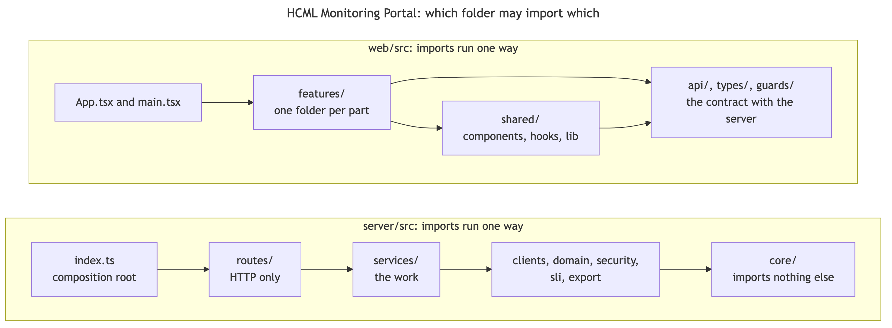

# Repository map

| Who it is for | Reading time | Read first | Read next |
|---|---|---|---|
| Operators and developers | about 7 min | [Start here](../README.md) | [The server](server.md) |

This page is the map of the whole repository: what each top-level folder and file is for, what runs where, which files exist only on a running machine, which files a program writes, and which rules decide who may import whom. The pages after it go through the folders one at a time.

## What runs where

```text
browser  ---->  nginx  ---->  server (the BFF)  ---->  Zabbix
React app       portal-web    portal-bff               JSON-RPC API
built from      port 8080     port 4000                a read token, and a
web/            inside the    inside the               separate write token
                container     container                for the one write
                                  |
                                  +---->  an AI model: hosted Claude over the internet,
                                          or Ollama on the host machine
```

The browser never talks to Zabbix and never holds a token. It talks to nginx, which serves the built web app and passes every address that starts with `/bff` to the server. The server holds the tokens, asks Zabbix, keeps what it learned in memory for seconds to hours, and answers in the shapes the web app expects. Docker publishes nginx on the loopback address of the host, on port 8081 for the hosted copy and 8082 for the local-model copy. Nothing in the repository ends TLS: put TLS in front of nginx before anyone outside the host machine uses it ([TLS in front of the portal](../../operations/tls.md)).

## The top level

<!-- gen:tree . depth=1 files -->
```text
./
├── .github/            1 file
├── deploy/             3 files
├── docs/               3 files
├── server/             9 files
├── tools/              1 file
├── web/                13 files
├── .env.example
├── .gitignore
├── .gitleaks.toml
├── .nvmrc
├── AUDIT_REPORT.md
├── CHANGELOG.md
├── DESIGN.md
├── LICENSE
├── README.md
├── SECURITY.md
├── docker-compose.yml
├── package.json
├── setup.md
└── tracker.md
```
<!-- /gen -->

| Entry | What it is |
|---|---|
| `server/` | The back end: a Fastify server in TypeScript, with its own packages, lockfile, Dockerfile and tests. [The server](server.md) goes through it. |
| `web/` | The front end: a React app built with Vite, served by nginx, with its own packages, lockfile, Dockerfile and tests. [The web app](web.md) goes through it. |
| `tools/` | Scripts that check the repository against itself (`check/`), read a running portal (`live/`) and build this handbook (`handover/`). Plain Node, no packages of their own. |
| `deploy/` | The rebuild script, the watcher that tells you when a portal stops answering, and a list of every setting with its default. |
| `docs/` | Everything documentary: the guide in 40 parts, the decisions, the diagrams, the API description, the design system and this handbook. |
| `.github/` | The CI workflow and the Dependabot settings. |
| `docker-compose.yml` | The two containers, `portal-bff` and `portal-web`, their limits, and every setting the server reads. Differs between the copies. |
| `.env.example` | Every setting with a safe example value. The real `.env` beside it is not in git. |
| `package.json` | No dependencies. Its scripts run the checks of both packages: `npm run verify` runs them all. |
| `README.md` | How to install, configure and run, and the layout. Differs between the copies. |
| `setup.md` | The index of the guide in `docs/setup/`, one part per subsystem. |
| `tracker.md` | Every row of work, what it was, and what state it is in. |
| `CHANGELOG.md` | What changed in each build, newest first. |
| `AUDIT_REPORT.md` | What two audits found and what is still open. Differs between the copies. |
| `DESIGN.md` | The design direction: identity, palette, type, mood, and the wall screen. |
| `SECURITY.md`, `LICENSE` | How to report a vulnerability, and the terms the code is shared on. |
| `.gitignore`, `.nvmrc` | What git leaves out, and the Node version for local installs and CI. |

## What exists only on a running machine

Some files sit in the folder and are not in the repository, on purpose.

| Path | What it holds | Why it is not committed |
|---|---|---|
| `.env` and `server/.env` | The real settings: users and roles, the Zabbix and model tokens, the signing secret | They are secrets. They are the one thing to back up by hand: [backup and restore](../../operations/backup-and-restore.md) |
| `docker-compose.override.yml` | Settings that belong to one machine, such as the name the server uses for Zabbix | It names an internal address. The file is excluded locally, not through `.gitignore`. |
| `pic/` | Screenshots of each copy's running portal, used to make the documents | They show real host and site names. The documents hold ten renamed images in `docs/screenshots/`. |
| `node_modules/`, `dist/`, `*.tsbuildinfo` | Installed packages, build output, build cache | They are made from the lockfiles and the source. |
| `HCML_SLA_Report_*` | A downloaded monthly SLA report | It names every device in the estate. |

## What a program writes

These files are made from another file. Edit the source, then run the command.

| File | Made from | Command |
|---|---|---|
| `web/src/generated/openapi.ts` and `openapi.json` | `docs/api/openapi.yaml` | `npm run gen:api` in `web/` |
| `docs/design-system/tokens.json`, `_tokens.scss`, `component-tokens.md` | `web/src/styles/01-tokens.css` and the rules that read it | `npm run tokens:export` at the root |
| The PDF and PNG beside each `.mmd` diagram | The `.mmd` source | Render it, then `node tools/check/diagrams.stamp.mjs` |
| The tables, trees, quoted code and reading times of `docs/handover/` | The code | `npm run handover:build` at the root |
| `server/dist/` and `web/dist/` | The source | `npm run build` |

Each one has a checker that fails when it is out of date, so an edit that forgets the command is caught by `npm run verify`.

## Who may import whom

The folders are layered, and a test in each package fails when a file reaches across a layer. Knowing the rules tells you where a new piece of code may go.



In the server:

1. `index.ts` mounts the routes, a route calls a service, and a service calls the shared folders: `core`, `clients`, `domain`, `security` and `http`.
2. Only `index.ts` imports a route module. No route imports another route, and no service imports a route. A route file exports its registrar and nothing else, so what two routes both need has to live in a service.
3. `core/` imports nothing from the other folders.
4. The shared folders import no route and no service, with one exception: the health check in `http/health.ts` reads the count of live screens from `services/stream.ts`.
5. Only `index.ts` imports `http/`, with two exceptions: `services/chat.ts` and `services/stream.ts` import `http/errors.ts` for the sentence shown when Zabbix cannot be read.
6. The files of `services/` form no cycle. The pieces of the Assistant never import its entry file, `services/assistant.ts`, because tests replace that file.
7. `index.ts` is the only file at the top of `src/`, and the folders under it are the nine listed in [the server](server.md).

In the web app:

1. A feature folder holds one part of the portal: its pages, components, hooks, logic and tests. `shared/` holds what two or more features use. The root holds the shell and the contract with the server: `api/`, `types/`, `guards/` and `theme.ts`.
2. The root files other than `App.tsx` and `main.tsx`, and everything in `shared/`, import no feature.
3. A feature imports another only where a table in `web/src/__tests__/layering.test.ts` allows it. The dashboard may use the hosts, meters, problems and shell features. Network may use graphs and hosts. Problems, shell and sla may use the assistant. The others use no feature. Adding a line to the table is the decision to couple two features.
4. No cycle among the shipped files, and no shipped file imports a test.

The reasons are in decision record 13, [layers, features and tools](../../architecture/adr/0013-layers-features-and-tools.md).
