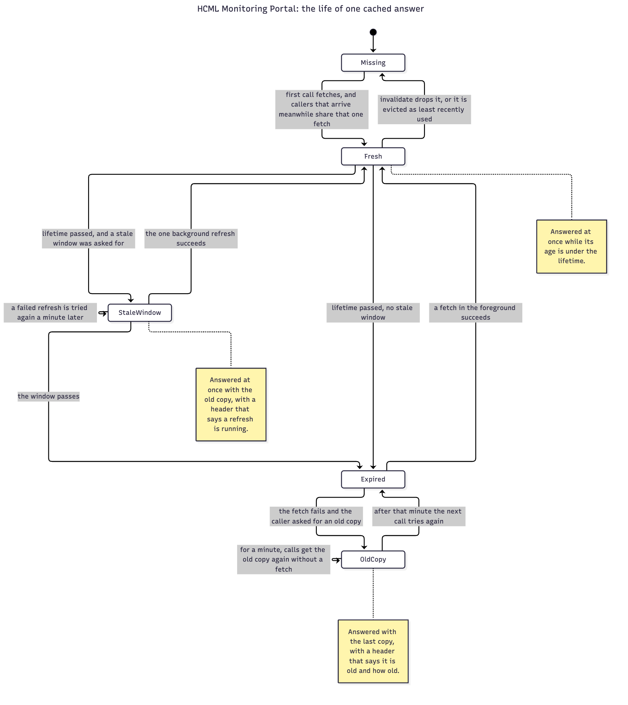

# Server: the core and the clients

| Who it is for | Reading time | Read first | Read next |
|---|---|---|---|
| Developers | about 35 min | [One request, from start to finish](one-request.md) | [Server: security and http](server-security-and-http.md) |

This chapter explains the functions the rest of the server stands on. `core/` is what everything uses: the cache, the checks on the settings, the gate that limits heavy work. `clients/` is everything the server calls out to: Zabbix, the certificate exception for Zabbix, and the AI layer's slot and guard.

Each entry names the file, says in one sentence what the function does, quotes the real code, and then reads it step by step, with what can go wrong, who calls it and which tests pin it. The quoted code is written from the source by `npm run handover:build`, so it cannot be mistyped. Each quote carries a fingerprint of the code its explanation was written against, and the checker fails when the code changes under an explanation until someone reads it again.

## The cache

### cached

`server/src/core/cache.ts`. Every read of Zabbix goes through this function. It answers from memory when it can, makes callers that arrive together share one fetch, and can answer with an old copy while a new one is read, or when the read fails.

<!-- gen:snippet server/src/core/cache.ts#cached sha=55d99b6a2597 -->
`server/src/core/cache.ts:181-238`

```ts
export async function cached<T>(
  key: string,
  ttlMs: number,
  fn: () => Promise<T>,
  opts: CacheOptions = {},
): Promise<T> {
  const now = Date.now();
  const held = isHeld(key, now);
  const ttl = held ? Math.min(ttlMs, HOLD_TTL_MS) : ttlMs;
  const staleMs = held ? 0 : Math.max(0, opts.staleMs ?? 0);
  const maxAge = opts.maxAgeMs ?? Infinity;

  const hit = store.get(key);
  if (hit) {
    const age = now - hit.t;
    if (age < ttl && age < maxAge) {
      remember(key, hit);
      return hit.v as T;
    }
    if (age < ttl + staleMs && age < maxAge) {
      remember(key, hit);
      if (opts.noteAge) noteRefreshing(age);
      if (!hit.refreshing && !inflight.has(key) && now >= (hit.retryAt ?? 0)) {
        hit.refreshing = true;
        // Nobody awaits this promise. Left unhandled, a rejection would take
        // the whole process down; caught, the stale value simply stays.
        begin(key, fn, opts).promise.catch((err: unknown) => {
          hit.refreshing = false;
          hit.retryAt = Date.now() + REFRESH_RETRY_MS;
          log?.warn({ key, reason: reason(err) }, 'cache: background refresh failed; keeping the stale value');
        });
      }
      return hit.v as T;
    }
    // Past the window, behind a fetch that failed: the old copy again until the pause is over.
    if (opts.staleIfError && !held && age < maxAge && now < (hit.retryAt ?? 0) && !inflight.has(key)) {
      remember(key, hit);
      noteStale(age);
      return hit.v as T;
    }
  }

  const flight = inflight.get(key) ?? begin(key, fn, opts);
  try {
    return (await flight.promise) as T;
  } catch (err) {
    // Never inside a write hold: that is exactly when an old value is wrong.
    const last = opts.staleIfError && !held ? store.get(key) : undefined;
    if (!last) throw err;
    remember(key, last);
    // Only on the copy this call started from: a newer one stored while the fetch ran (an invalidate, a second fetch) is fresh.
    if (last === hit) last.retryAt = Date.now() + REFRESH_RETRY_MS;
    const ageMs = Date.now() - last.t;
    noteStale(ageMs);
    log?.warn({ key, ageMs, reason: reason(err) }, 'cache: fetch failed; answering with the last cached value');
    return last.v as T;
  }
}
```
<!-- /gen -->



What it takes: a key, a lifetime in milliseconds, the function that fetches, and options. The options are four opt-ins and two marks: `staleMs` (a window after the lifetime in which the old copy is still answered at once), `staleIfError` (answer with the last copy when a fetch fails), `noteAge` (tell the response that an old copy was used), `maxAgeMs` (this call takes no copy that old, fresh or stale, and fetches instead; 0 always fetches) `pin` (evict this entry last) and `typed` (the key is made from what a caller chose, such as a search, a page number or a graph range: at most `MAX_TYPED_ENTRIES`, 150, of those are kept, and they are evicted before any other entry, so a run of distinct requests cannot push the problem list or the hosts out).

Reading it, top to bottom:

1. `held` asks whether the key is under a hold, which `invalidate` sets after a write. A held key gets a lifetime of at most `HOLD_TTL_MS` (two seconds) and no stale window, because a copy from before an acknowledgement is exactly what must not be shown.
2. A copy younger than the lifetime is answered at once, and `remember` makes it the most recently used. A caller that passed `maxAgeMs` gets no answer from a copy that old or older, so it falls through to a fetch: the live stream passes 0, because the cache dates a copy from the end of its read, and a stream that ticks at the lifetime would otherwise find a copy 14 seconds old and skip the read.
3. A copy older than the lifetime but inside `ttl + staleMs`, and under any `maxAgeMs`, is answered at once as well. If the caller passed `noteAge`, the response will carry `X-Data-Refreshing` and the age. If no refresh is running for the key, and none has failed in the last minute (`REFRESH_RETRY_MS`), exactly one starts in the background. Nobody awaits it, so its failure is caught and logged: left unhandled, a rejection would stop the whole process. A failure also clears the running flag and starts the minute, so the next request after it tries again; the stale window, which can be a day, does not have to run out first. Past the window, a copy whose last fetch failed less than a minute ago is answered at once too, marked as an old copy, when the caller asked for an old copy after a failure (`staleIfError`), the key is not held, no fetch for it is running (a running one is joined, step 4) and the call takes a copy that old: Zabbix is not asked again until the minute has passed. A Zabbix that accepts and never answers still makes the first request after each minute wait for the read to time out.
4. Anything else is a fetch. `inflight.get(key) ?? begin(...)` means that if a fetch for this key is already running, this call waits for that one. Ten pages asking together make one read of Zabbix.
5. If the fetch fails, an old copy is used only when the caller asked for it and the key is not held. `noteStale` records the age for the response headers, and the failure is logged with the key and the reason. The failure also starts the minute on that copy, if it is still the copy this call started from: a newer one stored while the fetch ran is fresh and gets no pause. That minute is what step 3 refers to. Otherwise the error goes up to the error handler.

What can go wrong. A fetch that returns after `invalidate` has cancelled it still answers its own callers, but its value is not stored, so a read that began just before a write cannot put the old list back. A value larger than the whole 64 MB budget is not stored at all, and a warning says so. The cache holds at most 500 entries and about 64 MB, evicts the least recently used first, typed entries before the others and pinned entries last, and a parameterised key such as one per month or per host stays until it is evicted.

The trap. The stale window and the old copy after a failure are not on by default. A new read that should survive a slow Zabbix must say so, and the problem list never does: an operator who has just acknowledged something must not be shown the list from before.

Used by nearly every service and by the domain reads and the health check. Pinned by `cache.test.ts`, `stale-headers.test.ts` and `light-reads.test.ts`.

### invalidate

`server/src/core/cache.ts`. Drops cached entries by key prefix, so the next read fetches again. It is how a write shows up at once.

<!-- gen:snippet server/src/core/cache.ts#invalidate sha=1611fe02bdeb -->
`server/src/core/cache.ts:337-356`

```ts
export function invalidate(prefix: string, opts: InvalidateOptions = {}): number {
  let dropped = 0;
  for (const key of store.keys()) {
    if (key.startsWith(prefix)) {
      discard(key);
      dropped++;
    }
  }
  for (const [key, flight] of inflight) {
    if (key.startsWith(prefix)) {
      flight.cancelled = true;
      inflight.delete(key);
    }
  }
  if (prefix === '') holds.clear();
  if (opts.holdMs && opts.holdMs > 0) {
    holds.set(prefix, Math.max(holds.get(prefix) ?? 0, Date.now() + opts.holdMs));
  }
  return dropped;
}
```
<!-- /gen -->

1. Every key that starts with `prefix` is discarded, and the count is returned.
2. Every fetch in flight for a matching key is marked `cancelled` and forgotten. Its callers still get their answer, and `begin` will not store it.
3. `invalidate('')` also clears every hold, which a test uses to start over.
4. With `holdMs`, the prefix is held until that moment: for that long a matching key lives at most two seconds and has no stale window. The later of two holds wins.

The acknowledge route calls it for each key in `STALE_AFTER_WRITE` (the problem list, the counts, the sites, the aging report, the services and others) with `holdMs: WRITE_HOLD_MS`, which is fifteen seconds. That is why, for about fifteen seconds after an acknowledgement, the portal asks Zabbix again every two seconds: Zabbix applies a close a few seconds after the call returns, so the first read can still show the problem as open. The Assistant's snapshot also drops its own key when it must.

The trap is the prefix. `invalidate('avail:')` clears every availability report for every parameter at once, and a prefix that is too short clears more than meant. Tests: `cache.test.ts` and the tests of the routes that write.

### registerStaleHeaders

`server/src/core/staleness.ts`. Puts `X-Data-Stale`, `X-Data-Refreshing` and `X-Data-Age-Seconds` on a response when the cache answered with an old copy, without touching the body.

<!-- gen:snippet server/src/core/staleness.ts#registerStaleHeaders sha=e8b2478424e8 -->
`server/src/core/staleness.ts:51-70`

```ts
export function registerStaleHeaders(app: FastifyInstance): void {
  app.addHook('onRequest', (req, _reply, done) => {
    const served: Served = { oldestMs: null, refreshingMs: null };
    byRequest.set(req, served);
    current.run(served, done);
  });
  app.addHook('onSend', (req, reply, payload, done) => {
    const served = byRequest.get(req);
    const seconds = (ms: number) => String(Math.max(0, Math.round(ms / 1000)));
    // A failed fetch is the stronger news: it alone is reported when both happened.
    if (served?.oldestMs != null) {
      reply.header(STALE_HEADER, 'true');
      reply.header(AGE_HEADER, seconds(served.oldestMs));
    } else if (served?.refreshingMs != null) {
      reply.header(REFRESHING_HEADER, 'true');
      reply.header(AGE_HEADER, seconds(served.refreshingMs));
    }
    done(null, payload);
  });
}
```
<!-- /gen -->

The report that went stale is often several calls below the route handler: availability for a month reads the derived SLI, which reads the cache. Passing a flag up through all of them would touch every service. So the hook uses request-scoped storage.

1. On every request, `onRequest` makes an empty record and runs the rest of the request inside it (`current.run(served, done)`), with the same record kept in a map keyed by the request.
2. While the request is served, `cache.ts` calls `noteStale(ageMs)` or `noteRefreshing(ageMs)`. Each writes to the record that belongs to the running request, and does nothing outside a request. The oldest age wins.
3. `onSend` reads the record. A failed fetch is the stronger news: if one happened, only `X-Data-Stale: true` and the age are sent. Otherwise, if a slow view was answered from its last copy, `X-Data-Refreshing: true` and the age.

It must be registered before the routes, because a Fastify hook reaches only the routes registered after it. The web app turns the headers into the lines "Data from ..." and "Zabbix did not answer, so ...". Tests: `stale-headers.test.ts`.

## The gate

### createGate

`server/src/core/gate.ts`. Lets at most `limit` jobs run at once and makes the rest wait, first come first served. The heavy reports use it so that a new window or severity cannot keep the database busy with several cold reports.

<!-- gen:snippet server/src/core/gate.ts#createGate sha=0cfe9a2d6adf -->
`server/src/core/gate.ts:11-36`

```ts
export function createGate(limit: number): Gate {
  if (!Number.isInteger(limit) || limit < 1) throw new RangeError('A gate needs a whole limit of at least 1.');
  let running = 0;
  const queue: Array<() => void> = [];

  return {
    async run<T>(job: () => Promise<T>): Promise<T> {
      // A place handed to the next in line stays counted in `running`, so a newcomer cannot jump the queue.
      if (running < limit) running++;
      else await new Promise<void>((resolve) => queue.push(resolve));
      try {
        return await job();
      } finally {
        const next = queue.shift();
        if (next) next();
        else running--;
      }
    },
    get running() {
      return running;
    },
    get waiting() {
      return queue.length;
    },
  };
}
```
<!-- /gen -->

1. A limit that is not a whole number of at least one is a programming error and throws at once.
2. `run(job)` takes a place when one is free (`running++`). Otherwise it waits on a promise whose resolver goes to the back of `queue`.
3. `finally` is the whole of the correctness. When a job ends, by returning or by throwing, it hands its place straight to the next in line: `next()` resolves the waiter and `running` is not decremented, so the place stays counted and a newcomer arriving at that instant cannot jump the queue. Only when nobody is waiting does `running` go down.
4. `running` and `waiting` are read-only counters for tests and logs.

A job that throws gives its place back, which is what the `finally` guarantees. A gate has no timeout: a job that never settles holds its place for good. The heavy reports use a gate of two, `HEAVY_REPORTS_AT_ONCE`. Tests: `gate.test.ts`.

## The settings

### assertConfig

`server/src/core/config.ts`. Run once at start. It refuses a configuration that is unsafe or unreadable, and warns about one that is merely odd, so that a portal that looks healthy and is not never starts.

<!-- gen:snippet server/src/core/config.ts#assertConfig lines=1-48 sha=3abf7030d12a -->
`server/src/core/config.ts:552-599` (lines 1 to 48 of assertConfig)

```ts
export function assertConfig(warn: (msg: string) => void): void {
  if (parseAuthEnabled(process.env.AUTH_ENABLED) === undefined) {
    throw new Error(
      `AUTH_ENABLED="${process.env.AUTH_ENABLED}" is not a value the portal knows. ` +
        'Use true, 1 or yes to turn sign-in on, false, 0 or no to turn it off, or leave it unset or empty to keep it on.',
    );
  }
  if (config.auth.enabled && KNOWN_JWT_SECRETS.includes(config.auth.jwtSecret)) {
    throw new Error(
      'AUTH_ENABLED=true but JWT_SECRET is a value published in this repo. ' +
        'Anyone with the repo could forge an admin token. Set one from `openssl rand -hex 32`.',
    );
  }
  if (config.auth.enabled && Buffer.byteLength(config.auth.jwtSecret) < MIN_JWT_SECRET_BYTES) {
    throw new Error(
      `AUTH_ENABLED=true but JWT_SECRET is shorter than ${MIN_JWT_SECRET_BYTES} bytes, ` +
        'short enough to guess offline from one token. Set one from `openssl rand -hex 32`.',
    );
  }
  // A name the cookie format cannot carry makes every sign-in fail with a 500.
  if (!COOKIE_NAME.test(config.auth.sessionCookie)) {
    throw new Error(
      `SESSION_COOKIE "${config.auth.sessionCookie}" is not a valid cookie name. ` +
        'Use letters, digits, "_" or "-", for example hcml_session.',
    );
  }
  // A session length or epoch that cannot be read must not fall back quietly: someone who wrote
  // SESSION_HOURS=1 to shorten sessions would otherwise get twelve hours and no word of it.
  const hours = (process.env.SESSION_HOURS ?? '').trim();
  if (hours !== '' && validSessionHours(hours) === undefined) {
    throw new Error(
      `SESSION_HOURS="${hours}" is not a length of session the portal can use. ` +
        `Use a number of hours from ${SESSION_HOURS_MIN} to ${SESSION_HOURS_MAX} (an open portal renews an hour before the end), ` +
        `or leave it unset for ${SESSION_HOURS_DEFAULT}.`,
    );
  }
  if (!SESSION_EPOCH_PATTERN.test(config.auth.sessionEpoch)) {
    throw new Error(
      `SESSION_EPOCH "${config.auth.sessionEpoch}" is not a label the portal can put in a token. ` +
        'Use up to 32 letters, digits, "." "_" or "-", for example 2.',
    );
  }
  // A span that cannot be read would otherwise count real downtime that was meant to be left out, with no word of it.
  if (parseNoDataWindows(process.env.SLA_NO_DATA_WINDOWS) === undefined) {
    throw new Error(
      `SLA_NO_DATA_WINDOWS="${process.env.SLA_NO_DATA_WINDOWS}" cannot be read. Write each span as start/end in ISO time ` +
        'with its zone, comma-separated, for example 2026-10-26T16:10+07:00/2026-10-26T21:03+07:00.',
    );
```
<!-- /gen -->

The first part of it, quoted above, throws. Each throw names the setting and says what to do.

1. `AUTH_ENABLED` must be a value the portal knows (`true`, `1`, `yes`, `false`, `0`, `no`, or unset). A typo would otherwise be read as one of them.
2. With sign-in on, `JWT_SECRET` must not be a value that is published in the repository and must be at least 32 bytes. Anyone with the repository could forge an admin token with a published one, and a short one can be guessed offline from a single token.
3. `SESSION_COOKIE` must be a name browsers accept, or every sign-in would fail with a server error.
4. `SESSION_HOURS` and `SESSION_EPOCH` that cannot be read must not fall back quietly: someone who wrote `SESSION_HOURS=1` to shorten sessions would otherwise get twelve hours and no word of it.
5. `SLA_NO_DATA_WINDOWS` that cannot be read would count real downtime that was meant to be left out.
6. `SLA_TIMEZONE` must be a zone the runtime knows. A name such as `Asia/Jakata` would otherwise make every month view and the SLA report answer 500 while the health route stayed green.
7. `ZABBIX_TIMEOUT_MS` and `AI_TIMEOUT_MS`, when set, must be a whole number of milliseconds from 1,000 to 2,147,483,647. A timeout of 0 fails every call at once, a word or a unit such as `30s` would fall back to the default without a word, and a timer longer than that last number is turned into 1 ms by Node.
8. `SLO_TARGET` and `SLI_MIN_COVERAGE`, when set, must be numbers inside their range: a percentage from 0 to 100, and a share from 0 to 1. A target typed as `99,9` or a coverage of 5 would otherwise be read as something else, and change what every report says.

The rest of the function warns and does not stop the start: an invalid `ZBX_URL`, the certificate exception half-written, set while the address is not https, or past its last day, one warning for each reason email is off when a `MAIL_` setting is present and cannot be used (the password is never in the text), one warning when email is refused because sign-in is off and `ALLOW_EMAIL_WITHOUT_AUTH` is not true, and, last of all, one warning while email is on and `MAIL_ALLOWED_DOMAINS` is empty, since a report may then go to any address an administrator types. `index.ts` runs it, and `assertUsers` after it, before any route is registered. Tests: `startup-guards.test.ts`, `config-tls-pin.test.ts`, `config-placeholder-key.test.ts`, `write-gate.test.ts`, `email-without-auth.test.ts` and `mail-config-wiring.test.ts`.

### parseTlsPin

`server/src/core/config.ts`. Reads the two settings of the certificate exception, `ZBX_TLS_PIN_SHA256` and `ZBX_TLS_PIN_UNTIL`, into one value, or into nothing.

<!-- gen:snippet server/src/core/config.ts#parseTlsPin sha=f50b80f50ab5 -->
`server/src/core/config.ts:143-151`

```ts
export function parseTlsPin(rawFingerprint: string | undefined, rawUntil: string | undefined): TlsPin | undefined {
  const hex = (rawFingerprint ?? '').replace(/[\s:]/g, '').toUpperCase();
  const until = (rawUntil ?? '').trim();
  if (!/^[0-9A-F]{64}$/.test(hex) || !/^\d{4}-\d{2}-\d{2}$/.test(until)) return undefined;
  // A day the calendar lacks, such as 2026-11-31, would otherwise roll over into the next month.
  const day = Date.parse(`${until}T00:00:00Z`);
  if (!Number.isFinite(day) || new Date(day).toISOString().slice(0, 10) !== until) return undefined;
  return { fingerprint256: (hex.match(/../g) ?? []).join(':'), until, untilMs: Date.parse(`${until}T23:59:59.999+07:00`) };
}
```
<!-- /gen -->

1. The fingerprint is stripped of spaces and colons and upper-cased, and must be exactly 64 hexadecimal digits. The date must be `YYYY-MM-DD`.
2. A day the calendar lacks, such as 2026-11-31, would roll over into the next month when parsed, so the date is parsed and written back, and the two must match.
3. The result keeps the fingerprint in colon form, the way Node reports it, and turns the last day into the last millisecond of that day in Jakarta time. Until that moment the exception holds.

Anything wrong gives `undefined`, which means no exception, so an expired certificate is refused. `assertConfig` warns when one of the two settings is present and the pair does not parse. Tests: `pinned-tls.test.ts`.

## Zabbix

### call, zbx and zbxWrite

`server/src/clients/zabbix.ts`. Every call to Zabbix is one of these. `zbx` reads with the read token, `zbxWrite` writes with the separate write token, and both use `call`, which turns every way a call can fail into one of four typed errors.

<!-- gen:snippet server/src/clients/zabbix.ts#call lines=1-26 sha=c4535ed0869a -->
`server/src/clients/zabbix.ts:109-134` (lines 1 to 26 of call)

```ts
async function call<T>(method: string, params: unknown, token: string, timeoutMs: number): Promise<T> {
  let res: Reply;
  try {
    res = await send(JSON.stringify({ jsonrpc: '2.0', method, params, id: ++id }), token, timeoutMs);
  } catch (err) {
    if (err instanceof PinnedTlsError) {
      throw new ZabbixApiError(`Refused Zabbix's certificate for ${method} (${err.code}). ${err.message}`, `ZBX_URL=${config.zbxUrl}`);
    }
    const name = (err as { name?: unknown } | null)?.name;
    if (name === 'TimeoutError' || name === 'AbortError') {
      throw new ZabbixTimeoutError(
        `Zabbix did not respond to ${method} within ${timeoutMs} ms. ` +
          'It may be overloaded or unreachable. Check ZBX_URL and the Zabbix server.',
        `ZBX_URL=${config.zbxUrl}`,
      );
    }
    // Connection refused, DNS failure, TLS error, a connection dropped part-way.
    // The system error names the host and port, so only its code is shown.
    const cause = err instanceof Error && err.cause instanceof Error ? err.cause : err;
    const code = (cause as { code?: unknown } | null)?.code;
    throw new ZabbixApiError(
      `Could not reach Zabbix for ${method}${typeof code === 'string' ? ` (${code})` : ''}. ` +
        'Check ZBX_URL and that the Zabbix frontend is running.',
      `ZBX_URL=${config.zbxUrl}: ${cause instanceof Error ? cause.message : String(cause)}`,
    );
  }
```
<!-- /gen -->

<!-- gen:snippet server/src/clients/zabbix.ts#call lines=28-62 sha=c4535ed0869a -->
`server/src/clients/zabbix.ts:136-170` (lines 28 to 62 of call)

```ts
  if (!res.ok) {
    throw new ZabbixApiError(
      `${method}: HTTP ${res.status} ${res.statusText}`,
      `ZBX_URL=${config.zbxUrl} answered: ${snippet(res.body)}`,
    );
  }

  // A 200 that is not JSON-RPC: ZBX_URL pointing at the frontend's login page
  // rather than api_jsonrpc.php, or PHP failing part-way through (zabbix-web
  // running out of memory on a large trend.get prints an HTML error).
  let json: { result?: T; error?: unknown } | null;
  try {
    json = JSON.parse(res.body) as { result?: T; error?: unknown } | null;
  } catch {
    json = null;
  }
  if (!json || typeof json !== 'object') {
    throw new ZabbixApiError(
      `${method}: Zabbix returned a non-JSON response. Check that ZBX_URL points at api_jsonrpc.php ` +
        'and that the Zabbix frontend is not out of memory.',
      `ZBX_URL=${config.zbxUrl} answered: ${snippet(res.body)}`,
    );
  }

  if (json.error) {
    if (isAuthFailure(json.error)) {
      throw new ZabbixAuthError(
        'Zabbix rejected the API token (expired, invalid, or revoked). Update ZABBIX_API_TOKEN ' +
          '(or ZABBIX_WRITE_TOKEN, for acknowledge/close) in server/.env.',
      );
    }
    throw new ZabbixRefusedError(`${method}: ${JSON.stringify(json.error)}`);
  }
  return json.result as T;
}
```
<!-- /gen -->

1. `send` posts the JSON-RPC body. While a certificate exception is set and the address is https, it goes through the pinned agent. Otherwise it is a plain `fetch` with `AbortSignal.timeout`, because `fetch` has no timeout of its own and one hung Zabbix would hold every page open. The body is read under the same timeout, since `fetch` resolves once the headers arrive, and a Zabbix that stalled while still sending a large answer used to escape it and end as a bare 500.
2. A refused certificate becomes a `ZabbixApiError` with the code in the message. A timeout becomes a `ZabbixTimeoutError`. Any other failure to connect, such as a refused connection, a name that does not resolve or a dropped connection, becomes a `ZabbixApiError` that names the code (`ECONNREFUSED`, `ENOTFOUND`) and not the host.
3. A status that is not 2xx is a `ZabbixApiError` carrying the start of what Zabbix sent, for the log.
4. A body that is not JSON-RPC means the address points at the frontend's login page or that PHP failed part-way, so the message tells you to check that it points at the API file and that the frontend is not out of memory.
5. A JSON-RPC `error` is a `ZabbixAuthError` when its text names an expired, invalid or revoked token, and otherwise a `ZabbixRefusedError`, a kind of `ZabbixApiError`, with Zabbix's own words. The acknowledge route tells the kinds apart: a refusal gets the portal's own sentence, and a timeout says that the change may or may not have been made.

`zbx` and `zbxWrite` are three and four lines. `zbxWrite` refuses at once with `ZabbixWriteDisabledError` when no write token is set, so the read token can never reach a write. The reasons the message never carries the address: it would reach the browser, and the address is internal. Tests: `zabbix.test.ts`, `zabbix-pinned.test.ts` and the error mapping in `routes.test.ts`.

### judgePeer

`server/src/clients/pinnedTls.ts`. Decides whether to accept a certificate that failed the normal check, given the one exception. It is a pure function of what the handshake showed, the pin and the clock, so it is tested without a network.

<!-- gen:snippet server/src/clients/pinnedTls.ts#judgePeer sha=a4b992086b85 -->
`server/src/clients/pinnedTls.ts:28-47`

```ts
export function judgePeer(peer: Peer, pin: TlsPin, nowMs: number): PinnedTlsError | undefined {
  if (peer.authorized) return undefined;
  const fault = peer.authorizationError ?? 'UNVERIFIED';
  if (fault !== 'CERT_HAS_EXPIRED') {
    return new PinnedTlsError(fault, 'The certificate fails the normal check for a reason other than its age.');
  }
  if (peer.identityError) {
    return new PinnedTlsError('ERR_TLS_CERT_ALTNAME_INVALID', 'The certificate does not name the host in ZBX_URL.');
  }
  if (peer.fingerprint256 !== pin.fingerprint256) {
    return new PinnedTlsError('ZBX_TLS_PIN_MISMATCH', 'The server sent a different certificate from the one in ZBX_TLS_PIN_SHA256.');
  }
  if (nowMs > pin.untilMs) {
    return new PinnedTlsError(
      'ZBX_TLS_PIN_ENDED',
      `The exception for the expired certificate ended on ${pin.until}. Renew the certificate.`,
    );
  }
  return undefined;
}
```
<!-- /gen -->

1. A certificate that passes the normal check goes through: the exception does not weaken anything that works.
2. Node names only the last fault it found. A fault other than `CERT_HAS_EXPIRED` is refused with its own name.
3. For an expired one, the name on the certificate must still match the host in `ZBX_URL`.
4. The fingerprint must be the pinned one. A different certificate, expired or not, is refused as `ZBX_TLS_PIN_MISMATCH`.
5. The last day must not have passed, or the refusal says the exception has ended and the certificate should be renewed.

It returns an error to refuse, or nothing to accept. Tests: `pinned-tls.test.ts`.

### postPinned

`server/src/clients/pinnedTls.ts`. One POST through the pinned agent, with the same timeout rule as the plain path.

<!-- gen:snippet server/src/clients/pinnedTls.ts#postPinned sha=ee22ba457683 -->
`server/src/clients/pinnedTls.ts:115-155`

```ts
export function postPinned(
  url: string,
  headers: Record<string, string>,
  body: string,
  timeoutMs: number,
  agent: https.Agent,
): Promise<Reply> {
  return new Promise((resolve, reject) => {
    const req = https.request(
      url,
      { method: 'POST', agent, headers: { ...headers, 'Content-Length': String(Buffer.byteLength(body)) } },
      (res) => {
        const chunks: Buffer[] = [];
        res.on('data', (chunk: Buffer) => chunks.push(chunk));
        res.on('error', fail);
        res.on('end', () => {
          clearTimeout(timer);
          const status = res.statusCode ?? 0;
          resolve({
            ok: status >= 200 && status < 300,
            status,
            statusText: res.statusMessage ?? '',
            body: Buffer.concat(chunks).toString('utf8'),
          });
        });
      },
    );
    const timer = setTimeout(() => {
      // Named as `fetch` names its own timeout, which the client already maps.
      const err = Object.assign(new Error(`No answer within ${timeoutMs} ms.`), { name: 'TimeoutError' });
      req.destroy(err);
      reject(err);
    }, timeoutMs);
    function fail(err: Error): void {
      clearTimeout(timer);
      reject(err);
    }
    req.on('error', fail);
    req.end(body);
  });
}
```
<!-- /gen -->

1. It writes the request on a connection the agent has already judged, so a refused server never receives the token: the judgement happens at connection time, before the request is written.
2. It collects the body and resolves with the same shape a `fetch` reply gives (`ok`, `status`, `statusText`, `body`), so `call` treats both paths alike.
3. The timer destroys the request with an error named `TimeoutError`, which is what `fetch` names its own, so `call` maps it to `ZabbixTimeoutError` without knowing which path ran.
4. Any error clears the timer and rejects, and the end of the body clears it too, so no timer outlives the request.

Used only by `zabbix.ts`. Tests: `pinned-tls.test.ts` and `zabbix-pinned.test.ts`, which use a throwaway certificate authority and certificates (`tlsTestCerts.ts`), one of them expired in 2020.

## The AI layer

### acquireModelSlot

`server/src/clients/ai.ts`. Waits for the one local model, holds it, and gives back a function that releases it. A local model takes one request at a time, and a second request would wait inside Ollama with no word to the reader.

<!-- gen:snippet server/src/clients/ai.ts#acquireModelSlot sha=33527b7ec1eb -->
`server/src/clients/ai.ts:401-429`

```ts
export function acquireModelSlot(signal?: AbortSignal, waitMs = SLOT_WAIT_MS): Promise<() => void> {
  if (signal?.aborted) return Promise.reject(signal.reason);
  if (!slotHeld) {
    slotHeld = true;
    return Promise.resolve(releaser());
  }
  return new Promise((resolve, reject) => {
    const leave = () => {
      clearTimeout(timer);
      signal?.removeEventListener('abort', onAbort);
      const i = slotQueue.indexOf(grant);
      if (i >= 0) slotQueue.splice(i, 1);
    };
    const grant = () => {
      leave();
      resolve(releaser());
    };
    const onAbort = () => {
      leave();
      reject(signal?.reason);
    };
    const timer = setTimeout(() => {
      leave();
      reject(new AiBusyError(BUSY_MESSAGE));
    }, waitMs);
    signal?.addEventListener('abort', onAbort, { once: true });
    slotQueue.push(grant);
  });
}
```
<!-- /gen -->

1. If the caller's `signal` has already aborted, it rejects at once with the reason. A reader who left gives up their place.
2. If nobody holds the slot, it is taken and released by the function that is returned.
3. Otherwise a promise joins `slotQueue`. `grant` is called when the slot frees up: it removes the timer and the abort listener, then resolves with a release function.
4. Two ways out besides being granted: the timer, after `waitMs` (twenty seconds), rejects with `AiBusyError`, which the error handler answers as a 503 with `Retry-After`, and the abort rejects with the signal's reason. Both go through `leave`, which also takes the waiter out of the queue, so nobody is granted a slot they no longer want.

The release function is safe to call twice and hands the slot straight to the next in line (`releaser`). The slot belongs to one server process, so a second server pointed at the same Ollama would not see it. Used by the Assistant's answer. Tests: `ai.test.ts`.

### aiGuard

`server/src/clients/limits.ts`. The route guard for the AI routes. It refuses a call that is too frequent, or one made after the day's tokens are used.

<!-- gen:snippet server/src/clients/limits.ts#aiGuard sha=50e83d36c1c4 -->
`server/src/clients/limits.ts:194-215`

```ts
export function aiGuard(kind: AiKind) {
  return async function guard(req: FastifyRequest, reply: FastifyReply): Promise<FastifyReply | void> {
    const caller = callerOf(req);
    const wait = perMinute[kind].take(`${kind}|${caller}`);
    if (wait !== null) {
      const { max, unit } = WHAT[kind];
      return reply
        .code(429)
        .header('retry-after', String(wait))
        .send({
          error: 'rate_limited',
          message: `You are asking too quickly: the limit is ${max} ${unit} a minute for each person. Try again in ${wait} second${wait === 1 ? '' : 's'}.`,
        });
    }
    // Only the hosted API is billed.
    if (config.ai.provider !== 'anthropic') return;
    const refusal = aiBudget.refusal(caller);
    if (refusal) {
      return reply.code(429).header('retry-after', String(refusal.retryAfter)).send({ error: 'ai_budget', message: refusal.message });
    }
  };
}
```
<!-- /gen -->

1. `aiGuard(kind)` returns a guard for `chat` or `explain`. `callerOf` names the person: the signed-in user, or the client address when sign-in is off.
2. `perMinute[kind].take(key)` is a fixed minute that starts at the key's first call. It answers with the seconds to wait, or `null` when the call may go on. Too fast is a 429 `rate_limited` with `retry-after` and a sentence that names the limit.
3. Only the hosted API is billed, so a local model skips the budget. Otherwise `aiBudget.refusal(caller)` says whether this person, or the whole portal, has used the day's tokens. If so, 429 `ai_budget`, with the time to midnight in the reporting time zone.

It is a `preHandler`, so it runs after the sign-in guard has set the user and before the route reads its body or takes over the response. It is not the rate-limit plugin's own route option, because that runs one limiter for each request and the overall one has already run by then. Counts live in memory, so a restart gives everyone a fresh allowance. Used by `routes/chat.ts` and `routes/explain.ts`. Tests: `ai-limits.test.ts` drives both refusals through the routes.
