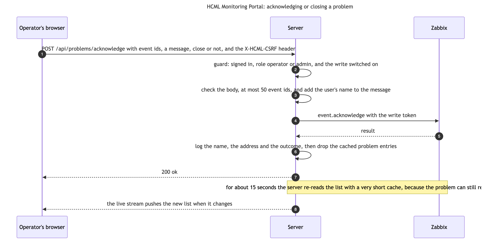

# Server: routes

| Who it is for | Reading time | Read first | Read next |
|---|---|---|---|
| Developers | about 25 min | [Server: export](server-export.md) | [Web app: the shell and the shared code](web-shell-and-shared.md) |

A route is where a request meets the code. In this server a route does three small things: it checks what the caller sent, it calls a service, and it returns what the service gave. It reads no Zabbix itself and holds no cache. The services in the other chapters do that. This chapter shows the shared pattern, the helpers that check input, the one write path, and a table of every route.

## The pattern

`server/src/routes/` holds 22 modules. Each exports one async function that takes the Fastify app, which Fastify calls a plugin, and `index.ts` registers them in a fixed order after the guard that checks every request (`setupAuth`). The smallest is this:

<!-- gen:snippet server/src/routes/problems.ts#problemRoutes sha=f8bac13d43db -->
`server/src/routes/problems.ts:4-7`

```ts
export async function problemRoutes(app: FastifyInstance): Promise<void> {
  // Current problems, host-enriched. Cached 15 s, the entry the live stream shares.
  app.get('/api/problems', () => cachedProblems());
}
```
<!-- /gen -->

1. The handler is a plain function that returns a value. Fastify turns the value into the JSON of the answer. A thrown error goes to the error handler (`registerErrorHandler`), which gives it its status and its one public sentence.
2. The role a route needs is not written here. It is in `ROUTE_RULES` in `security/auth.ts`, matched by the path, and the guard enforces it before the handler runs. So a new route is open to every signed-in user until a rule says otherwise.
3. The cache is not here either. `cachedProblems` holds the 15-second entry that this route, the live stream and the reports all share.
4. The 22 modules hold 39 routes. The sign-in routes in `security/auth.ts` and the two health routes in `http/health.ts` make 45, which is the number of paths in `docs/api/openapi.yaml`, and the openapi checker compares the two lists.

## Checking input

Everything in `req.query` arrives as text or not at all, and both failures are silent. A missing id reaches Zabbix as `[undefined]` and comes back as an opaque 500. A non-numeric window becomes `NaN`, which Zabbix reads as "no time limit", and one request once returned an item's whole history, 20,218 points. So the routes use four helpers. An id is digits and no larger than Zabbix stores, 18446744073709551615 (`isZabbixId`): a longer number only comes back from Zabbix as a failed read, so it is a 400 here.

<!-- gen:snippet server/src/core/validate.ts#requireId sha=1c2bb6afeeac -->
`server/src/core/validate.ts:34-39`

```ts
export function requireId(value: unknown, name: string): string {
  if (typeof value !== 'string' || !isZabbixId(value)) {
    throw new BadRequestError(`${name} is required and must be a numeric Zabbix id.`);
  }
  return value;
}
```
<!-- /gen -->

<!-- gen:snippet server/src/core/validate.ts#intParam sha=188640584a71 -->
`server/src/core/validate.ts:51-55`

```ts
export function intParam(value: unknown, fallback: number, min: number, max: number): number {
  const parsed = typeof value === 'string' && value.trim() !== '' ? Math.trunc(Number(value)) : NaN;
  const n = Number.isFinite(parsed) ? parsed : fallback;
  return Math.min(Math.max(n, min), max);
}
```
<!-- /gen -->

<!-- gen:snippet server/src/core/schemas.ts#singleValues sha=8d93d74e2c93 -->
`server/src/core/schemas.ts:34-39`

```ts
export function singleValues(...names: string[]) {
  return {
    type: 'object',
    properties: Object.fromEntries(names.map((name) => [name, { type: 'string', maxLength: QUERY_VALUE_MAX }])),
  } as const;
}
```
<!-- /gen -->

<!-- gen:snippet server/src/core/schemas.ts#AJV_OPTIONS sha=bd4bf8d9a63f -->
`server/src/core/schemas.ts:22-25`

```ts
export const AJV_OPTIONS: NonNullable<FastifyServerOptions['ajv']> = {
  // Union types such as ['string', 'array'] are plain JSON Schema; Ajv logs a warning at startup without this.
  customOptions: { coerceTypes: false, allowUnionTypes: true },
};
```
<!-- /gen -->

1. `requireId` accepts a Zabbix id only: required, digits only. Anything else throws a `BadRequestError`, which `registerErrorHandler` answers with a 400 and the message "name is required and must be a numeric Zabbix id." `optionalId` accepts an absent value and checks a present one the same way.
2. `intParam` reads an integer from a query value. An absent or non-numeric value gives the fallback, and a value out of range is clamped, so `days=9999` becomes 365 and `NaN` never escapes. A plain `Math.min(Math.max(...))` does not catch `NaN`, which is why the function exists.
3. `singleValues('hostid', 'search')` is the query schema of a GET route: each named value is one string of at most 2,000 characters. A name sent twice reaches a handler as a list, which no handler reads, and `search.trim()` on one was a 500. Names not listed pass as before.
4. `AJV_OPTIONS` turns type coercion off in Fastify's validator, which would otherwise turn the text "false" into `false` and a list of one name into the name. The handlers refuse those, so the schemas must not accept them. `index.ts` and the test helpers both pass these options.
5. A POST has a body schema in the same file (`loginBody`, `noBody`, `acknowledgeBody`, `chatBody`). The schema fixes the shape. The finer rules stay in the handler: digits only in an event id, a message cut at 2,048 characters, a chat that must end on a user turn.

Tests: `request-schemas.test.ts` holds the schemas, and `graphs.test.ts` and `routes.test.ts` run the helpers through the routes.

### A route that uses them: /api/items

<!-- gen:snippet server/src/routes/hosts.ts#hostRoutes lines=17-31 sha=15e4285f7883 -->
`server/src/routes/hosts.ts:35-49` (lines 17 to 31 of hostRoutes)

```ts
app.get('/api/items', { schema: { querystring: ITEMS_QUERY }, preHandler: searchGuard }, async (req) => {
  const q = req.query as { hostid?: string; search?: string; graphable?: string; itemids?: string };
  const graphable = q.graphable === '1' || q.graphable === 'true';
  const itemids =
    q.itemids !== undefined && q.itemids !== ''
      ? [...new Set(q.itemids.split(',').map((s) => requireId(s.trim(), 'itemids')))]
      : undefined;
  if (itemids && itemids.length > MAX_ITEMIDS) {
    throw new BadRequestError(`At most ${MAX_ITEMIDS} itemids per request.`);
  }
  const hostid = itemids ? optionalId(q.hostid, 'hostid') : requireId(q.hostid, 'hostid');
  const found = await findItems({ hostid, itemids, search: q.search, graphable });
  // Interface items are operator data. Cut after the cache: it holds one list for every role.
  return hidesNetwork(req) ? withoutNetworkItems(found) : found;
});
```
<!-- /gen -->

1. `ITEMS_QUERY` is `singleValues('hostid', 'search', 'graphable', 'itemids')`. The query is then read by hand: `graphable` is true for `1` or `true`, and `itemids` is a comma list that is split, checked id by id with `requireId`, and made unique.
2. At most `MAX_ITEMIDS` (50) ids are taken, and more is a 400. `hostid` is required unless `itemids` is given, because without either Zabbix would get `hostids: [undefined]`.
3. `findItems` reads the items and keeps one list for every role. A request with a `search` is counted first by `searchGuard`: 120 a minute for each person, and more is a 429 `rate_limited` with a `retry-after`; `/api/latest` has the same guard. The search text is trimmed, and the cache key is `typed`. After the cache, a role below `wall` loses the interface items, `hidesNetwork(req)` deciding. The cut is after the cache so that one entry serves all roles. `/api/latest` and `/api/graph` do the same.

### A route that refuses: /api/graph

<!-- gen:snippet server/src/routes/history.ts#historyRoutes sha=2bc16f8520f7 -->
`server/src/routes/history.ts:9-21`

```ts
export async function historyRoutes(app: FastifyInstance): Promise<void> {
  // ?itemids=a,b&hours=24 | &from=&to= | &month=YYYY-MM   [&points=1500]  (getGraph says how it is read)
  app.get('/api/graph', { schema: { querystring: GRAPH_QUERY } }, async (req, reply) => {
    const q = req.query as Record<string, string | undefined>;
    const ids = parseItemIds(q.itemids);
    const denied = await networkItemsDenied(req, ids);
    if (denied) return reply.code(403).send({ error: 'forbidden', message: denied });
    const now = Math.floor(Date.now() / 1000);
    const { from, to } = parseRange(q, now);
    const points = intParam(q.points, 1500, 200, 3000);
    return getGraph({ ids, from, to, points, now });
  });
}
```
<!-- /gen -->

1. `/api/graph` reads an item by its id, and ids can be guessed, so leaving interface items out of a list is not enough. `networkItemsDenied` looks the ids up, and a viewer who asks for an interface item gets a 403 with the sentence that names the role they would need.
2. `parseRange` reads `hours`, or `from` and `to`, or a `month`, and `intParam` keeps `points` between 200 and 3,000. `getGraph` then makes the series, and is the next section.

### getGraph

`server/src/services/history.ts`. Chart-ready series for one to four numeric items over a window.

<!-- gen:snippet server/src/services/history.ts#parseRange sha=331a25f8ee92 -->
`server/src/services/history.ts:209-230`

```ts
export function parseRange(q: Record<string, string | undefined>, now: number): { from: number; to: number } {
  if (q.month !== undefined && q.month !== '') {
    const b = monthBounds(parseMonth(q.month), config.sla.timezone);
    if (b.from >= now) throw new BadRequestError('month is in the future.');
    return { from: b.from, to: Math.min(b.to, Math.ceil(now / 60) * 60) };
  }
  if ((q.from ?? '') !== '' || (q.to ?? '') !== '') {
    const from = Number(q.from);
    const to = Number(q.to);
    if (!Number.isInteger(from) || !Number.isInteger(to) || from <= 0 || to <= 0) {
      throw new BadRequestError('from and to must both be Unix timestamps in seconds.');
    }
    if (from >= to) throw new BadRequestError('from must be before to.');
    if (to - from > MAX_RANGE) throw new BadRequestError('The range may not exceed 400 days.');
    // Widened to whole minutes, so requests seconds apart share a cache entry and none loses a sample.
    return { from: Math.floor(from / 60) * 60, to: Math.ceil(to / 60) * 60 };
  }
  const hours = intParam(q.hours, 24, 1, 8760);
  // Pinned to the next whole minute: every request within that minute shares a cache entry.
  const to = Math.ceil(now / 60) * 60;
  return { from: to - hours * 3600, to };
}
```
<!-- /gen -->

<!-- gen:snippet server/src/services/history.ts#getGraph lines=4-23 sha=d0300a290b6a -->
`server/src/services/history.ts:244-263` (lines 4 to 23 of getGraph)

```ts
const items = await zbx<ZGraphItem[]>('item.get', {
  itemids: ids,
  output: ['itemid', 'name', 'key_', 'units', 'value_type', 'delay', 'hostid'],
  selectHosts: ['hostid', 'name'],
  webitems: true,
});
const byId = new Map(items.map((i) => [i.itemid, i]));
const missing = ids.filter((id) => !byId.has(id));
if (missing.length) throw new BadRequestError(`Unknown itemids: ${missing.join(', ')}.`);
const ordered = ids.map((id) => byId.get(id)!);
const nonNumeric = ordered.filter((i) => i.value_type !== '0' && i.value_type !== '3');
if (nonNumeric.length) {
  throw new BadRequestError(
    `Only numeric items can be graphed; not: ${nonNumeric.map((i) => i.name).join(', ')}.`,
  );
}

const useTrends = to - from > DAY;
const fillFloor = now - HISTORY_FILL_WINDOW;
let usedHistoryFill = false;
```
<!-- /gen -->

<!-- gen:snippet server/src/services/history.ts#getGraph lines=52-83 sha=d0300a290b6a -->
`server/src/services/history.ts:292-323` (lines 52 to 83 of getGraph)

```ts
if (!useTrends) {
  const rows = await fetchHistory(item.itemid, vt, from, to - 1);
  samples = rows.map(historySample).filter((s): s is Sample => s !== null);
} else {
  samples = trendRows
    .filter((r) => r.itemid === item.itemid)
    .map((r) => {
      const num = Number(r.num) || 1;
      return {
        clock: Number(r.clock),
        num,
        sum: Number(r.value_avg) * num,
        min: Number(r.value_min),
        max: Number(r.value_max),
        trend: true,
      };
    })
    .filter((s) => Number.isFinite(s.sum) && Number.isFinite(s.min) && Number.isFinite(s.max))
    .sort((a, b) => a.clock - b.clock);

  // Trends stop early → history for whatever recent span they miss.
  const lastTrend = samples[samples.length - 1]?.clock;
  const fillFrom = Math.max(from, lastTrend !== undefined ? lastTrend + 3600 : from, fillFloor);
  if (fillFrom < to) {
    const rows = await fetchHistory(item.itemid, vt, fillFrom, to - 1);
    const fill = rows.map(historySample).filter((s): s is Sample => s !== null);
    if (fill.length) {
      usedHistoryFill = true;
      samples = samples.concat(fill);
    }
  }
}
```
<!-- /gen -->

<!-- gen:snippet server/src/services/history.ts#getGraph lines=113-121 sha=d0300a290b6a -->
`server/src/services/history.ts:353-361` (lines 113 to 121 of getGraph)

```ts
const lastClocks = series.map((s) => s.series.stats?.lastClock).filter((c): c is number => c != null);
return {
  from,
  to,
  source: !useTrends ? 'history' : usedHistoryFill ? 'trend+history' : 'trend',
  series: series.map((s) => s.series),
  latestClock: lastClocks.length ? Math.max(...lastClocks) : null,
  downsampled: series.some((s) => s.downsampled),
};
```
<!-- /gen -->

1. `parseRange` turns the query into a window. A `month` is cut in the SLA time zone and clipped to now. A `from` and a `to` must be whole Unix seconds, in order, and at most 400 days apart. Otherwise `hours` (1 to 8,760, 24 by default) counts back from now. The window is widened to whole minutes, so two requests a few seconds apart share one cache entry and none loses a sample.
2. `parseItemIds`, next to it, takes at most four items for one chart. `getGraph` keeps its answer for 15 seconds when the window reaches now, and ten minutes when it lies in the past. An unknown item id is a 400, and so is an item that is not numeric: only float and unsigned integer items can be drawn. The key is `typed`: the ranges a caller can ask for are without number, so at most 150 such answers are kept.
3. A window of up to a day reads raw history, one item at a time, and a longer one reads the hourly trends, sliced like every trend read (`fetchTrendsSliced`), so a long range cannot become one request too big for Zabbix's PHP. `fetchHistory` splits its window in half whenever a page of 100,000 rows comes back full.
4. This instance of Zabbix once stopped writing trends while history carried on. So after the last trend row, `getGraph` tops the series up from history, for at most `HISTORY_FILL_WINDOW` (seven days) back, and says so in `source`: `history`, `trend` or `trend+history`.
5. `shapeSeries` turns the samples into chart points. Up to `points` samples go through as they are. Beyond that they are folded into `points` equal time buckets, the average weighted by the sample count, the minimum of the minimums and the maximum of the maximums. Wherever two neighbours are more than three times the expected spacing apart it inserts a null, so the chart breaks the line instead of drawing across a collection gap.
6. For each series the result also carries its statistics (`seriesStats`), how much of the window was covered (`seriesCoverage`), and `step`, which is true for items that are a state, such as ping, an interface status or a web check, so the chart draws them as steps. A dependent item, which is every SNMP-walk interface metric, reports a delay of 0, and the spacing of its own history is used as the interval.

Tests: `graphs.test.ts`.

## The write path: acknowledge

`server/src/routes/actions.ts`. The only route that writes to Zabbix. Everything else in the server is read-only by design, and these routes break that rule on purpose, so they are fenced four ways: a separate `ZABBIX_WRITE_TOKEN`, so the read token never gains write power; the `operator` role or above, in `ROUTE_RULES`; a blank write token gives a 503 and the page hides the buttons; and with sign-in off it is a 503 too, unless `ALLOW_WRITE_WITHOUT_AUTH=true`.



<!-- gen:snippet server/src/routes/actions.ts#actionRoutes lines=10-35 sha=bc64fe860b2c -->
`server/src/routes/actions.ts:38-63` (lines 10 to 35 of actionRoutes)

```ts
const trail = trailOf(req);
const user = trail.user;
// A refusal is logged too, so a probe or a slip leaves a line with the same fields.
const refuse = (status: number, error: string, message: string, fix?: string) => {
  answered.add(req);
  req.log.warn({ ...trail, status, error, fix }, 'zabbix write-back refused');
  return reply.code(status).send({ error, message });
};

if (!writeBackEnabled()) {
  // The reader is told to ask an administrator; the setting to change goes to the log.
  return refuse(
    503,
    'zabbix_write_disabled',
    config.zbxWriteToken
      ? 'Acknowledge and Close are off while sign-in is off. Tell an administrator.'
      : 'Acknowledge and Close are not switched on for this portal. Tell an administrator.',
    config.zbxWriteToken
      ? 'For local dev only, set ALLOW_WRITE_WITHOUT_AUTH=true in server/.env.'
      : 'Set ZABBIX_WRITE_TOKEN in server/.env.',
  );
}

if (req.body != null && (typeof req.body !== 'object' || Array.isArray(req.body))) {
  return refuse(400, 'bad_request', 'The request body must be a JSON object.');
}
```
<!-- /gen -->

<!-- gen:snippet server/src/routes/actions.ts#actionRoutes lines=63-101 sha=bc64fe860b2c -->
`server/src/routes/actions.ts:91-129` (lines 63 to 101 of actionRoutes)

```ts
const note = (body.message ?? '').trim();
const acknowledge = body.acknowledge ?? true;
const close = body.close === true;

// What the caller asked for. The reply reports this, so the field means what it always did.
let asked = 0;
if (acknowledge) asked |= ACTION_ACKNOWLEDGE;
if (close) asked |= ACTION_CLOSE;
if (note) asked |= ACTION_MESSAGE;

if (asked === 0) {
  return refuse(400, 'bad_request', 'Nothing to do. Supply acknowledge, close, or a message.');
}

// Zabbix files the write under the token's owner, so the portal user goes into the text. The tag
// comes first: a "[portal:...]" typed after it is only text, and the cut to Zabbix's limit keeps it.
const tag = `[portal:${user}]`;
const message = cutText(note ? `${tag} ${note}` : tag, MAX_MESSAGE);
const action = asked | ACTION_MESSAGE;
const sent = { ...trail, eventids, action, close, acknowledge };

let result: { eventids: string[] } | undefined;
try {
  result = await zbxWrite<{ eventids: string[] }>('event.acknowledge', { eventids, action, message });
} catch (err) {
  answered.add(req);
  req.log.warn({ ...sent, err: err instanceof Error ? `${err.name}: ${err.message}` : String(err) }, 'zabbix write-back failed');
  const told = writeFailure(err, req.id);
  if (!told) throw err;
  // The error handler's own log line, which this answer skips: the address Zabbix was asked at is in it.
  req.log.error({ detail: (err as { detail?: string }).detail }, (err as Error).message);
  return reply.code(told.status).send({ error: told.error, message: told.message });
}

// Without this the change wouldn't surface until the 15 s cache expired, and
// the click would look like it did nothing.
for (const key of STALE_AFTER_WRITE) invalidate(key, { holdMs: WRITE_HOLD_MS });
// Live screens get the new list now, not on the stream's next tick.
void notifyProblemsChanged();
```
<!-- /gen -->

1. Every attempt is on record before any check can turn it away. `logAttempt` runs as a pre-validation hook and logs who, from where and which events. The `onResponse` hook logs a refusal that happened outside the handler (no token, a viewer, a bad body, a limit).
2. `refuse` logs the refusal with the same fields and sends the status. A blank write token or a sign-in that is off gives the 503 `zabbix_write_disabled`, with a sentence for the reader that says to tell an administrator, and the setting to change goes to the log only.
3. The lines left out between the two quotes check the body: it must be an object, there must be at least one event id and at most 50 (`MAX_EVENTIDS`), every id must be digits and no larger than Zabbix stores (`isZabbixId`), `message` must be text, and `acknowledge` and `close` must be true or false. Types are checked and not coerced: the text "false" would otherwise count as true.
4. `asked` is a bit mask of what the caller wants: 1 closes the problem, 2 acknowledges it and 4 adds a message. Acknowledging is the default. A request that asks for nothing is a 400.
5. Zabbix files every write under the owner of the write token, so the portal user goes into the message as `[portal:<user>]`, first, and the cut to 2,048 characters keeps it. The cut never splits a pair of characters such as an emoji, and the dialog allows 1,974 characters, which leaves room for the longest tag, so a note is not cut off unseen. `actor`, in `security/audit.ts`, takes brackets and control characters out of the name so the tag cannot be closed early.
6. `zbxWrite` sends `event.acknowledge`. A failure is logged. A refusal by Zabbix and a timeout are answered by the route itself, through `writeFailure`, with the portal's own sentence and the reference to quote (BK-43): 502 `zabbix_error` for a refusal, which says that Zabbix refused the change and that it may already be closed or the account may not be allowed to change it, and 503 `zabbix_timeout` for a timeout, which says that the change may or may not have been made. The route writes the error handler's log line itself, because the reply skips the handler and the address is in that line. Any other failure is thrown to the error handler as before.
7. After a write, `STALE_AFTER_WRITE` lists the cache entries that show problem state: the problem list, the counts, the problems by group, the sites, the aging report, the services, the hosts overview, the Devices page, the maps and the Assistant's snapshot. Each is invalidated with a hold of `WRITE_HOLD_MS`, 15 seconds, on a short lifetime, because Zabbix applies a close a few seconds after the call returns and the first refetch can still read the problem as open. `notifyProblemsChanged` then pushes the new list to the live screens.
8. The route is `/api/problems/acknowledge` only. The rule in `ROUTE_RULES` also names a `close` path, but closing is a flag of the same call and nothing is registered at that path. Closing works only when the trigger allows a manual close, and `getProblems` carries that flag so the page does not offer a button Zabbix would reject.

Tests: `write-gate.test.ts` holds the fences, `write-audit.test.ts` the log lines, and `surface.test.ts` the role.

## Every route

Roles are the lowest that may call the route: `public` needs no sign-in, `viewer` any signed-in user, then `wall`, `operator` and `admin`. The `ai` mark means the route runs behind `aiGuard` and counts against the per-minute and daily limits.

| Route | Role | Module and service |
|---|---|---|
| `GET /api/health` | public | `http/health.ts` |
| `GET /api/ready` | viewer | `http/health.ts` |
| `POST /api/auth/login` | public | `security/auth.ts` |
| `GET /api/auth/me` | public | `security/auth.ts` |
| `POST /api/auth/logout` | public | `security/auth.ts` |
| `POST /api/auth/refresh` | viewer | `security/auth.ts` |
| `GET /api/problems` | viewer | `problems.ts`, `domain/queries.ts` |
| `GET /api/stream` | viewer | `stream.ts`, `services/stream.ts` |
| `POST /api/problems/acknowledge` | operator | `actions.ts`, `services/actions.ts` |
| `GET /api/hosts` | viewer | `hosts.ts`, `services/hosts.ts` |
| `GET /api/hosts/overview` | viewer | `hosts.ts`, `services/hosts.ts` |
| `GET /api/hostgroups` | viewer | `hosts.ts`, `services/hosts.ts` |
| `GET /api/items` | viewer | `hosts.ts`, `services/hosts.ts` |
| `GET /api/latest` | viewer | `hosts.ts`, `services/hosts.ts` |
| `GET /api/devices` | viewer | `devices.ts`, `services/devices.ts` |
| `GET /api/graph` | viewer | `history.ts`, `services/history.ts` |
| `GET /api/sites` | viewer | `sites.ts`, `services/sites.ts` |
| `GET /api/maps` | viewer | `maps.ts`, `services/maps.ts` |
| `GET /api/maps/detail` | viewer | `maps.ts`, `services/maps.ts` |
| `GET /api/stats` | viewer | `reports.ts`, `services/reports.ts` |
| `GET /api/freshness` | viewer | `reports.ts`, `services/reports.ts` |
| `GET /api/reports/problems-by-group` | viewer | `reports.ts`, `services/reports.ts` |
| `GET /api/reports/top-triggers` | viewer | `reports.ts`, `services/reports.ts` |
| `GET /api/reports/top-hosts` | viewer | `topHosts.ts`, `services/topHosts.ts` |
| `GET /api/reports/web-monitoring` | viewer | `webMonitoring.ts`, `services/webMonitoring.ts` |
| `GET /api/reports/availability` | viewer | `analytics.ts`, `services/availability.ts` |
| `GET /api/reports/noise` | viewer | `analytics.ts`, `services/noise.ts` |
| `GET /api/reports/aging` | viewer | `analytics.ts`, `services/aging.ts` |
| `GET /api/reports/capacity` | viewer | `analytics.ts`, `services/capacity.ts` |
| `GET /api/reports/inventory` | admin | `inventory.ts`, `services/inventory.ts` |
| `GET /api/net/devices` | wall | `net.ts`, `services/net.ts` |
| `GET /api/net/interfaces` | wall | `net.ts`, `services/net.ts` |
| `GET /api/net/meters` | wall | `meters.ts`, `services/meters.ts` |
| `GET /api/links` | wall | `links.ts`, `services/links.ts` |
| `GET /api/services` | viewer | `services.ts`, `services/services.ts` |
| `GET /api/services/derived` | viewer | `services.ts`, `sli/tree.ts` |
| `GET /api/sla` | viewer | `sla.ts`, `services/sla.ts` |
| `GET /api/sla/sli` | viewer | `sla.ts`, `services/sla.ts` |
| `GET /api/sla/source` | viewer | `sla.ts`, `services/sla.ts` |
| `GET /api/sli` | viewer | `sli.ts`, `services/sli.ts` |
| `GET /api/sli/export` | viewer | `sliExport.ts`, `services/sliExport.ts` |
| `GET /api/sli/email` | admin | `sliMail.ts`, `services/mailState.ts` |
| `POST /api/sli/email` | admin | `sliMail.ts`, `services/sliMail.ts`, `services/mailState.ts` |
| `GET /api/sli/schedule` | admin | `sliSchedule.ts`, `services/reportSchedule.ts` |
| `PUT /api/sli/schedule` | admin | `sliSchedule.ts`, `services/reportSchedule.ts` |
| `GET /api/explain/problem` | viewer, ai | `explain.ts`, `services/explain.ts` |
| `GET /api/explain/sla` | viewer, ai | `explain.ts`, `services/explain.ts` |
| `GET /api/chat/warm` | viewer | `chat.ts`, `services/chat.ts` |
| `POST /api/chat` | viewer, ai | `chat.ts`, `services/chat.ts` |

Which chapter explains each service: the problem list, hosts, items and the Dashboard counts are in [domain and hosts](server-domain-and-hosts.md). The network pages, links, meters and the Capacity report are in [network and capacity](server-network-and-capacity.md). The SLA, the availability, noise, aging and inventory reports, the service tree and the file export are in [SLA and reports](server-sla-and-reports.md) and [export](server-export.md). The live stream, Explain and the Assistant are in [live and assistant](server-live-and-assistant.md). Sign-in and the guard are in [security and http](server-security-and-http.md).

### The routes this chapter has not shown

The few that remain are thin. `devices.ts` and `sites.ts` call one service each. `maps.ts` serves the list of Zabbix maps and one map's detail, and for a viewer it takes the network hosts out of the detail (`withoutNetworkElements`, with `NET_GROUP_IDS`). `meters.ts`, `links.ts` and `net.ts` return what the network chapter describes. `reports.ts` and `analytics.ts` clamp `days`, `severity` and `top` with `intParam` and call the report services. `sli.ts`, `sliExport.ts` and `explain.ts` read `month` and `profile` through `parseMonth` and `parseProfile`, so a bad value is a 400 and never reaches the engine.

Tests: `routes.test.ts` calls most of them, `surface.test.ts` pins the whole list of routes and their roles, and `openapi-contract.test.ts` checks the answers against `docs/api/openapi.yaml`.
