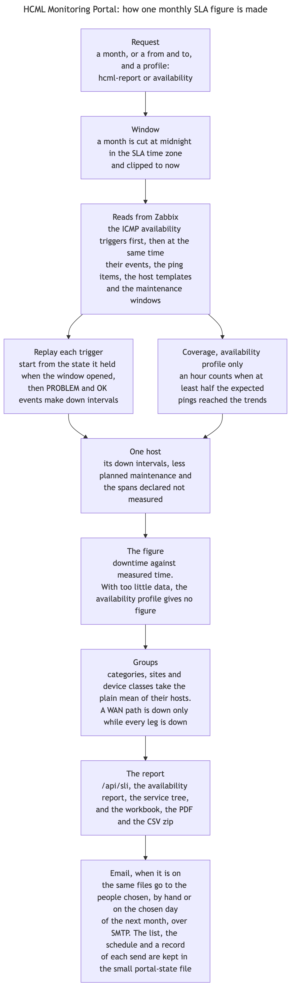

# Server: SLA and reports

| Who it is for | Reading time | Read first | Read next |
|---|---|---|---|
| Developers | about 55 min | [Server: network and capacity](server-network-and-capacity.md) | [Server: live and assistant](server-live-and-assistant.md) |

An SLA figure says what share of the time a device was up. HCML's Zabbix has no services configured, so Zabbix's own SLA engine has nothing to measure. The portal measures it instead, from the ICMP availability triggers that every device already carries, and calls the result the derived SLA. It is read-only and creates nothing in Zabbix. The engine is in `server/src/sli/`. The reports that sit on it, and the ones that read incident history, are in `server/src/services/`.

This is the most careful code in the server. Every figure the SLA pages show is a sum of seconds, and a mistake in it does not throw: it gives a percentage that looks right and is not. So the functions below are small and pure where they can be, and the tests hold their arithmetic.



## Two profiles

The engine measures in one of two ways, chosen with `profile` on `/api/sli`. The default is `availability`, set by `SLI_PROFILE`.

| | `hcml-report` | `availability` |
|---|---|---|
| What it is for | Reproduces HCML's own Availability Reports exactly | The strict figure |
| What counts as down | Only the trigger "High ICMP ping loss" (`SLI_REPORT_TRIGGERS`). That trigger is defined as loss under 100 percent, so it never fires for a device that is completely down | "Unavailable by ICMP ping" or "High ICMP ping loss" (`SLI_AVAILABILITY_TRIGGERS`) |
| Hours in which nothing was collected | Counted as up | Left out of the measurement |
| A host with too little data | Counted as 100 percent | No figure at all |
| A problem still open at month end | Clipped to the last second of the month | Counted to the end of the window, or to now for a month still running |

Both profiles leave out time inside a planned Zabbix maintenance window, from the downtime and the total alike. Both leave out the spans that `SLA_NO_DATA_WINDOWS` declares not measured: the strict profile drops them from the figure, and HCML's counts them as up, as it does any hour nothing was collected in. The target is `SLO_TARGET`, 99 percent by default, which is what every row of HCML's reports uses.

## The building blocks

### mergeIntervals, intersectIntervals and complementIntervals

`server/src/sli/intervals.ts`. The arithmetic on spans of time. An interval is `[start, end)` in Unix seconds.

<!-- gen:snippet server/src/sli/intervals.ts#mergeIntervals sha=ba87e3aff4c5 -->
`server/src/sli/intervals.ts:11-20`

```ts
export function mergeIntervals(intervals: Interval[]): Interval[] {
  const sorted = intervals.filter(([s, e]) => e > s).sort((a, b) => a[0] - b[0]);
  const out: Interval[] = [];
  for (const [s, e] of sorted) {
    const last = out[out.length - 1];
    if (last && s <= last[1]) last[1] = Math.max(last[1], e);
    else out.push([s, e]);
  }
  return out;
}
```
<!-- /gen -->

<!-- gen:snippet server/src/sli/intervals.ts#intersectIntervals sha=a015eda90e4b -->
`server/src/sli/intervals.ts:37-51`

```ts
export function intersectIntervals(a: Interval[], b: Interval[]): Interval[] {
  const x = mergeIntervals(a);
  const y = mergeIntervals(b);
  const out: Interval[] = [];
  let i = 0;
  let j = 0;
  while (i < x.length && j < y.length) {
    const s = Math.max(x[i][0], y[j][0]);
    const e = Math.min(x[i][1], y[j][1]);
    if (e > s) out.push([s, e]);
    if (x[i][1] < y[j][1]) i++;
    else j++;
  }
  return out;
}
```
<!-- /gen -->

<!-- gen:snippet server/src/sli/intervals.ts#complementIntervals sha=b1f97cb25f7f -->
`server/src/sli/intervals.ts:61-70`

```ts
export function complementIntervals(holes: Interval[], from: number, to: number): Interval[] {
  const out: Interval[] = [];
  let cursor = from;
  for (const [s, e] of mergeIntervals(clipIntervals(holes, from, to))) {
    if (s > cursor) out.push([cursor, s]);
    cursor = Math.max(cursor, e);
  }
  if (cursor < to) out.push([cursor, to]);
  return out;
}
```
<!-- /gen -->

1. `mergeIntervals` drops empty intervals, sorts the rest, and joins any that overlap or touch. Two problems open at the same time are one stretch of downtime, and this is what stops them being counted twice.
2. `intersectIntervals(a, b)` returns the parts of `a` that also lie inside `b`. It merges both sides first and then walks them together once.
3. `complementIntervals(holes, from, to)` is `[from, to)` less the holes. The engine uses it to turn "the spans that do not count" (planned maintenance, declared spans) into "the time that does".
4. The same file has `clipIntervals`, which cuts every interval to a window, and `totalSeconds`, which merges and adds.

Tests: `sli-engine.test.ts`.

### monthBounds

`server/src/sli/time.ts`. Cuts a calendar month in a named time zone.

<!-- gen:snippet server/src/sli/time.ts#zonedDayStart sha=6dcb107f8536 -->
`server/src/sli/time.ts:43-45`

```ts
export function zonedDayStart(year: number, month: number, day: number, tz: string): number {
  return zonedTime(year, month, day, 0, 0, tz);
}
```
<!-- /gen -->

<!-- gen:snippet server/src/sli/time.ts#monthBounds sha=838a5fe7b6b8 -->
`server/src/sli/time.ts:81-87`

```ts
export function monthBounds(month: string, tz: string): { from: number; to: number } {
  const [, y, m] = MONTH_RE.exec(parseMonth(month))!;
  const year = Number(y);
  const mon = Number(m);
  const next = mon === 12 ? { year: year + 1, mon: 1 } : { year, mon: mon + 1 };
  return { from: zonedMonthStart(year, mon, tz), to: zonedMonthStart(next.year, next.mon, tz) };
}
```
<!-- /gen -->

1. HCML's reports cut months at midnight in Asia/Jakarta, not in UTC. An event at 23:30 on the 31st belongs to that month, though its UTC clock already reads the 1st. The zone is `SLA_TIMEZONE`.
2. The offset comes from `Intl` and not from a fixed seven hours, so the zone stays a setting and a zone with daylight saving time is still right. `zonedTime` (which `zonedDayStart` calls with the hour and the minute at zero, and the monthly send uses for the time of day it was set to) works the offset out twice, because across a change of clocks the offset at the guess and the offset at the answer differ.
3. `monthBounds('2026-09', tz)` returns the start of September and the start of October, so a month is the interval `[from, to)`. `parseMonth` refuses anything that is not `YYYY-MM` with a 400.

Tests: `sli-time.test.ts`.

### fetchEventsSliced

`server/src/sli/events.ts`. Reads event history without ever accepting a cut-off page.

<!-- gen:snippet server/src/sli/events.ts#fetchEventsSliced sha=efcfa7d385d9 -->
`server/src/sli/events.ts:25-55`

```ts
export async function fetchEventsSliced<T extends { eventid: string }>(
  base: Record<string, unknown>,
  from: number,
  to: number,
  opts: SliceOptions = {},
): Promise<T[]> {
  const pageLimit = opts.pageLimit ?? PAGE_LIMIT;
  const minSlice = opts.minSliceSeconds ?? MIN_SLICE_SECONDS;
  if (to < from) return [];

  const rows = await zbx<T[]>('event.get', {
    ...base,
    time_from: from,
    time_till: to,
    sortfield: ['clock', 'eventid'],
    sortorder: 'ASC',
    limit: pageLimit,
  });
  if (rows.length < pageLimit) return rows;

  if (to - from < minSlice) {
    throw new ZabbixApiError(
      `event.get: more than ${pageLimit} events within ${to - from + 1} s, too dense to report on exactly.`,
    );
  }
  // Halves that do not overlap: an event exactly on `mid` belongs to the first.
  const mid = Math.floor((from + to) / 2);
  const first = await fetchEventsSliced<T>(base, from, mid, opts);
  const second = await fetchEventsSliced<T>(base, mid + 1, to, opts);
  return [...first, ...second];
}
```
<!-- /gen -->

1. One request for the newest 10,000 events overflowed at HCML's volume over 30 days, and Zabbix dropped the oldest ones. The report then gave impossible results: 59.6 percent at severity 3 and above, and 2.8 percent at severity 4 and above. So a full page is never taken as the answer.
2. The function asks for one slice in ascending clock order. If the answer is under the page limit (5,000) it is complete and is returned. If it is full, the window is halved at its middle and each half is read the same way. The halves do not overlap: an event exactly on the middle belongs to the first.
3. A slice shorter than a minute that is still full is an error, "too dense to report on exactly". An error is better than a partial answer that looks complete.

### fetchTrendsSliced and mapLimit

`server/src/sli/events.ts`. The same idea for `trend.get`, which Zabbix answers hourly.

<!-- gen:snippet server/src/sli/events.ts#TREND_MAX_ROWS sha=e83e2c682573 -->
`server/src/sli/events.ts:63-63`

```ts
export const TREND_MAX_ROWS = 35 * 745;
```
<!-- /gen -->

<!-- gen:snippet server/src/sli/events.ts#fetchTrendsSliced sha=cc8aa3a756d9 -->
`server/src/sli/events.ts:129-150`

```ts
export async function fetchTrendsSliced<T extends { itemid: string }>(
  itemids: string[],
  from: number,
  to: number,
  output: string[],
  opts: TrendSliceOptions<T> = {},
): Promise<T[]> {
  const slices = trendSlices(itemids, from, to, opts.maxRows);
  const parts = await mapLimit(slices, opts.parallel ?? 4, async (s) => {
    opts.onRequest?.();
    const rows = await zbx<T[]>('trend.get', {
      itemids: s.itemids,
      time_from: s.from,
      time_till: s.to,
      output,
    });
    if (!opts.onRows) return rows;
    opts.onRows(rows);
    return [];
  });
  return parts.flat();
}
```
<!-- /gen -->

<!-- gen:snippet server/src/sli/events.ts#mapLimit sha=3da1503e1e7c -->
`server/src/sli/events.ts:153-164`

```ts
export async function mapLimit<I, O>(items: I[], limit: number, fn: (item: I, index: number) => Promise<O>): Promise<O[]> {
  const out = new Array<O>(items.length);
  let next = 0;
  const workers = Array.from({ length: Math.max(1, Math.min(limit, items.length)) }, async () => {
    while (next < items.length) {
      const i = next++;
      out[i] = await fn(items[i], i);
    }
  });
  await Promise.all(workers);
  return out;
}
```
<!-- /gen -->

1. A request may return at most `TREND_MAX_ROWS` rows, counted as items times hour marks: 35 items over a 31-day month, which is known to work against HCML's Zabbix. A year of the same items in one request ran Zabbix's PHP out of memory, and the API reports that as a bare "HTTP 500".
2. `trendSlices` cuts the work into chunks of items and into windows that start and end on hour marks and do not overlap, so every trend row, which is stamped on the hour, falls in exactly one. A request that fits is sent whole.
3. `fetchTrendsSliced` sends the slices through `mapLimit`, which runs at most `parallel` of them at once (`SLI_ZBX_PARALLEL`, 4 by default) and returns the results in input order.
4. `onRows` takes each request's rows as they arrive and keeps nothing, so a caller that only adds them up never holds them all. A year of hourly rows for a few hundred items is millions of objects.

Tests: `sli-engine.test.ts`.

### initialState and intervalsFor

`server/src/sli/engine.ts`. Replay one trigger's history across the window.

<!-- gen:snippet server/src/sli/engine.ts#initialState sha=8b2b87698a8c -->
`server/src/sli/engine.ts:206-216`

```ts
export function initialState(
  eventsInWindow: TriggerEvent[],
  trigger: { value: string; lastchange: string },
  end: number,
  firstLater?: number,
  lastBefore?: number,
): boolean {
  if (eventsInWindow.length) return eventsInWindow[0].value === 1 && lastBefore !== undefined ? lastBefore === 1 : eventsInWindow[0].value === 0;
  if (Number(trigger.lastchange) < end || firstLater === undefined) return trigger.value === '1';
  return firstLater === 0;
}
```
<!-- /gen -->

<!-- gen:snippet server/src/sli/engine.ts#intervalsFor sha=f0b5907906b6 -->
`server/src/sli/engine.ts:170-193`

```ts
export function intervalsFor(
  events: TriggerEvent[],
  initialProblem: boolean,
  from: number,
  endClip: number,
): { intervals: Interval[]; incidents: number } {
  const intervals: Interval[] = [];
  let open: number | null = initialProblem ? from : null;
  let incidents = initialProblem ? 1 : 0;
  for (const ev of events) {
    if (ev.clock < from || ev.clock > endClip) continue;
    if (ev.value === 1) {
      if (open === null) {
        open = ev.clock;
        incidents++;
      }
    } else if (open !== null) {
      if (ev.clock > open) intervals.push([open, ev.clock]);
      open = null;
    }
  }
  if (open !== null && endClip > open) intervals.push([open, endClip]);
  return { intervals, incidents };
}
```
<!-- /gen -->

1. The events of a trigger say when it changed state. To replay them you need the state it was in when the window opened. `initialState` works that out: its first event inside the window says it (an OK first means it was in problem, and a PROBLEM first means it was not, except for a trigger set to raise a PROBLEM event on every evaluation, whose first event can be a repeat: for those the last event before the window is read, and it says what the state was), a trigger with no events inside and unchanged since before the window is in its current state, and a trigger that changed only after the window is asked for its first later event, which says what it changed from.
2. `intervalsFor` then walks the events in order. A PROBLEM opens a stretch, the next OK closes it, and a repeated PROBLEM while one is open is the same outage, not a second one. A stretch still open at the end is closed at `endClip`. The function also counts the incidents.
3. Both are pure, with no Zabbix in them, so a test gives them a list of events and checks the seconds.

### wasMeasured and coveredFromTrends

`server/src/sli/engine.ts`. Two judgements about data.

<!-- gen:snippet server/src/sli/engine.ts#wasMeasured sha=212711fcefd8 -->
`server/src/sli/engine.ts:251-254`

```ts
export function wasMeasured(items: { state?: string; lastclock?: string }[], hostDisabled: boolean): boolean {
  if (!items.length) return true;
  return !items.every((i) => i.lastclock === '0' && (i.state === '1' || hostDisabled));
}
```
<!-- /gen -->

<!-- gen:snippet server/src/sli/engine.ts#coveredFromTrends sha=59962f9b7fce -->
`server/src/sli/engine.ts:260-269`

```ts
export function coveredFromTrends(
  rows: { clock: number; num: number }[],
  delaySeconds: number,
  from: number,
  end: number,
): Interval[] {
  const expected = 3600 / delaySeconds;
  const hours = rows.filter((r) => r.num >= 0.5 * expected).map((r): Interval => [r.clock, r.clock + 3600]);
  return intersectIntervals(hours, [[from, end]]);
}
```
<!-- /gen -->

1. `wasMeasured` says whether a host's ping was ever collected, from its ping items as they are now. A host whose every ping item has no value and is not being collected (unsupported, which at HCML means there is no interface to ping, or the host is disabled) was never measured. HCML's method still counts such a host as 100 percent, so the figures do not change. The flag only says so, and the page can say "never measured" beside it.
2. `coveredFromTrends` finds the hours in which an item really collected. An hour counts when at least half of the samples its update interval promises are in the trends. The result is the set of those hours, cut to the window. The strict profile measures only inside them.

### maintenanceByHost

`server/src/sli/maintenance.ts`. Turns Zabbix's maintenance periods into windows for each host.

<!-- gen:snippet server/src/sli/maintenance.ts#maintenanceByHost sha=09d686a55657 -->
`server/src/sli/maintenance.ts:119-172`

```ts
export async function maintenanceByHost(
  from: number,
  to: number,
  tz: string,
  onCall: () => void,
): Promise<Map<string, Interval[]>> {
  onCall();
  const all = await zbx<ZMaintenance[]>('maintenance.get', {
    output: ['maintenanceid', 'active_since', 'active_till'],
    selectTimeperiods: 'extend',
    selectHosts: ['hostid'],
    selectHostGroups: ['groupid'],
  });
  const relevant = all.filter((m) => Number(m.active_till) > from && Number(m.active_since) < to);
  const groupids = [...new Set(relevant.flatMap((m) => (m.hostgroups ?? []).map((g) => g.groupid)))];
  const hostsByGroup = new Map<string, string[]>();
  if (groupids.length) {
    type ZGroup = { groupid: string; name?: string; hosts?: { hostid: string }[] };
    const idsOf = (g: ZGroup) => (g.hosts ?? []).map((h) => h.hostid);
    onCall();
    const named = await zbx<ZGroup[]>('hostgroup.get', { groupids, output: ['groupid', 'name'], selectHosts: ['hostid'] });
    for (const g of named) hostsByGroup.set(g.groupid, idsOf(g));
    // Zabbix selects the groups nested under a group a maintenance names ("Parent/Child"), with their hosts (BK-46).
    const parents = named.filter((g) => typeof g.name === 'string' && g.name !== '');
    if (parents.length) {
      onCall();
      const below = await zbx<ZGroup[]>('hostgroup.get', {
        search: { name: parents.map((g) => `${g.name}/`) },
        searchByAny: true,
        startSearch: true,
        output: ['groupid', 'name'],
        selectHosts: ['hostid'],
      });
      // Zabbix's search ignores case; a group name does not.
      for (const parent of parents) {
        for (const g of below) {
          if (g.name?.startsWith(`${parent.name}/`)) hostsByGroup.set(parent.groupid, [...(hostsByGroup.get(parent.groupid) ?? []), ...idsOf(g)]);
        }
      }
    }
  }

  const byHost = new Map<string, Interval[]>();
  for (const m of relevant) {
    const windows = maintenanceWindows(m, from, to, tz);
    if (!windows.length) continue;
    const hostids = new Set([
      ...(m.hosts ?? []).map((h) => h.hostid),
      ...(m.hostgroups ?? []).flatMap((g) => hostsByGroup.get(g.groupid) ?? []),
    ]);
    for (const id of hostids) byHost.set(id, mergeIntervals([...(byHost.get(id) ?? []), ...windows]));
  }
  return byHost;
}
```
<!-- /gen -->

1. It makes one `maintenance.get`, and one `hostgroup.get` only when a maintenance names host groups, with a second to find the groups nested under those, whose names start with a named group's name and a slash. A maintenance reaches the hosts it names, the hosts in its groups and the hosts in the groups nested under them, as in Zabbix (BK-46). Zabbix's search ignores case and a group name does not, so the name is checked again, in full and by case.
2. `maintenanceWindows` (above it in the file) turns each maintenance's schedule into concrete windows inside the range. A one-time period runs from its start date. Daily, weekly and monthly periods start `start_time` seconds after midnight in the SLA zone. Every occurrence is cut to the maintenance's own active dates.
3. Two limits are stated in the report's basis. The periods are read as Zabbix defines them now, so an edited or deleted period changes past months too. And a maintenance's tag filter, which only narrows which problems Zabbix suppresses, is ignored: a host in maintenance is out of the measurement.

Tests: `sli-maintenance.test.ts`.

## The engine: computeSli

`server/src/sli/engine.ts`. The one function that makes a report. It is 254 lines, so it is quoted in parts.

<!-- gen:snippet server/src/sli/engine.ts#computeSli lines=9-28 sha=ae21acdaf1f8 -->
`server/src/sli/engine.ts:561-580` (lines 9 to 28 of computeSli)

```ts
const { from, to } = req.month
  ? monthBounds(req.month, tz)
  : { from: req.from as number, to: req.to as number };
if (!Number.isFinite(from) || !Number.isFinite(to) || from >= to) {
  throw new BadRequestError('A month (YYYY-MM) or a from/to window is required.');
}
checkPeriodStart(from, now);

const end = Math.min(to, now);
const closed = to <= now;
const window = end - from;
// Spans declared not measured (SLA_NO_DATA_WINDOWS) are a gap in both profiles: left out of the strict figure,
// counted as up in HCML's, as an hour nothing was collected in is.
const declared = mergeIntervals(clipIntervals(config.sla.noDataWindows, from, end));
const outsideDeclared = complementIntervals(declared, from, end);
// HCML's report clips a problem still open at month end to the last second.
const endClip = !strict && closed ? to - 1 : end;
const counter: Counter = { calls: 0, events: 0, trendRows: 0 };
const triggerNames = strict ? config.sla.availabilityTriggers : config.sla.reportTriggers;

```
<!-- /gen -->

1. A request names a month, or a `from` and a `to`. Anything else, a window that has not started, or one that starts more than 400 days back (Zabbix keeps events for about a year) is a 400 with a plain message. The two refusals are made by `checkPeriodStart` in `server/src/sli/time.ts`, which the email route also calls before it logs in to a mail server.
2. `end` is the part of the window that has happened, and `closed` says whether the whole window is in the past. A month that has not ended is measured as far as it has gone.
3. `declared` is the spans from `SLA_NO_DATA_WINDOWS` inside the window, and `outsideDeclared` is the rest. `endClip` is where an open problem is cut off: the last second of a closed month for HCML's profile, and `end` for the strict one.
4. `triggerNames` is the list of triggers that count, which is the difference between the two profiles.

<!-- gen:snippet server/src/sli/engine.ts#computeSli lines=30-37 sha=ae21acdaf1f8 -->
`server/src/sli/engine.ts:582-589` (lines 30 to 37 of computeSli)

```ts
// HCML's report lists too.
const triggers = await counted<ZTrigger[]>(counter, 'trigger.get', {
  output: ['triggerid', 'description', 'value', 'lastchange', 'status', 'type'],
  filter: { description: triggerNames },
  templated: false,
  selectHosts: ['hostid', 'name', 'status'],
});

```
<!-- /gen -->

<!-- gen:snippet server/src/sli/engine.ts#computeSli lines=49-81 sha=ae21acdaf1f8 -->
`server/src/sli/engine.ts:601-633` (lines 49 to 81 of computeSli)

```ts
  hostids.length
    ? counted<{ hostid: string; parentTemplates?: { name: string }[] }[]>(counter, 'host.get', {
        hostids,
        output: ['hostid'],
        selectParentTemplates: ['name'],
      })
    : Promise.resolve([]),
  // Every ICMP item of the reported hosts, in both profiles: `measured` needs
  // their state, and the strict profile's coverage their delays.
  hostids.length
    ? counted<ZIcmpItem[]>(counter, 'item.get', {
        hostids,
        search: { key_: 'icmpping' },
        startSearch: true,
        output: ['itemid', 'hostid', 'key_', 'delay', 'value_type', 'state', 'lastclock'],
      })
    : Promise.resolve([]),
  triggers.length
    ? fetchEventsSliced<ZEvent>(
        {
          source: 0,
          object: 0,
          objectids: triggers.map((t) => t.triggerid),
          value: [0, 1],
          output: ['eventid', 'objectid', 'clock', 'value'],
        },
        from,
        end - 1,
      )
    : Promise.resolve([]),
  maintenanceByHost(from, end, tz, () => counter.calls++),
]);
counter.calls++;
```
<!-- /gen -->

1. The first read finds the triggers by name, on real hosts only (`templated: false`), with their hosts, disabled ones included, which HCML's report lists too.
2. Then four reads run at the same time: the hosts' parent templates, which give each host its category, every ping item of those hosts, the events of all those triggers in the window, and the maintenance windows. The events go through `fetchEventsSliced`.
3. A trigger with no events in the window that changed only afterwards needs its first later event to know what state it was in. `firstEventsAfter` searches for it in widening steps, a week, a month, four months and a year, until it is found or reaches now. A trigger set to raise a PROBLEM event on every evaluation whose first event in the window is a PROBLEM may be repeating one that began before the window, so for those triggers only `lastEventsBefore` reads the last event before the window, one `event.get` each, and `initialState` uses it.
4. In the strict profile, `icmpCoverage` then reads the trends of the ping items and works out, for each host, the hours in which it collected. It fills the last hour or two, which have no trends yet, from raw history, bounded to six hours; when trends stopped being written for longer than that, only the hour in progress is read, so that hour is not counted as no data. It also finds the estate's gaps: hours in which fewer than 10 percent of the items that collected anything collected data. A gap is the estate's, not a host's, so a host is not blamed for an hour nobody collected in.

<!-- gen:snippet server/src/sli/engine.ts#computeSli lines=122-153 sha=ae21acdaf1f8 -->
`server/src/sli/engine.ts:674-705` (lines 122 to 153 of computeSli)

```ts

const hosts: SliHost[] = [];
const downByHost = new Map<string, Interval[]>();
const coveredByHost = new Map<string, Interval[]>();
for (const [hostid, meta] of hostMeta) {
  const all: Interval[] = [];
  let incidents = 0;
  for (const t of meta.triggers) {
    const evs = eventsByTrigger.get(t.triggerid) ?? [];
    const initial = initialState(evs, t, end, firstLater.get(t.triggerid), lastBefore.get(t.triggerid));
    const r = intervalsFor(evs, initial, from, endClip);
    all.push(...r.intervals);
    incidents += r.incidents;
  }
  const merged = mergeIntervals(all);
  const category = categoryByHost.get(hostid) ?? 'Other';

  // Planned maintenance leaves the measurement entirely, as a no-data hour
  // does in the strict profile: neither down nor counted in the total.
  const planned = clipIntervals(maintenance.get(hostid) ?? [], from, end);
  const plannedSec = totalSeconds(planned);
  const outsidePlanned = complementIntervals(planned, from, end);
  const measurable = window - plannedSec;

  let covered: Interval[];
  if (strict) covered = intersectIntervals(coverage!.byHost.get(hostid) ?? [], outsidePlanned);
  else covered = outsidePlanned;
  const measured = intersectIntervals(intersectIntervals(merged, covered), outsideDeclared);
  const downtime = totalSeconds(measured);
  const coveredSec = totalSeconds(covered);
  const cov = measurable > 0 ? coveredSec / measurable : 0;
  const nodata = strict && (coveredSec === 0 || cov < config.sla.minCoverage);
```
<!-- /gen -->

<!-- gen:snippet server/src/sli/engine.ts#computeSli lines=154-178 sha=ae21acdaf1f8 -->
`server/src/sli/engine.ts:706-730` (lines 154 to 178 of computeSli)

```ts
const denominator = strict ? coveredSec : measurable;
const sli = nodata || denominator <= 0 ? null : Math.max(0, 100 * (1 - downtime / denominator));

downByHost.set(hostid, measured);
coveredByHost.set(hostid, covered);
hosts.push({
  hostid,
  name: meta.name,
  hostStatus: meta.status,
  site: siteFromHostName(meta.name),
  category,
  deviceClass: deviceClass(meta.name, category),
  triggerids: meta.triggers.map((t) => t.triggerid),
  sli,
  downtime,
  window,
  covered: coveredSec,
  maintenance: plannedSec,
  coverage: cov,
  incidents,
  longest: measured.reduce((m, [s, e]) => Math.max(m, e - s), 0),
  dataStatus: nodata
    ? 'nodata'
    : strict && coveredSec < 0.95 * Math.max(0, estateSeconds - plannedSec)
      ? 'partial'
```
<!-- /gen -->

1. This is the loop over the hosts. For each trigger of a host it takes the initial state, replays the events, and collects the down intervals. They are merged, so a host with two triggers in problem together is counted once.
2. `planned` is the host's maintenance inside the window. `measurable` is the window less that. In the strict profile `covered` is the hours the host collected, less the maintenance. In HCML's profile it is everything outside the maintenance, since a missing hour counts as up.
3. `measured` is the down intervals that fall inside `covered` and outside the declared spans. `downtime` is its seconds. The denominator is `covered` for the strict profile and `measurable` for HCML's.
4. The figure is `100 * (1 - downtime / denominator)`, never below zero. It is null, with no figure, when the strict profile has no covered time or less than `SLI_MIN_COVERAGE` (half) of the measurable time, or when the denominator is zero.
5. The row carries the figure and its reasons: the downtime, the window, the covered seconds, the maintenance seconds, the coverage, the incidents, the longest outage, and a `dataStatus` of `ok`, `partial` (the host collected less than 95 percent of what the estate did) or `nodata`. `meeting` compares the figure with the target, and `errorBudget` is the seconds of downtime the target still allows, which is negative when it is missed.

After the loop the hosts are sorted, with the missing figures last and the worst first, and grouped by category, by site and by device class with `aggregate`, which takes the plain mean of the hosts that have a figure, as HCML's own reports do for every total. `buildWanPaths` and, in the strict profile, `webScenarios` follow, and the result is the `SliReport` with `stats` that count the Zabbix calls, the events and the milliseconds.

Tests: `sli-engine.test.ts` for the arithmetic, and `sli-cache.test.ts` for the cache around it.

### buildWanPaths

`server/src/sli/engine.ts`. Pairs the legs of a redundant WAN path.

<!-- gen:snippet server/src/sli/engine.ts#buildWanPaths sha=f10664c15cd0 -->
`server/src/sli/engine.ts:830-874`

```ts
function buildWanPaths(
  hosts: SliHost[],
  downByHost: Map<string, Interval[]>,
  coveredByHost: Map<string, Interval[]>,
  window: number,
  strict: boolean,
  estateSeconds: number,
): SliPath[] {
  const byPath = new Map<string, { legs: SliHost[]; legIds: string[] }>();
  for (const h of hosts) {
    const key = wanPairKey(h.name);
    if (!key) continue;
    const row = byPath.get(key.path) ?? { legs: [], legIds: [] };
    row.legs.push(h);
    row.legIds.push(key.leg);
    byPath.set(key.path, row);
  }
  const paths: SliPath[] = [];
  for (const [path, { legs, legIds }] of byPath) {
    const nodata = legs.some((l) => l.dataStatus === 'nodata');
    let covered: Interval[] = coveredByHost.get(legs[0].hostid) ?? [];
    let down: Interval[] = downByHost.get(legs[0].hostid) ?? [];
    for (const leg of legs.slice(1)) {
      covered = intersectIntervals(covered, coveredByHost.get(leg.hostid) ?? []);
      down = intersectIntervals(down, downByHost.get(leg.hostid) ?? []);
    }
    const coveredSec = strict ? totalSeconds(covered) : window;
    const downtime = totalSeconds(down);
    const coverage = window > 0 ? Math.min(1, coveredSec / window) : 0;
    const sli = nodata || coveredSec <= 0 ? null : Math.max(0, 100 * (1 - downtime / coveredSec));
    paths.push({
      key: `wan:${path}`,
      name: path,
      site: legs[0].site,
      legs: legs
        .map((l, i) => ({ hostid: l.hostid, name: l.name, leg: legIds[i], sli: l.sli, dataStatus: l.dataStatus }))
        .sort((a, b) => naturalCompare(a.leg, b.leg)),
      sli,
      downtime,
      coverage,
      dataStatus: nodata ? 'nodata' : strict && coveredSec < 0.95 * estateSeconds ? 'partial' : 'ok',
    });
  }
  return paths.sort((a, b) => naturalCompare(a.name, b.name));
}
```
<!-- /gen -->

1. `INET : SAMPANG WAN 1` and `WAN 2` are two legs of one path, found by `wanPairKey` from the host names.
2. A path is down only while every leg is down. The code takes the intersection of every leg's down intervals, and the intersection of what every leg covered. That is what a redundant pair is for, and the downtime of a path is therefore never more than the downtime of its best leg.
3. A path has no figure when any of its legs has none.

## The derived service tree

### buildDerivedTree

`server/src/sli/tree.ts`. Builds a service tree out of the estate, for a Zabbix that has no services of its own. It has the same shape as `/api/services`, so the Services page draws either with one component.

<!-- gen:snippet server/src/sli/tree.ts#buildDerivedTree lines=30-48 sha=dceda374b894 -->
`server/src/sli/tree.ts:101-119` (lines 30 to 48 of buildDerivedTree)

```ts
const hostNode = (h: SliHost): DerivedServiceNode => {
  const open = (problemsByHost.get(h.hostid) ?? []).sort((a, b) => SEVERITY_ORDER(b) - SEVERITY_ORDER(a));
  return finish({
    serviceid: `derived:host:${h.hostid}`,
    name: h.name,
    kind: 'host',
    hostid: h.hostid,
    status: open.length ? Number(open[0].severity) : -1,
    algorithm: 'derived',
    tags: [],
    problems: open.slice(0, 5).map((p) => ({ eventid: p.eventid, name: p.name, severity: p.severity })),
    sla: slaFor(h.sli, h.errorBudget, target),
    children: [],
    worst: -1,
    descendants: 0,
    dataStatus: h.dataStatus,
    coverage: h.coverage,
  });
};
```
<!-- /gen -->

<!-- gen:snippet server/src/sli/tree.ts#buildDerivedTree lines=169-195 sha=dceda374b894 -->
`server/src/sli/tree.ts:240-266` (lines 169 to 195 of buildDerivedTree)

```ts
  const children = businessHosts.length || webNodes.length ? [business, ...siteNodes] : siteNodes;
  const root = groupNode('derived:estate', 'HCML estate', 'root', report.hosts, children, report.overall);

  let total = 0;
  let degraded = 0;
  const count = (n: DerivedServiceNode) => {
    total++;
    if (n.status >= 0) degraded++;
    n.children.forEach(count);
  };
  count(root);

  return {
    tree: [root],
    total,
    degraded,
    worst: root.worst,
    source: 'derived',
    label: report.label,
    month,
    profile: report.profile,
    target,
    closed: report.closed,
    gaps: report.gaps,
    noDataWindows: report.noDataWindows,
  };
}
```
<!-- /gen -->

1. The tree is the estate at the root, then "Business services" (the web checks and the `WEB :` and `SERVER :` hosts), then one node for each site, then each site's device classes, then the hosts. In a site, the WAN links come first and their legs are grouped into their paths. Hosts with no site go under "Unassigned".
2. `hostNode` makes the leaf for a host. Its status is the severity of its worst open problem, or -1 when it has none, and it carries the host's SLA for the month and its data status.
3. Every group node takes its figure from `aggregate` over its hosts, and `finish` fills in the worst status below it, the number of descendants, and the top five problems of its children when it has none of its own.
4. The tree is the root with its totals, and says where it comes from: `source: 'derived'`, the month, the profile, the target, whether the month is closed, and the gaps. `getDerivedServices`, at the end of the file, reads the month's report and the open problems and builds it.

Tests: `api-hygiene.test.ts` checks its shape against the API description.

## Caching and the file export

### getMonthlySli

`server/src/services/sli.ts`. The one place a report is asked for, so that every caller shares it.

<!-- gen:snippet server/src/services/sli.ts#getMonthlySli sha=0e3319c525b3 -->
`server/src/services/sli.ts:35-49`

```ts
export function getMonthlySli(month: string, profile: SliProfile): Promise<SliReport> {
  const { from, to } = monthBounds(month, config.sla.timezone);
  const now = Math.floor(Date.now() / 1000);
  // Before the gate: a month nobody can report is refused at once, and does not wait for a place behind cold months (BK-50).
  checkPeriodStart(from, now);
  // Three phases, each with its own key: a report computed while the month was still running, or in the minutes after it
  // ended while Zabbix still gets its last values (the monthly send waits as long), must not be kept for a day as the final figure.
  const phase = to + SETTLE_SECONDS <= now ? 'closed' : to <= now ? 'settling' : 'open';
  const closed = phase === 'closed';
  const ttl = closed ? 86_400_000 : 300_000;
  const key = `derived-sli:${profile}:${month}:${phase}`;
  // A closed month costs a full recompute and cannot change: pinned, so a run
  // of graph keys cannot push it out of the cache.
  return cached(key, ttl, () => sliReads.run(() => computeSli({ month, profile })), { staleMs: ttl, staleIfError: true, pin: closed });
}
```
<!-- /gen -->

1. A closed month cannot change once Zabbix has had ten minutes (`SETTLE_SECONDS`) for its last values, so its report is kept a day and pinned, which keeps a run of graph keys from pushing it out of the cache. The current month moves, and so do the ten minutes after it, so those are kept five minutes. A report that is not cached is computed behind `sliReads`, a gate of two (`SLI_AT_ONCE`), so that a caller who asks for every month of both profiles at once starts two reads and the rest wait (BK-50); a cached report does not wait, and two callers for one key still share one computation.
2. For as long again after that, the old report is answered at once while a new one is computed in the background, and if the new one fails the old one is served. A report takes seconds to compute, so nobody should wait for it twice.
3. The key holds the phase as well as the month: `open`, `settling` (the month has ended and Zabbix is still getting its last values, which the monthly send waits for) or `closed`. A report computed in the first two must not be kept for a day as that month's final figure.
4. A month that cannot be reported, one that has not started or is older than about a year, is refused with a 400 before the gate (`checkPeriodStart`), so it never waits for a place behind cold months. `forgetMonthlySli` drops what is kept for a month, in both methods and every phase, and the email path calls it when a report came back empty, so the next try reads Zabbix again (BK-51).
5. `parseProfile` in the same file turns the `profile` query value into a profile, or the default, or a 400.

Tests: `sli-cache.test.ts` and `sla-summary.test.ts`.

### fileFor

`server/src/services/sliExport.ts`. The monthly SLA as a PDF or a workbook, from the figures already in the cache.

<!-- gen:snippet server/src/services/sliExport.ts#fileFor sha=a29445e06c39 -->
`server/src/services/sliExport.ts:45-56`

```ts
export function fileFor(format: Format, strict: SliReport, hcml: SliReport, now: Date, style: ReportStyle = DEFAULT_STYLE): Buffer {
  let byHcml = built.get(strict);
  if (!byHcml) built.set(strict, (byHcml = new WeakMap()));
  let byKey = byHcml.get(hcml);
  if (!byKey) byHcml.set(hcml, (byKey = new Map()));
  const key = keyOf(format, style);
  const kept = byKey.get(key);
  if (kept && now.getTime() - kept.at < REUSE_MS) return kept.body;
  const body = FORMATS[format].build(buildSlaReportDoc(strict, hcml, now, style), now, style);
  byKey.set(key, { at: now.getTime(), body });
  return body;
}
```
<!-- /gen -->

1. A file holds both methods side by side, so it takes both reports, each through `getMonthlySli`. A report the page has already loaded is not computed again.
2. A build costs about 10 ms of CPU, and a burst of requests would run them back to back with the whole server waiting. So a repeat inside `REUSE_MS`, ten seconds, shares the file.
3. The files are kept in `WeakMap`s keyed on the two report objects themselves. When a report is refreshed it is a new object, so a new file is built, and nothing outlives the reports it came from.
4. The builders, `buildSlaReportDoc`, `buildPdf`, `buildXlsx` and `buildCsv`, are in `server/src/export/` and have a chapter of their own, the one called Server: export. `FORMATS` also holds each format's type and the end of its file name (`_csv.zip` for the CSV zip), so the route and the email name a file the same way.
5. The key of a kept file is the format and the style. A PDF or a workbook asked for with the other CSV separator is the same file, so the separator is left out of its key; a CSV has it in.

Tests: `export-route.test.ts`.

## Reports built from incident history

### fetchIncidents

`server/src/services/incidents.ts`. Reads the problem history of a window once, for the availability report and the alert-noise report.

<!-- gen:snippet server/src/services/incidents.ts#fetchIncidents lines=5-26 sha=9294a61a45ac -->
`server/src/services/incidents.ts:206-227` (lines 5 to 26 of fetchIncidents)

```ts
const query = problemEventQuery(minSeverity);
const lookFrom = from - OPEN_AT_START_LOOKBACK;
// Every PROBLEM event in the window, in slices, never a silently cut page: a single "newest
// 10,000" request would drop the oldest events at HCML's volume, and the report would then
// compute impossible figures. Then the same for the month before it, and the problems still open
// from before that. And the window's recovery events, which also say when most problems ended.
const [inWindow, before, older, recoveries] = await Promise.all([
  fetchEventsSliced<ProblemEvent>(query, from, to),
  fetchEventsSliced<ProblemEvent>(query, lookFrom, from - 1),
  stillOpenBefore(lookFrom - 1, minSeverity),
  fetchEventsSliced<RecoveryEvent>(recoveryEventQuery, from, to),
]);

// Keyed by id: a problem raised between the reads could come back from two.
const events = new Map<string, ProblemEvent>();
for (const p of [...older, ...before, ...inWindow]) events.set(p.eventid, p);

// Outages that began before the look-back and ended inside the window.
const explained = new Set<string>();
for (const p of events.values()) if (p.r_eventid && p.r_eventid !== '0') explained.add(p.r_eventid);
const ended = await endedInWindow(recoveries, explained, lookFrom, minSeverity);
for (const p of ended.problems) events.set(p.eventid, p);
```
<!-- /gen -->

<!-- gen:snippet server/src/services/incidents.ts#fetchIncidents lines=47-75 sha=9294a61a45ac -->
`server/src/services/incidents.ts:248-276` (lines 47 to 75 of fetchIncidents)

```ts
const incidents: Incident[] = [];
for (const p of qualifying) {
  const h = p.hosts?.[0];
  if (!h) continue;
  const start = Math.max(Number(p.clock), from);
  const resolved = Boolean(p.r_eventid && p.r_eventid !== '0');
  const rec = resolved ? recoveryClock[p.r_eventid as string] : undefined;
  // From before the window with no recovery on record: not assumed open.
  if (Number(p.clock) < from && resolved && rec === undefined) continue;
  const end = Math.min(rec ?? to, to); // still open ⇒ counts up to now
  if (end <= start) continue;

  incidents.push({
    eventid: p.eventid,
    objectid: p.objectid,
    host: h.name,
    hostid: h.hostid,
    name: p.name ?? '',
    severity: p.severity,
    start,
    began: Number(p.clock),
    end,
    resolved,
    acknowledged: p.acknowledged === '1',
  });
}

// A floor, not an exact figure, only when more outages needed a lookup than LONG_OUTAGE_LOOKUPS allows.
return { incidents, from, to, truncated: ended.partial };
```
<!-- /gen -->

1. A problem that began before the window and is still open belongs to it, and finding it is the hard part. Four reads run at the same time: the PROBLEM events inside the window, the same for the month before it (`OPEN_AT_START_LOOKBACK`), the problems still open from before that (`stillOpenBefore`, which asks `problem.get` for unresolved problems and fetches their events by id), and the recovery events inside the window.
2. `endedInWindow` then finds the outages that began before the look-back and ended inside the window. A recovery carries no link to its problem, so it starts from the recoveries that no problem points at, asks which triggers they belong to and which are above the severity floor, and asks for each trigger's last earlier problem, one request each. It does this for at most `LONG_OUTAGE_LOOKUPS` (200) triggers, and past that the report says `truncated`, meaning its figures are a floor.
3. Recovery times for problems whose recovery lies outside the window are read by id, in chunks of 2,000.
4. Each incident starts at the later of its own start and the window's start, ends at its recovery or at the window's end, and says whether it was resolved and acknowledged. A problem from before the window whose recovery cannot be found is not assumed open.

### Availability

`server/src/services/availability.ts`. How much of a window each host spent in a problem state.

<!-- gen:snippet server/src/services/availability.ts#getDerivedAvailabilityReport sha=c3a143da5724 -->
`server/src/services/availability.ts:166-175`

```ts
export function getDerivedAvailabilityReport(opts: { days: number; month?: string; profile: SliProfile; minSeverity: number }) {
  const { days, month, profile, minSeverity } = opts;
  if (month) return getDerivedAvailability({ days, month, profile, minSeverity });
  return cached(
    `avail:${profile}:${days}`,
    REPORT_TTL,
    () => heavy.run(() => getDerivedAvailability({ days, profile, minSeverity })),
    staleReport(REPORT_TTL),
  );
}
```
<!-- /gen -->

1. There are two bases. `availability`, the default, goes through the SLA engine: a device is down while its ICMP triggers are in problem, and hours with no data are left out. A month is served from `getMonthlySli`. A rolling window of days is computed by `computeSli` with a `from` and a `to`.
2. `all-problems` is the original report. Any open problem at or above the severity floor counts as downtime, read through `fetchIncidents`, with the overlaps merged so none is counted twice. The floor is `AVAILABILITY_MIN_SEVERITY`, 2 by default, because HCML's estate raises "High ICMP ping loss" at severity 2 on essentially every trigger.
3. A rolling-window answer is kept `REPORT_TTL`, two minutes, through the `heavy` gate and with `staleReport`. A month uses the cache of the engine.

Tests: `incidents-before-window.test.ts`.

### getNoise and getNoiseReport

`server/src/services/noise.ts`. Separates a noisy trigger from a real recurring fault. A count of firings alone cannot: forty firings that clear themselves in 90 seconds are noise, and forty that take an hour each are a fault.

<!-- gen:snippet server/src/services/noise.ts#getNoise lines=13-32 sha=aedff33b3247 -->
`server/src/services/noise.ts:76-95` (lines 13 to 32 of getNoise)

```ts
const durations = list.map((i) => i.end - i.start);
const acked = list.filter((i) => i.acknowledged).length;
const med = median(durations);
// Not Math.max(...durations): a call with about 125,000 arguments throws, and one flapping trigger gets there.
const longest = durations.reduce((a, b) => (b > a ? b : a), 0);
const stillOpen = list.some((i) => !i.resolved);
// An open problem's real age, not the part inside the window: a 1 day window holds at most a day of it.
let openAge = 0;
for (const i of list) if (!i.resolved) openAge = Math.max(openAge, i.end - i.began);
const ackRate = acked / list.length;

const flags: NoiseFlag[] = [];
// Fires often and clears itself before anyone could act.
if (list.length >= minCount && med < shortSeconds) flags.push('flapping');
// Fires often and nobody has ever acknowledged it.
if (list.length >= minCount && acked === 0) flags.push('unactioned');
// Not noise: one condition nobody has cleared.
if (stillOpen && Math.max(longest, openAge) > CHRONIC_SECONDS) flags.push('chronic');

// The newest incident carries the most current name/severity.
```
<!-- /gen -->

<!-- gen:snippet server/src/services/noise.ts#getNoiseReport sha=cb48a2d3342c -->
`server/src/services/noise.ts:149-157`

```ts
export async function getNoiseReport(days: number, minSeverity: number, top: number) {
  const report = await cached(
    `noise:${days}:${minSeverity}`,
    REPORT_TTL,
    () => heavy.run(() => getNoise(days, minSeverity)),
    staleReport(REPORT_TTL),
  );
  return topNoise(report, top);
}
```
<!-- /gen -->

1. Each trigger gets its incidents from `fetchIncidents`, and then its median duration, which is the median and not the mean so that one long outlier does not hide forty short firings, the count of short ones, the share that were acknowledged, and its longest duration. The longest is found with a loop and not with `Math.max(...list)`, which throws at about 125,000 arguments: one trigger that flaps every minute for three months would otherwise turn the whole report into a 500.
2. Three flags say what to look at. `flapping` is `NOISE_MIN_COUNT` (5) or more firings with a median under `NOISE_SHORT_SECONDS` (300). `unactioned` is the same count with none acknowledged. `chronic` is a trigger still open for more than a day, whether by its longest incident or by the real age of the open one.
3. The triggers are sorted by count and then by total duration, and the report adds a Pareto line: how much of all the alerts the loudest five produce.
4. `getNoiseReport` keeps the full report once for each pair of days and severity, so `top` only cuts what is sent, through `topNoise`. It runs through the `heavy` gate and with `staleReport`.

### getAgingReport

`server/src/services/aging.ts`. The open problems by age, and the oldest ones nobody has acknowledged.

<!-- gen:snippet server/src/services/aging.ts#getAging lines=2-11 sha=457f28ad4783 -->
`server/src/services/aging.ts:29-38` (lines 2 to 11 of getAging)

```ts
const problems = await cachedProblems().then(openProblems);
const now = Math.floor(Date.now() / 1000);
const unacked = problems.filter((p) => p.acknowledged !== '1');

const buckets = BUCKETS.map((b) => ({ label: b.label, count: 0 }));
for (const p of unacked) {
  const age = now - Number(p.clock);
  const i = BUCKETS.findIndex((b) => age < b.maxSeconds);
  buckets[i < 0 ? BUCKETS.length - 1 : i].count++;
}
```
<!-- /gen -->

<!-- gen:snippet server/src/services/aging.ts#getAgingReport sha=caeca1e83e35 -->
`server/src/services/aging.ts:59-61`

```ts
export function getAgingReport() {
  return cached('aging', 15_000, getAging);
}
```
<!-- /gen -->

1. `getAging` takes the shared open problems, keeps those not acknowledged, and counts them into four buckets by age: under an hour, one to four hours, four to twenty-four hours, and over a day. It also returns the twenty oldest, with their age in seconds.
2. It is kept only 15 seconds and is never served stale. A stale answer is for reports over days of history, and this one shows live problem state.

### getScorecard

`server/src/services/inventory.ts`. Measures how well the estate is labelled. The portal is read-only, so it cannot enforce a standard on host names, sites and owners. It can turn the gap into a number that rises as hosts get tagged.

<!-- gen:snippet server/src/services/inventory.ts#hasOwner sha=ed49140986fa -->
`server/src/services/inventory.ts:62-65`

```ts
function hasOwner(h: ZHostMeta): boolean {
  const i = inv(h);
  return Boolean(i?.poc_1_name?.trim() || i?.poc_1_email?.trim() || tagValue(h, config.inventory.ownerTag));
}
```
<!-- /gen -->

<!-- gen:snippet server/src/services/inventory.ts#hasExplicitSite sha=6fd30be3cac1 -->
`server/src/services/inventory.ts:71-73`

```ts
function hasExplicitSite(h: ZHostMeta): boolean {
  return resolveSite(h).source !== 'group';
}
```
<!-- /gen -->

<!-- gen:snippet server/src/services/inventory.ts#getScorecard lines=15-45 sha=77ca7cc3e4ec -->
`server/src/services/inventory.ts:89-119` (lines 15 to 45 of getScorecard)

```ts
const checks: { key: DimensionKey; label: string; hint: string; scored: boolean; ok: (h: ZHostMeta) => boolean }[] =
  [
    {
      key: 'naming',
      label: 'Naming convention',
      hint: `host name matches ${config.inventory.namePattern || '(HOST_NAME_PATTERN not set)'}`,
      scored: Boolean(namingRe),
      ok: (h) => (namingRe ? namingRe.test(h.name) : true),
    },
    {
      key: 'site',
      label: 'Site mapping',
      hint: `tag "${config.site.tag}", the site code in the host name, or inventory site_city / location`,
      scored: true,
      ok: hasExplicitSite,
    },
    {
      key: 'owner',
      label: 'Owner / PIC',
      hint: `inventory poc_1_name / poc_1_email, or tag "${config.inventory.ownerTag}"`,
      scored: true,
      ok: hasOwner,
    },
    {
      key: 'criticality',
      label: 'Criticality',
      hint: `tag "${config.inventory.criticalityTag}"`,
      scored: true,
      ok: (h) => Boolean(tagValue(h, config.inventory.criticalityTag)),
    },
  ];
```
<!-- /gen -->

1. Four dimensions are scored for every host. Naming: the host name matches `HOST_NAME_PATTERN`, and the check is not scored when the pattern is unset, and a pattern that is not a valid expression is treated as unset. Site: the site was stated on purpose, by a tag, by the code in the host name or by inventory, and the hint beside the check names all three. Owner: an inventory contact, or the `owner` tag (`OWNER_TAG`). Criticality: the `criticality` tag (`CRITICALITY_TAG`).
2. A site found only because the host is in a host group does not count, since falling back to the group is the very ambiguity the scorecard is about, so `hasExplicitSite` refuses `source === 'group'`.
3. The `hint` of each dimension says where a compliant host carries it, so the list of gaps tells a person what to fix.
4. The answer has the four dimensions with their share, the overall share of hosts that are complete, the groups sorted worst first, and the gaps, with the most incomplete hosts first. The route is `/api/reports/inventory`, for admins only, and keeps the answer 60 seconds.

## Zabbix's own SLA and services

### getSlaSource

`server/src/services/sla.ts`. Says whether Zabbix's own SLAs have anything to show.

<!-- gen:snippet server/src/services/sla.ts#getSlaSource sha=585ac520039f -->
`server/src/services/sla.ts:92-107`

```ts
export async function getSlaSource(): Promise<SlaSource> {
  const [slas, count] = await Promise.all([
    slasView(),
    zbx<string>('service.get', { countOutput: true }),
  ]);
  const services = Number(count) || 0;
  const enabled = slas.filter((s) => s.status !== '0');
  let real = false;
  if (services > 0) {
    const slis = await Promise.all(
      enabled.map((s) => sliView(s.slaid).catch(() => [])),
    );
    real = slis.some((rows) => rows.length > 0);
  }
  return { real, slas: slas.length, services };
}
```
<!-- /gen -->

1. `sla.ts` and `services.ts` read Zabbix's own SLA and service tree (`sla.get`, `sla.getsli`, `service.get`) and return empty lists until someone configures them. HCML's Zabbix has one SLA and no services, so these pages would be empty.
2. `getSlaSource` decides once, for every caller: `real` is true only when services exist and at least one enabled SLA returns figures. When `real` is false, the web app and the Assistant switch to the derived SLA. `/api/sla/source` serves it, kept 60 seconds.
3. `/api/services` is Zabbix's own tree, through `serviceTreeView`. `/api/services/derived` is the tree built from the estate by `buildDerivedTree`.
