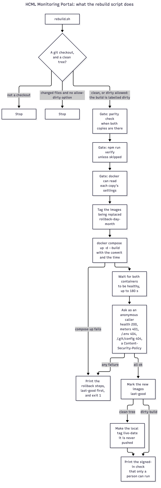

# Operations

| Who it is for | Reading time | Read first | Read next |
|---|---|---|---|
| Operators and developers | about 10 min | [Report files](reports-exports.md) | [GitHub and CI](github-ci.md) |

## What it is for

This page is how the running portals are looked after: what is on the machine, how a change goes live, how to go back, how to know one has stopped, what to back up, and how to follow one request through the logs. The runbooks in `docs/operations/` go deeper on three of these, and part 4 of this handbook is the order of a day. The portals run under Docker compose, one project for each copy, on one machine.

## What is on the machine

| Where | What | In git |
|---|---|---|
| The two folders | `hcml-portal` and `hcml-portal-ollama`, each with its compose file | The first only |
| `.env` in each folder | The settings of that copy: accounts, tokens, secrets, thresholds | No |
| `docker-compose.override.yml` in each folder | Settings for this machine alone, such as the name Zabbix answers to | No |
| Four containers | `<folder>-portal-bff-1` and `<folder>-portal-web-1` for each copy | |
| Images tagged `latest` | What runs now | |
| Images tagged `rollback-<day><month>` | What ran before each rebuild | |
| `~/.local/state/hcml-portal-watch` | The watcher's state and log, when it is installed | |
| The `portal-state` volume | The hosted copy's saved report recipients, the monthly schedule and a record of the last 24 sends, at `/data` in its server container | No |
| `~/.local/state/hcml-portal-logs` | The compressed logs of the containers that `deploy/rebuild.sh` replaced | No |

`docker compose` reads the `.env` at the root of the folder, and `docker-compose.override.yml` beside the compose file. A setting is changed by editing `.env` and recreating the server container with `docker compose up -d` in that folder. The server reads its settings once, when it starts, so a change takes effect only then. A recreated container starts with an empty log, so save the log first ([Change a setting](../4-working/deploy-rebuild-rollback.md#change-a-setting)).

## A change goes live: the rebuild

`deploy/rebuild.sh` rebuilds both copies from the commit in its folder, the hosted copy first and then the one beside it. Run it from `hcml-portal`, with `--dry-run` first: it prints every command that would change something and runs none.

- The build is named by the commit it was made from, and a name that lies is worse than none. So the script refuses a folder that is not a git checkout, and a tree whose `server/`, `web/` (less their tests, which no image holds) or compose file differs from the commit. `--allow-dirty` builds anyway and labels the build `<commit>-dirty`, and then no tag is made.
- `--skip-verify` leaves out `npm run verify`, which takes about five minutes. Use it only after a verify that has just passed.
- It checks that Docker can read each copy's `.env` before it tags anything. A line Docker cannot parse once stopped a rebuild after the images were tagged. The script shows the line's number and not Docker's message, since that message can quote a secret.
- It tags the images it replaces `rollback-<day><month>`, then `docker compose up -d --build` with the commit and the time as build arguments, and waits up to 180 seconds for both containers of each copy to be healthy.
- Then it asks as an anonymous caller: health answers 200, the meters 401, `/.env` and `/.git/config` 404, and the page carries a content-security policy. It prints the bundle name and the build.
- On a clean tree it makes the local tag `live-<date>`. It never pushes it.
- It cannot sign in, so it prints the one check that needs a person: `tools/live/signedin_check.py` against each portal, with your name and password in your own shell. Open the Dashboard and Problems on each portal as well.

## Going back

If a rebuild fails or a build proves bad, the previous images are tagged `rollback-<day><month>`, and a second build on the same day takes `-2`. When the script itself stops, it lists `last-good` first, the build last marked good with `deploy/rebuild.sh --mark-good`, and then the tags it made, each image under its own name. A run does not mark its images itself, because the check that only a person can make comes after it. The rollback tags of a run hold what ran before it, and when the run before it failed too that is the failed build, so `last-good` is the one to use. To go back in one copy, give the good image the name `latest` and start without building:

1. `docker tag <image>:last-good <image>:latest` for each of the two images, or the rollback tag the script names when it names no `last-good`.
2. `docker compose up -d --no-build` in that copy's folder.

The rule keeps the two newest rollback tags of each image. Delete older ones only when the owner says so, because each is a way back.

## Knowing one has stopped

Docker restarts a dead container and tells nobody. `deploy/watch.sh` tells somebody. Every minute it asks each portal's `/bff/api/health` and runs `docker inspect` on its containers, and it says so once when a portal stops answering for two checks in a row, answers again, turns unhealthy, stays stopped, paused, dead, created, restarting or being removed for two checks in a row, restarts in a loop, or when Docker itself stops answering for two checks in a row. A call to Docker that takes longer than `WATCH_DOCKER_TIMEOUT`, 20 seconds, counts as Docker not answering, so a Docker Desktop that hangs is reported and does not hold the run, and it says "answers again" only once every container has been read. It only reads.

- `--once` checks once, which is what a timer runs. `--install` makes a per-user timer on macOS. `--uninstall` removes it. `--status` shows the last state, the last lines of its log and when it last ran, and exits 1 when there was no run for five minutes (`STALE`) or ever, which a check from outside can use. A change is recorded as told only when the notification went through (the command exited 0), so a mail relay that is down gets the same news again at the next check. Every run writes the time to `heartbeat` in the state folder.
- With no settings it watches the copy whose folder it sits in and the copy beside it. `WATCH_URLS` names other addresses, `WATCH_CONTAINERS` other containers, `WATCH_STATE_DIR` the state folder, `WATCH_DOCKER_TIMEOUT` the seconds a call to Docker may take, and `WATCH_NOTIFY_CMD` a command that receives the message as its one argument, for a server that should send a mail instead of a desktop notice. Without it a server only writes the log.
- On a Linux server run `deploy/watch.sh --once` every minute from cron or a systemd timer, as a user that may run `docker`.

## After a restart

The containers come back by themselves when Docker starts, because of `restart: unless-stopped`. On a Mac that needs Docker Desktop's "Start Docker Desktop when you sign in" and a signed-in Mac, and the Mac has to be on HCML's office network, where Zabbix's internal address answers. Off it the portals come back and say the data source is not answering, and nothing false is recorded meanwhile, because Zabbix keeps collecting whether or not the portal is up.

After a start the server reads the slow views once, one at a time, so that the first visitor finds them ready: the problem list, the dashboard counts, the data clock, the sites, links, hosts overview, devices, meters, busiest hosts, web monitoring, services, the SLA list, and last the Capacity report. It does not read the other reports, the SLA figures, the Graphs item list or the interfaces, so their first visit waits. On 30 October 2026 the whole round took about four minutes on HCML's Zabbix, the Capacity report two and a half of them. [Can I trust it](../0-everyone/can-i-trust-it.md) and the runbook [after a restart](../../operations/after-a-restart.md) have the rest.

## What to back up

The portal keeps no estate data, but it does keep its settings, and nothing else holds a copy: the `.env` files, which git ignores because they hold passwords and tokens. Make an encrypted copy after every change to a user, a role, a token, `JWT_SECRET` or a setting, and keep it off the machine, with its passphrase somewhere else. In the hosted copy the volume `portal-state` holds one more file worth keeping, `portal-state.json` (the saved addresses and the schedule): copy it out before any `docker compose down -v`. The recipe, with the `openssl` commands, the checks that a copy opens, and how to restore from it, is [backup and restore](../../operations/backup-and-restore.md). The `docker-compose.override.yml` of each folder holds an address and no secret, and a plain copy saves asking HCML IT for the address again. The second copy is not under git at all, so its whole folder (less `node_modules` and `dist`) is also worth copying.

## Logs, and finding one request

`docker logs <container>` shows a container's log. The server writes one JSON line for each request (the health check's are left out), plus its own events: each sign-in (`sign_in`, with the outcome), each acknowledgement, each failure of Zabbix or the model with its detail, and the warm-up. nginx writes an access line with `rid=` and the request id.

Every error a person sees says "quote reference" and an id. That id is the request id: nginx makes it, the server logs it as `reqId`, returns it in `X-Request-Id` and puts it in every error body. So `docker logs <server container> | grep <id>` finds the line that names the method, the setting to check and what Zabbix said.

Docker keeps five files of 50 MB for each container and overwrites the oldest, and deletes them when the container is made again: `deploy/rebuild.sh` saves a copy of them first (the newest 30 of each portal, in the home folder of whoever runs it). Where the logs should go so that they outlive the machine, and for how long they are kept, is HCML's to decide (SC-42; [the logs, in the backup page](../../operations/backup-and-restore.md)).

## Health and readiness

| Address | Who may ask | What it says |
|---|---|---|
| `GET /api/health` | Anyone | Always 200 while the process runs: `ok`, the time, whether the model features are on, whether the write is on, and `ready`, a plain true or false for whether Zabbix can be read. Signed in, it adds the version, the build, when it started, how many live screens, and the reason in `ready` |
| `GET /api/ready` | Anyone signed in | 200 when Zabbix answers one cached `host.get` within two seconds, 503 when not |

The server container's own health check asks `/api/health`, so a container is healthy while its process answers, whether or not Zabbix does.

## Where the code is

| What | File |
|---|---|
| The rebuild | `deploy/rebuild.sh`, and `server/src/__tests__/rebuild-script.test.ts` |
| The watcher | `deploy/watch.sh`, and `server/src/__tests__/watch-script.test.ts` |
| The list of settings | `deploy/settings.example` |
| The health routes | `server/src/http/health.ts` |
| The warm-up | `server/src/services/warmUp.ts` |
| The shutdown | `server/src/http/shutdown.ts` |
