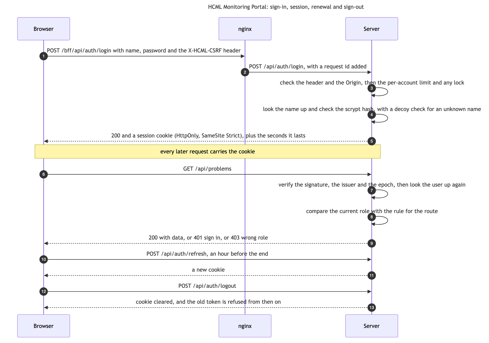

# Sign-in

| Who it is for | Reading time | Read first | Read next |
|---|---|---|---|
| Operators and developers | about 10 min | [nginx, Docker and TLS](nginx-docker-tls.md) | [Report files](reports-exports.md) |

## What it is for

Sign-in decides who may open the portal and what they may do. There is no user table and no identity provider: the accounts are part of the server's settings, a session is a signed token in a cookie, and the server checks that token, and the role behind it, on every request to `/api`. The menu hides what a role cannot open, but that is a courtesy. The refusal is made by the server.

[Who can do what](../0-everyone/who-can-do-what.md) says what the four roles mean to a person. This page says how it is built.

## The accounts

An account is a name, a password and a role. They are written in the settings as `PORTAL_USERS`, comma-separated triples of `name:password:role`. The name is what comes before the first colon and the role what comes after the last, so a password may hold colons, but not commas. The roles are `viewer`, `wall`, `operator` and `admin`. An entry with a role the portal does not know is a viewer, and a warning says so; an entry with no role is a viewer too, without a warning. The warnings name an entry by its position, never by its text, so a malformed entry cannot put a password in the log.

- A password is either plain text or a self-describing scrypt hash, `scrypt.N.r.p.salt.hash`, which `server/scripts/hash-password.ts` makes. It asks twice with the input hidden, or reads the password from standard input, never from an argument, so it stays out of the shell history. The cost settings travel with each hash, so raising them later leaves older entries working. A hash holds no `:`, `,` or `$`, the three characters that would break the settings.
- When `PORTAL_USERS` holds at least one valid entry, `PORTAL_USER` and `PORTAL_PASS` are ignored. Those two are the single-admin shorthand, for a portal with one account. So adding a `wall` entry beside a shorthand admin removes the admin, unless the admin is written into `PORTAL_USERS` too.
- Sign-in ignores the case of a name. A name listed twice can sign in with either entry, but its sessions are not renewed, because a token names its user and cannot say which entry it came from.
- The server refuses to start with an empty password, with the built-in `admin`, or with a hash it cannot read. It names the users and never the passwords.

An account is looked up again on every request. Remove a name from the settings and recreate the server container, and that person's session stops working on the next click. Change a role and it takes effect on the next click. Both wait for a recreate of the server container (`docker compose up -d`; a plain restart keeps the old settings), because the settings are read once.

## The session

A successful sign-in answers with the user and how many seconds the session lasts, and sets a cookie. The cookie is `HttpOnly`, so no script on the page can read it, and `SameSite=Strict`, so another site cannot make the browser send it. It is `Secure` only when the request arrived over HTTPS, which the server learns from `X-Forwarded-Proto`, since a browser drops a `Secure` cookie on plain HTTP. Its name is `SESSION_COOKIE`: `hcml_session` for the hosted copy and `hcml_session_ollama` for the other, so that two portals on one machine do not sign each other out.

The token is a signed JWT with the user's name, the role, the epoch, a unique id (`jti`), a session id (`sid`), and an issuer and audience taken from the cookie name, so a token minted by one copy is refused by the other. It lasts `SESSION_HOURS`, twelve by default, between two and twenty-four. A header `Authorization: Bearer` is accepted in place of the cookie, for scripts such as `tools/live/signedin_check.py`, and wins when both arrive.

- **Renewal.** An open page swaps its token for a new one an hour before it ends, with `POST /api/auth/refresh`, so a wall screen stays signed in for as long as its page is open. A closed tab renews nothing.
- **Sign-out.** `POST /api/auth/logout` clears the cookie and puts the token's session id on a list in memory, so every token of that sign-in, the ones a renewal gave included, is refused from then on, as a cookie or as an `Authorization: Bearer` header in any spelling: the id is taken from the verified token and never from the header text. The streams that session has open are closed at once. The list is kept for a whole session length, and a restart forgets it. What it does not end: a copy of a token that someone keeps renewing after the owner only closed the tab, without signing out. That copy works until the user is taken out of `PORTAL_USERS`, `SESSION_EPOCH` is raised and the server container recreated, or `JWT_SECRET` is changed. There is no absolute age on purpose, because a wall screen has to stay signed in. A sign-out that did not reach the server is not a sign-out: the page says so and stays, and the person presses the button again.
- **What the page learns.** `GET /api/auth/me` answers with the user, the seconds left and `pages`: the role each menu page needs, worked out from the same rules that guard its route, so the menu keeps no copy of the rules.

## The guard

One `onRequest` hook covers every route under `/api` except four that are public: `/api/health`, `/api/auth/login`, `/api/auth/me` and `/api/auth/logout`. `/api/health` is public too, but a signed-in caller is told more.

For every other route the hook checks the signature, the issuer and the epoch, looks the user up again, and compares the user's current role with the route's rule. A route that no rule names needs `viewer`, so a new route is protected by default. The rules are three:

| Route | Needs |
|---|---|
| `/api/reports/inventory`, `/api/sli/email` and `/api/sli/schedule` | `admin` |
| `/api/links` and everything under `/api/net` | `wall` |
| `/api/problems/acknowledge` and `/api/problems/close` | `operator` |

Ranks run viewer, wall, operator, admin, and a role may do what any lower rank may. Refusals have one shape: 401 `unauthorized` ("Sign in to continue.") and 403 `forbidden` ("This view needs the role ...; you are signed in as ..."). `server/src/security/pageAccess.ts` pairs each menu page with the route that fills it, and a test fails when the menu offers a page that is missing there. `server/src/security/viewerPolicy.ts` closes one more gap: network interface data is for the wall role and above even when it is read through a generic route such as the items list, the latest data or a graph.

The route is judged by the route the router matched, not by the raw text of the address, because the router decodes the path first and `/%61pi/hosts` reaches the `/api/hosts` handler.

## The cross-site check

A page on another site must not be able to make a signed-in browser acknowledge a problem. So every `POST` that the browser authenticates by itself, with the cookie, must carry the header `X-HCML-CSRF: 1`, and when it carries an `Origin`, that must be the `Host` the server received. Sign-in and sign-out are checked always. A script holding a Bearer token needs neither. CORS allows only `WEB_ORIGIN`, so another site's preflight for the custom header fails, and `X-HCML-CSRF` cannot be added without a preflight.

## The brakes on guessing

- **The overall limit.** `RATE_LIMIT_PER_MINUTE` (300) for one client address, counted before the guard, so a flood is counted before any token is verified. The live stream, the health check and sign-out are exempt, because a wall holds one connection and the others are polled on purpose.
- **Sign-in.** Ten attempts a minute for one account from one address. After ten failures in a row from one address for one account, the next sign-in is refused for a minute, and each further failure doubles the lock up to five minutes. A correct sign-in clears the count. The lock is short because everyone behind Docker's gateway shares one address.
- **The cost of a miss.** A name nobody holds still costs one hash check, so an unknown name is not quicker to refuse than a known one.
- **The log.** Every attempt is logged as `sign_in` with the name as typed (control characters removed), the outcome and the address, never the password. Every fifth failure in a row for one name, from any address within fifteen minutes, logs a warning.
- **The body.** A name and a password fit in 4 KB, so a megabyte-long name cannot reach the limiter's memory.

## With sign-in off

`AUTH_ENABLED=false` is for development only. Every caller is an admin, the host check answers only a `Host` that names this machine so that a rebinding page cannot reach the server, and acknowledge and close are refused unless `ALLOW_WRITE_WITHOUT_AUTH=true` is also set. Report email and the monthly schedule are refused unless `ALLOW_EMAIL_WITHOUT_AUTH=true` is set (SC-43), since every caller would be an administrator and could send the report to any address. Leave both unset.

## Settings

| Setting | Default | What it does |
|---|---|---|
| `AUTH_ENABLED` | `true` | Sign-in on or off |
| `JWT_SECRET` | none, and compose refuses to start without it | Signs the sessions. A value published in the repository, or under 32 bytes, stops the server. Each copy has its own |
| `PORTAL_USERS` | none | The accounts: `name:password-or-hash:role`, comma-separated |
| `PORTAL_USER`, `PORTAL_PASS` | `admin`, none | The single-admin shorthand. An empty password or `admin` stops the server |
| `SESSION_COOKIE` | `hcml_session`, or `hcml_session_ollama` | The cookie's name, which is also the token's issuer and audience |
| `SESSION_HOURS` | 12 | How long a session lasts, from 2 to 24 |
| `SESSION_EPOCH` | 1 | A label inside every token. Changing it ends every session |
| `ALLOW_WRITE_WITHOUT_AUTH` | unset | The development opt-in for the write |
| `ALLOW_EMAIL_WITHOUT_AUTH` | unset | The development opt-in for report email and the monthly schedule |

## How it fails

| What you see | Cause | What to do |
|---|---|---|
| 401 on every call after a restart that changed the settings | `JWT_SECRET` or `SESSION_EPOCH` changed, so old tokens are refused | Sign in again |
| "Invalid username or password." for a right password | The entry holds a `:` or `,` in the wrong place, or the name differs by more than case | Check the entry, using a hash for anything complicated |
| "Too many failed sign-ins ... Retry in n s." | The lock | Wait. Check for a script that retries |
| 403 `csrf` | A missing `X-HCML-CSRF` header, or an `Origin` that is not the `Host` | A proxy that changes `Host`, or a script that forgot the header |
| The server will not start | An unsafe configuration | The log names the setting, and never prints a secret |
| A new wall account locks the admin out | `PORTAL_USERS` replaced the shorthand | List the admin beside it |

## How to check it

`tools/live/signedin_check.py` signs in through nginx and checks health, readiness, both report downloads, the stream and the problem list, and, for an administrator, the email settings, the monthly schedule and the CSV report (`--expect-mail on` for the hosted copy and `off` for the local-model copy). It takes the name and password from `PORTAL_USER` and `PORTAL_PASSWORD` in the environment of your own shell and never prints them. Run it after every rebuild, because the rebuild script cannot sign in.

## Where the code is

| What | File |
|---|---|
| Accounts, the guard, the cookie, the limits, the cross-site check | `server/src/security/auth.ts` |
| Hashing and checking passwords | `server/src/security/passwords.ts`, `server/scripts/hash-password.ts` |
| Which role a menu page needs | `server/src/security/pageAccess.ts` |
| What a viewer may not read | `server/src/security/viewerPolicy.ts` |
| The request schemas | `server/src/core/schemas.ts` |
| The browser side: the session timing, renewal and the 401 | `web/src/api/session.ts`, `web/src/features/shell/useSessionRenewal.ts`, `web/src/shared/hooks/useAuth.ts` |
