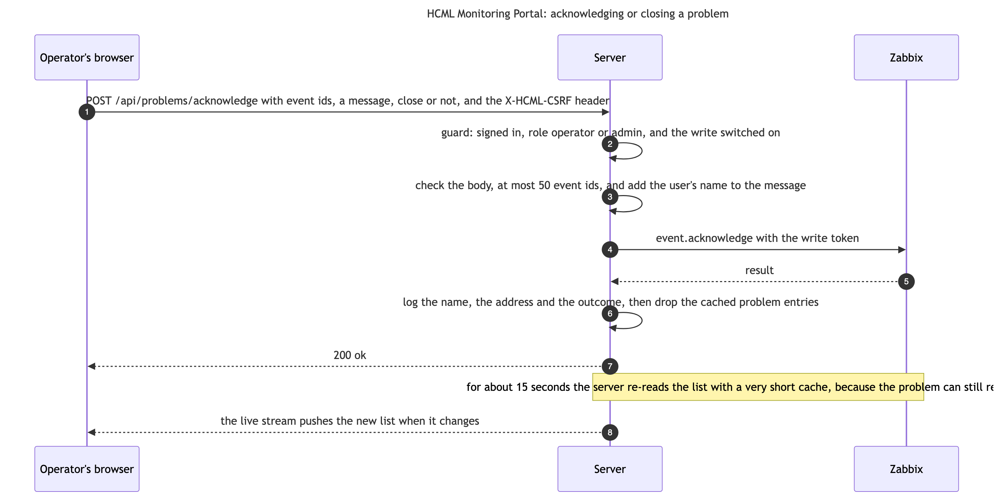

# Zabbix

| Who it is for | Reading time | Read first | Read next |
|---|---|---|---|
| Operators and developers | about 9 min | [The integration map](map.md) | [AI providers](ai-providers.md) |

## What it is for

Zabbix is the only source of data. Every site, link, incident, host state and SLA figure is worked out from what Zabbix holds, per request, and kept in memory for a while. The portal reads through Zabbix's JSON-RPC API and writes to it once, to acknowledge or close a problem. Nothing else touches Zabbix, and nothing else holds a Zabbix credential: `server/src/clients/zabbix.ts` is the only file that sends a token.

## What the portal sends

Every call is one HTTP POST to the address in `ZBX_URL`, with the body `{"jsonrpc":"2.0","method":...,"params":...,"id":n}`, the content type `application/json-rpc` and the header `Authorization: Bearer <token>`. Two functions make every call. `zbx()` uses the read token, and `zbxWrite()` uses the separate write token and refuses to run when none is set.

The portal calls fifteen methods, fourteen that read and one that writes. A table of the exact lines that name each is kept in the data-model documents ([ERD-Database](../../erd/database/ERD-Database.md)), and a checker keeps it equal to the code.

| Method | What the portal reads or does with it |
|---|---|
| `host.get` | Hosts with their tags, inventory, groups and interfaces: the Hosts, Devices, Sites and Maps pages, the host state, and the readiness probe |
| `hostgroup.get` | Host groups, for filters, the site fallback and maintenance |
| `item.get` | Measurements: ping items, interface items, a host's items for Graphs and Latest data, link and meter items, the busiest hosts, web scenarios |
| `history.get` | Raw values: the newest value of many items at once, the points of a graph, the meters' last readings, and how much of a period an item really collected, for the SLA |
| `trend.get` | Hourly lowest, average and highest values, read in slices: the capacity report and graphs over long ranges |
| `trigger.get` | Triggers: the hosts of the triggers behind problems, the count of monitored triggers, the alert-noise report, and the ping triggers the SLA counts |
| `problem.get` | Open problems |
| `event.get` | Problem events over a window, read in slices so nothing is cut off: incidents, the SLA, alert noise, top triggers |
| `maintenance.get` | Planned maintenance, so that planned downtime is left out of the SLA |
| `map.get` | Zabbix maps |
| `dashboard.get` | The gauge widgets of the Zabbix dashboard that the internet meters read |
| `service.get`, `sla.get`, `sla.getsli` | Zabbix's own services and SLAs, when there are any |
| `event.acknowledge` | The one write |

## What comes back, and what the server does with it

Zabbix sends everything as strings, ids and numbers included, and the services parse what they need. The browser never sees Zabbix's shapes: each route answers in a shape the web app expects, which a contract file describes ([the API description](../../api/openapi.yaml)).

When a call fails, the server turns the failure into one of four typed errors, and the error handler maps each to a status and one fixed sentence for the person at the screen. The details go to the server's log, with the request id, and never to the browser, since they name the address.

| Error | Raised when | The browser gets | The log says |
|---|---|---|---|
| `ZabbixAuthError` | Zabbix's answer says the token is expired, invalid, revoked or not authorised | 503 `zabbix_auth`, "The data source is not answering. Tell an administrator and quote reference ..." | "Zabbix rejected the API token ... Update ZABBIX_API_TOKEN (or ZABBIX_WRITE_TOKEN)" |
| `ZabbixTimeoutError` | No answer within `ZABBIX_TIMEOUT_MS`, or a body that stalled | 503 `zabbix_timeout`, the same sentence | "Zabbix did not respond to `<method>` within `<ms>` ms" |
| `ZabbixApiError` | The connection failed, the status was not 2xx, the body was not JSON-RPC, or Zabbix returned an error | 502 `zabbix_error`, the same sentence; for a write the portal's own sentence, which says that the change may or may not have been made when the error is marked as possibly applied (BK-53) | The method, and Zabbix's own words in `detail` |
| `ZabbixWriteDisabledError` | A write with no write token | 503 `zabbix_write_disabled`, "Acknowledge and Close are not switched on for this portal. Tell an administrator." | The setting to change |

A rejected token and a Zabbix that does not answer within `ZABBIX_TIMEOUT_MS` are 503, not 502 or 504, on purpose: both mean the data source is not usable right now, which is a state to act on and not a fault of the portal. Every other failure of the call is a 502 `zabbix_error`: a refused connection, a refused certificate, a status that is not 2xx, a reply that is not JSON-RPC, and an error from Zabbix itself. Tests pin all of it.

## Settings

| Setting | Default | What it does |
|---|---|---|
| `ZBX_URL` | HCML's API address, `https://zabbix.hcml.co.id/zabbix/api_jsonrpc.php` | Where every call goes |
| `ZABBIX_API_TOKEN` | none | The read token |
| `ZABBIX_WRITE_TOKEN` | none | The write token. Unset means the write is off |
| `ZABBIX_TIMEOUT_MS` | 300000 in Docker, 10000 when the server is run on its own | How long one call may take. A few reads take longer than a minute on HCML's Zabbix, so it is long. nginx waits longer still |
| `ZBX_TLS_PIN_SHA256`, `ZBX_TLS_PIN_UNTIL` | none | The exception for an expired certificate, below |
| `SLI_ZBX_PARALLEL` | 4 | How many Zabbix reads one SLA computation may run at once |
| `NET_GROUP_IDS` | none | The ids of the host groups that are network devices. Empty means no restriction |
| `SITE_TAG`, `SITE_GROUP_PREFIX`, `OWNER_TAG`, `CRITICALITY_TAG`, `HOST_NAME_PATTERN` | `site`, none, `owner`, `criticality`, none | How the portal reads sites, owners and criticality from Zabbix's tags and names |
| `INTERNET_METERS_DASHBOARD` | `Global view` | The name of the Zabbix dashboard whose gauge widgets are the meters |
| `SLI_REPORT_TRIGGERS`, `SLI_AVAILABILITY_TRIGGERS` | `High ICMP ping loss`, and that plus `Unavailable by ICMP ping` | The names of the triggers that the two SLA methods count |
| `AVAILABILITY_MIN_SEVERITY`, `SLA_TIMEZONE`, `SLO_TARGET` | 2, `Asia/Jakarta`, 99 | The lowest severity that counts for availability, the zone that cuts the months, and the target |

The full list of settings, with every default, is in `deploy/settings.example`.

## The network path and the certificate

From HCML's office network the public name of Zabbix leads to a Zero Trust gateway that refuses the portal. So `docker-compose.override.yml`, a file that stays on the machine and out of git because it names an internal address, maps that name to Zabbix's internal address for the server container. The certificate is still checked against the name. If Zabbix moves, the file has to change, and nothing in the repository will say so.

When Zabbix's certificate expired on 1 August 2026, the portal could not read at all. A narrow exception was added, and it still exists, switched off. With `ZBX_TLS_PIN_SHA256` (a fingerprint) and `ZBX_TLS_PIN_UNTIL` (a last day, in WIB) set, one expired certificate is accepted, but only that one and only until that day. `clients/pinnedTls.ts` judges every connection before the request is written to it, so a refused server never receives the token. It accepts a certificate that passes the normal check. Otherwise it accepts only the pinned one, and only when Node's fault is that it expired, the name matches and the last day has not passed. The refusals carry a code: the name of Node's own fault when the certificate fails for any reason other than its age, `ERR_TLS_CERT_ALTNAME_INVALID` when it does not name the host, `ZBX_TLS_PIN_MISMATCH` for a different certificate and `ZBX_TLS_PIN_ENDED` after the last day. Delete both settings once the certificate is renewed.

## Asking for little

HCML's Zabbix answers small questions in a tenth of a second and large ones in tens of seconds, so the portal is built to ask for little, and a new feature has to be.

- A read goes through `cached()`, and concurrent callers for one key share one fetch, so a busy page does not multiply a slow read.
- The newest value of many items is read with one `history.get` for each value type (`domain/recentValues.ts`). Zabbix's own `lastvalue` field is looked up one item at a time, from 30 milliseconds to half a second each, and asking for it on a list of hundreds made the Graphs page wait twenty seconds.
- The problem list leaves out operational data, which Zabbix fills one problem at a time. Explain and the Assistant ask for it only for the few problems they describe.
- The heavy reports run at most two at a time, and an SLA computation reads with `SLI_ZBX_PARALLEL` calls at once.
- A slow view is answered from its last copy while one refresh runs ([can I trust it](../0-everyone/can-i-trust-it.md) says how the page says so).

## The one write

The write is allowed only when a write token is set and either sign-in is on or the development opt-in `ALLOW_WRITE_WITHOUT_AUTH` is. Zabbix files every write under the owner of the token, so the portal puts the signed-in user into the message as `[portal:name]`, and logs every attempt, with the name, the address and the outcome. One request names at most 50 events.

## How to check it

From the host, a read-only probe of the API with a read token, from the README: send a `host.get` for three hosts to the address in `ZBX_URL`, with `--resolve` pointing the name at the internal address. Print nothing but the status and the names, and never paste the token into a shared place.

From the portal: `GET /api/health` always answers 200 and says only that the process is up. Its `ready` part says whether one cached `host.get`, with a two-second limit, got an answer (a plain true or false for anyone, with the reason for a signed-in caller), and `GET /api/ready` answers 503 while it does not. On the Dashboard, "Zabbix has collected nothing for ..." means the API answers but the collector has stopped, and "Zabbix cannot reach the network" means the collector has lost the devices.

## Where the code is

| What | File |
|---|---|
| The two calling functions and the four errors | `server/src/clients/zabbix.ts` |
| The certificate exception | `server/src/clients/pinnedTls.ts`, and `parseTlsPin` in `server/src/core/config.ts` |
| The reads shared by many pages | `server/src/domain/queries.ts`, `server/src/domain/recentValues.ts`, `server/src/domain/reachability.ts` |
| The error to status mapping | `server/src/http/errors.ts` |
| The readiness probe | `server/src/http/health.ts` |
| The write | `server/src/routes/actions.ts`, `server/src/services/actions.ts` |
| The test estate | `server/src/__tests__/helpers/fakeZabbix.ts` |
