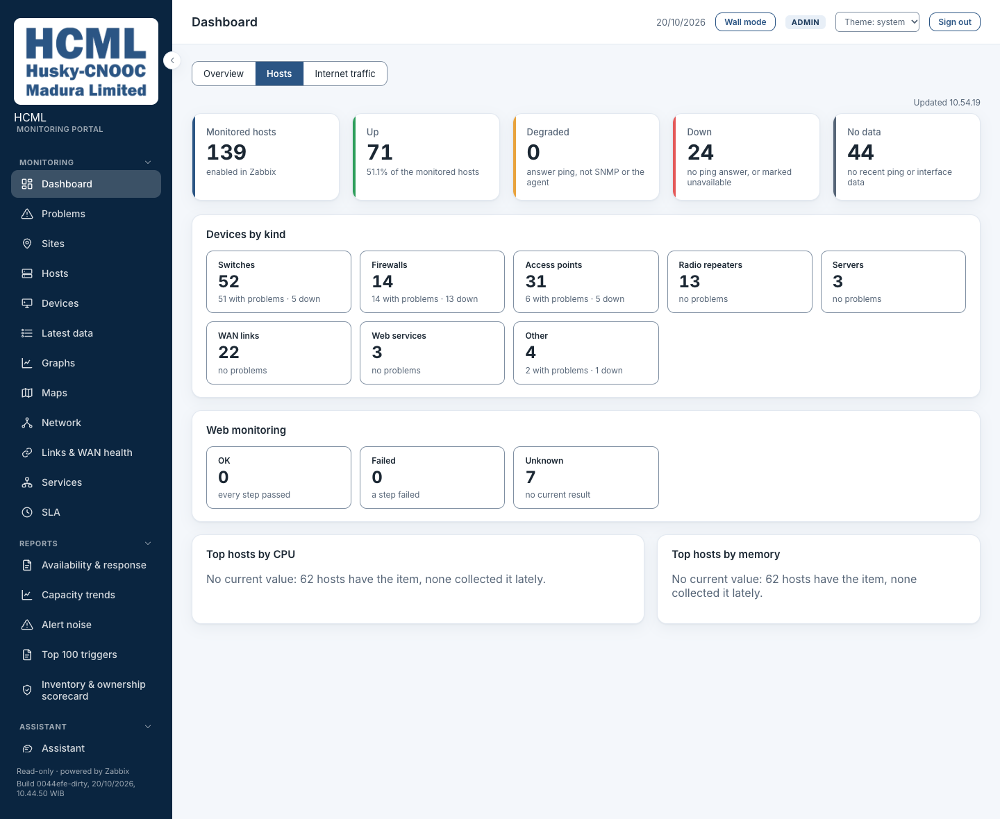
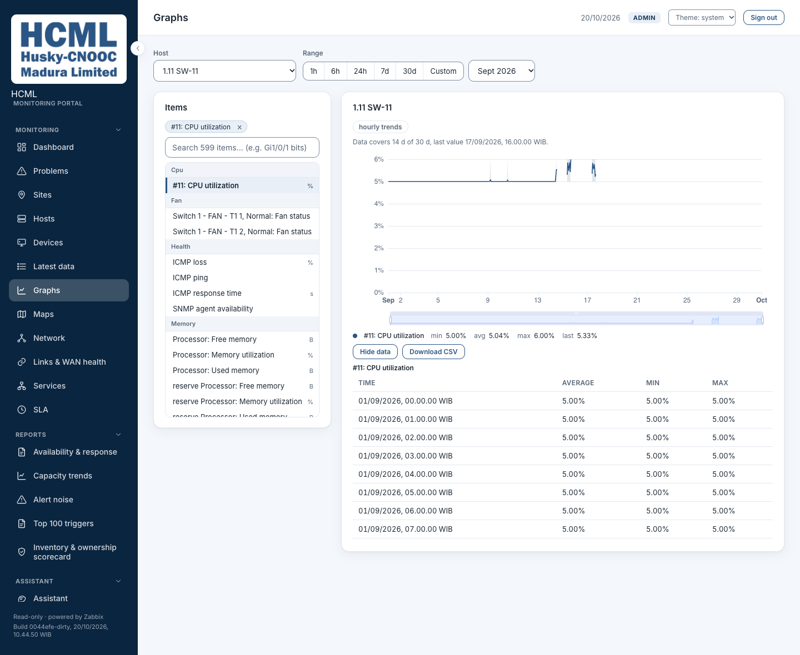
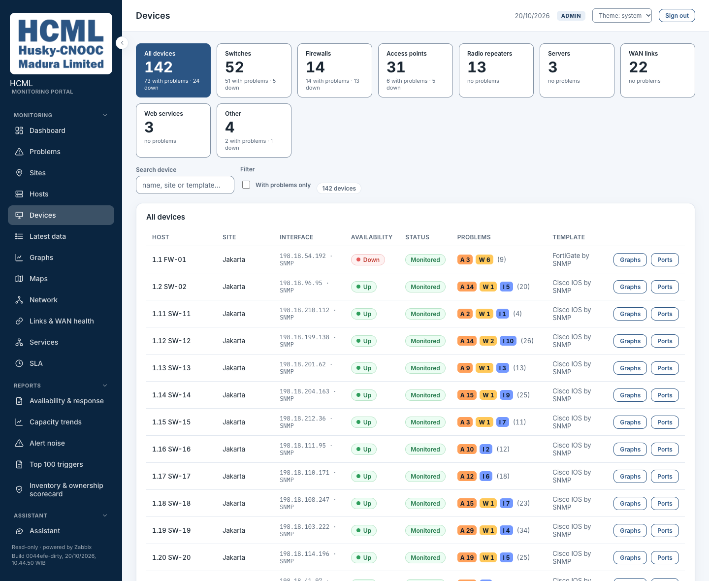
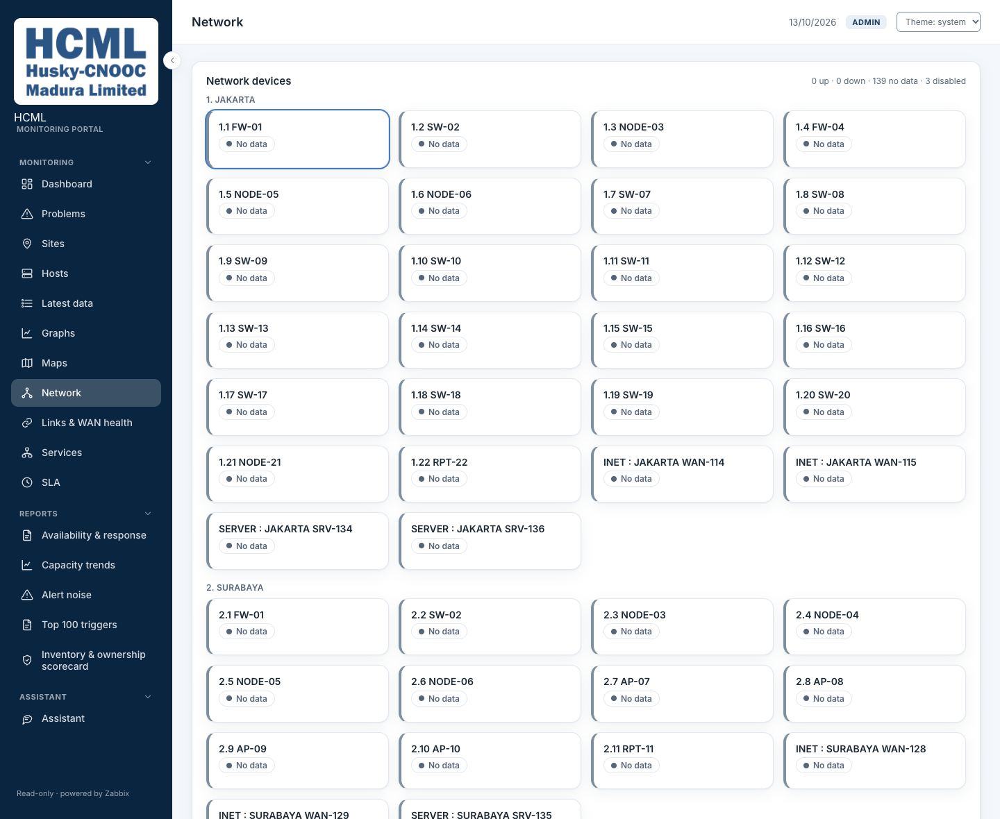
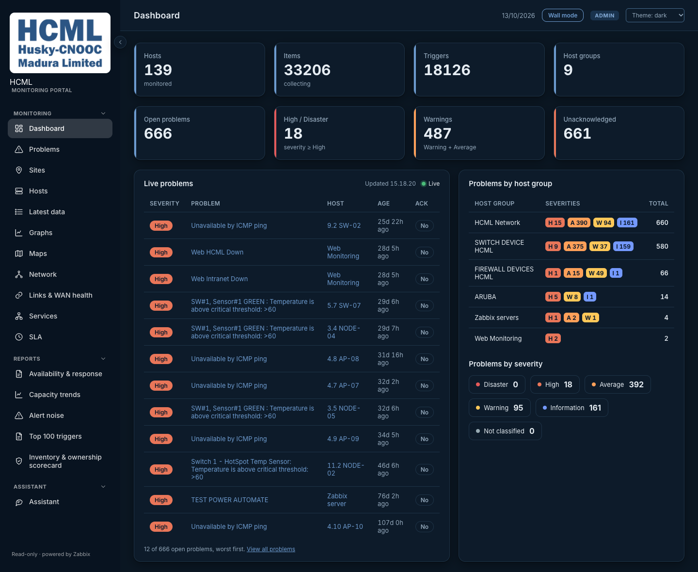
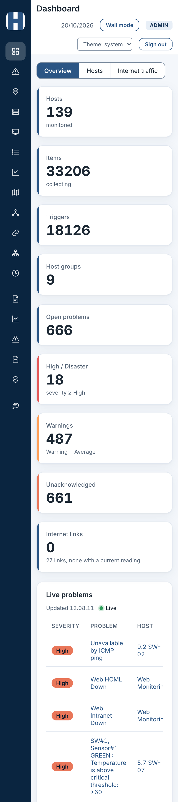

# Screenshots

The main pages of the portal, as images. They were taken on 20 October 2026 from a running portal that
reads HCML's restored Zabbix data, built from the working tree on top of commit `5cf5268`. The footer of the images says `Build 0044efe-dirty`, a label set by hand when the
portal was started and one commit behind the tree it was built from. The set of 13
October, from commit `cef91b3`, is replaced: it showed the Dashboard before its Hosts and Internet traffic
views, and Graphs before the CSV download. The Dashboard's Internet traffic view has no image here: see "Adding or replacing one".
Each is one screen, 1440 px wide, in the light theme unless it says otherwise.

## What is real and what is replaced

The portal shows names from HCML's own network, and this repository is public. So every host name,
address and interface description is replaced on the page before the picture is taken, and the capture
stops, writing nothing, if a real one is still there.

| Replaced | By |
|---|---|
| Host names | the site number at the start is kept, then a kind and a number: `1.4 SW-04`, `INET : JAKARTA WAN-114` |
| IP addresses | an address in 198.18.0.0/15, a range reserved for testing, so it cannot be a real one |
| Interface descriptions, link and tunnel names, the values of free-text problem tags | `link-` and three digits |

Not replaced, because the pages need them or this repository already says them: counts, severities, times,
site names, host group names, interface names such as `Gi1/0/8`, template names such as `Cisco IOS by SNMP`,
and the text of triggers that name no host. The figures are real, so the images show the size and shape of
the estate, though not what its devices are called.

The Zabbix server in the restored copy is off, so devices read "No data" and nothing is being polled. That
is how the portal looks on this data, and it is left as it is.

## The images

### Dashboard

The Overview, the first of three views: counts for the estate, a card for the Internet links, the live
list of open problems (worst first, kept current by a stream) and the problems of each host group. The
second view is the next image; the third, Internet traffic, has none.

### Dashboard: Hosts

How many hosts are up, degraded, down or without data, the devices of each kind, the web scenarios that
pass, fail or have no current result, and the ten busiest hosts by CPU and by memory. Everyone sees it. The
two lists of busiest hosts say "No current value" because the Zabbix server of this restored copy is off,
and a figure that is old is never listed.

### Dashboard: Internet traffic

There is no image of it. The view draws a gauge for each gauge widget of HCML's Zabbix dashboard, with the
capacity and the colour zones the widget gives, the value, and an old reading dimmed with its age, for
operators and administrators only, because it is interface data. The capacity of each link is a figure HCML
typed into its own Zabbix, and on 22 October 2026 the owner chose not to publish it, so the picture that was
here was removed (it is still in the commit of 20 October). A wall screen signed in as an operator or an
administrator turns between the three views by itself.

### Problems

One row per open problem, with its host, severity, duration and tags. Acknowledge is off here, which the
page says, so the one button on a row is Explain: it asks the model to put the problem in plain words.
The Actions column stays at the right edge while the table scrolls.

### Sites

One card per site, with its problems by severity and how many devices are down. A site is read from the
number at the start of a host name; hosts that name none are grouped by host group, which the note at
the top says is a guess.

### Graphs

One item over a calendar month, read from hourly trends. Under the chart are its minimum, average,
maximum and last values, and Show data opens every plotted point as a table, which the tooltip otherwise
gives one point at a time. Download CSV beside it saves the same table as a file, one column for each
selected item, with the unit in the column heading, whether or not the table is open.

With Show data open the table stays open when an item is added or removed or the range changes.

### Devices

A tile for each kind of device (switches, firewalls, access points, radio repeaters, servers, WAN links, web
services, other) with its count, how many have problems and how many are down, and under them the list of
the kind chosen, with its site, interface, availability, problems and template. Operators and administrators
also get a Ports link on each row.

### Network

Devices grouped by site. They read "No data" because the Zabbix server of this restored copy is off. A
card opens that device's interfaces.

### Dark theme

The theme follows the system setting, or the picker in the top bar.

### Narrow screen

On a screen 390 px wide the menu becomes a rail of icons, the cards stack, and a wide table scrolls
inside its card instead of widening the page.

## Adding or replacing one

A screenshot goes into this folder only if its names were replaced, and every image here was looked at
after it was taken, because the automatic check reads text and cannot read a chart. The pages left out
are the ones that print figures a reader could take for HCML's own: the SLA report shows each site's
availability for the month. The Internet traffic view is the nearest case, and it was left out for that reason.
[`../contributing.md`](../contributing.md) says never to commit estate data; this folder is the one exception,
for that reason.

The images were made with a private capture script that drives Chrome, rewrites the names in the page and
refuses to write an image while a real one is left. It is kept beside the repository, not in it, because
it reads the real host list. The unreplaced screenshots kept for the monthly documents are in `pic/`, which git
ignores.
